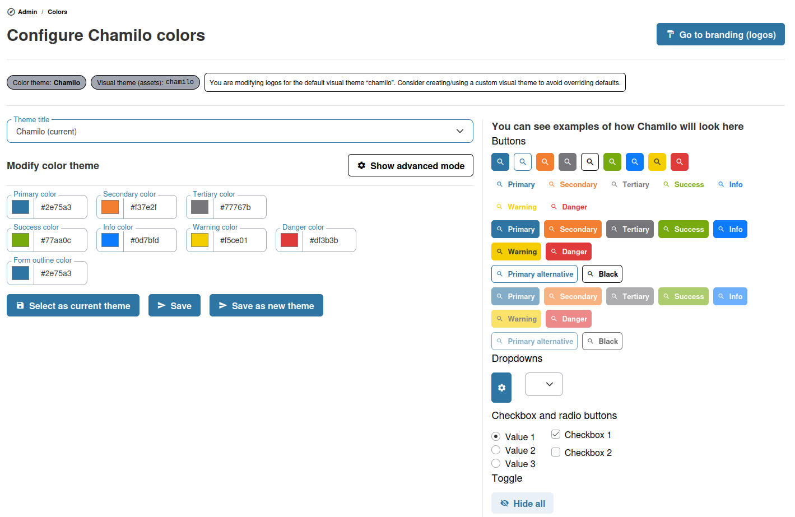

# Temas de color

Chamilo 2.0 introduce un sistema de temas de color que permite personalizar la apariencia visual de la plataforma.

## Cómo funcionan los temas

Los temas de color definen la paleta utilizada en toda la interfaz de Chamilo: colores primarios, colores de acento, fondos y colores de texto. Un tema se asocia a una URL de acceso: en un portal de una sola URL se convierte, en la práctica, en el tema global, y en una configuración multi-URL cada URL puede tener el suyo.

## Aplicar un tema

1. Desde el panel de administración, vaya a **Temas de color**
2. Examine los temas disponibles
3. Seleccione un tema y haga clic en **Aplicar**
4. El tema se aplica de inmediato a la plataforma

## Fondos de página

Algunas páginas muestran una imagen decorativa en su parte inferior, repetida horizontalmente: **Mis cursos** y **Mis sesiones** (un paisaje), las páginas de **Administración** (un paisaje urbano), las páginas de **Gestión de sesiones** (campos) y la **Red social** (un paisaje marino). Cada tema visual incluye estas imágenes.

En la página de temas de color, la sección **Fondos de página** muestra la imagen de cada uno de estos lugares en el tema visual activo. Para cada una, puede:

* **Sustituirla** — Haga clic en **Elegir archivo**, seleccione una imagen PNG, JPEG o WebP de 2 MB como máximo y, a continuación, haga clic en **Subir**. La imagen se muestra con una altura de 180 píxeles y se repite a lo largo de la página, por lo que una banda ancha cuyos bordes encajen ofrece el mejor resultado.
* **Ocultarla** — Haga clic en **Ocultar** para quitar la imagen de esas páginas y en **Mostrar** para volver a mostrarla. Ocultar una imagen subida la conserva para más adelante.
* **Restaurar la imagen del tema** — Elimina la imagen subida, tras una confirmación, y vuelve a mostrar la imagen que incluye el tema.

Al igual que los logotipos, estas imágenes pertenecen al tema visual activo: en una configuración multi-URL, cada URL con su propio tema tiene sus propias imágenes. Evite modificarlas en el tema predeterminado `chamilo`, cuyas imágenes son los valores predeterminados de todos los demás temas.

Las imágenes subidas se almacenan en el directorio del tema (`var/themes/<theme>/images/bg-<place>-custom.<extension>`, o el almacenamiento remoto de los temas), junto a un archivo `page-backgrounds.json` que registra las opciones. Para sustituir una imagen directamente en el servidor, coloque un archivo llamado `images/bg-landscape.png` (o `bg-cityscape.png`, `bg-fieldscape.png`, `bg-seascape.png`) en el directorio del tema activo: se utiliza siempre que no se haya subido ninguna imagen desde la página. Los navegadores conservan estas imágenes durante un día, por lo que un archivo sustituido en el servidor puede tardar ese tiempo en mostrarse, mientras que una imagen subida se muestra de inmediato.

## Temas por URL

En una configuración multi-URL, cada URL de acceso puede tener su propio tema de color. Esto permite que distintos portales tengan identidades visuales diferenciadas mientras comparten la misma instalación de Chamilo.

## Importar, exportar y mantener temas de color

Los administradores del portal pueden gestionar paquetes ZIP reutilizables de temas de color desde la interfaz de configuración de temas de color:

1. Seleccione un tema existente y elija **Exportar ZIP del tema** para descargar un paquete.
2. Para importar un paquete, elija **Importar ZIP de tema de color**, indique un **Nombre del nuevo tema**, seleccione el archivo ZIP y confirme. El control de carga acepta archivos ZIP de menos de 10 MB.
3. Use **Renombrar tema** para cambiar el nombre visible de un tema sin modificar su slug técnico.
4. Use **Eliminar tema** solo para un tema personalizado que no esté en uso. Los temas integrados y los temas referenciados por la plataforma están protegidos contra la eliminación.

Las importaciones duplicadas y los archivos no válidos se rechazan. Compruebe el uso de los temas en las URL de acceso antes de eliminar recursos personalizados; los escenarios multiportal merecen pruebas adicionales. Consulte [PR de paquetes de temas de color #9404](https://github.com/chamilo/chamilo-lms/pull/9404).

## Consejos

* **Ajuste a su marca** — Elija o personalice un tema que coincida con los colores de marca de su organización
* **Compruebe la legibilidad** — Tras aplicar un tema, verifique que el texto sea legible sobre los colores de fondo, especialmente en situaciones de alto contraste
* **Tenga en cuenta la accesibilidad** — Asegure un contraste de color suficiente para los usuarios con discapacidad visual