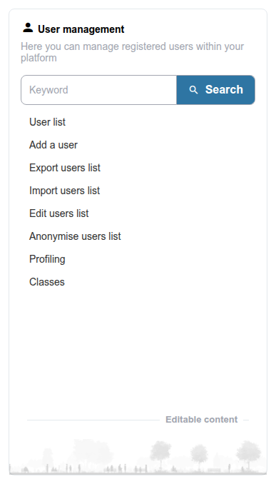

# Usuarios

Esta sección describe cómo gestionar las cuentas de usuario en su plataforma Chamilo: crear usuarios, asignar roles, organizar a los usuarios en grupos y gestionar perfiles.

* **[Roles de usuario](user-roles.md)** — Comprender los distintos roles de usuario y sus permisos
* **[Gestión de usuarios](managing-users.md)** — Crear, editar, importar y exportar cuentas de usuario
* **[Grupos de usuarios](user-groups.md)** — Organizar a los usuarios en grupos de ámbito de plataforma
* **[Perfiles de usuario](user-profiling.md)** — Configurar campos de perfil adicionales y metadatos de usuario
* **[Expedientes académicos](academic-transcripts.md)** — Configurar y emitir expedientes oficiales firmados para los estudiantes que cumplan los requisitos