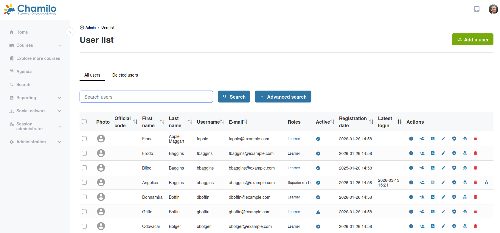
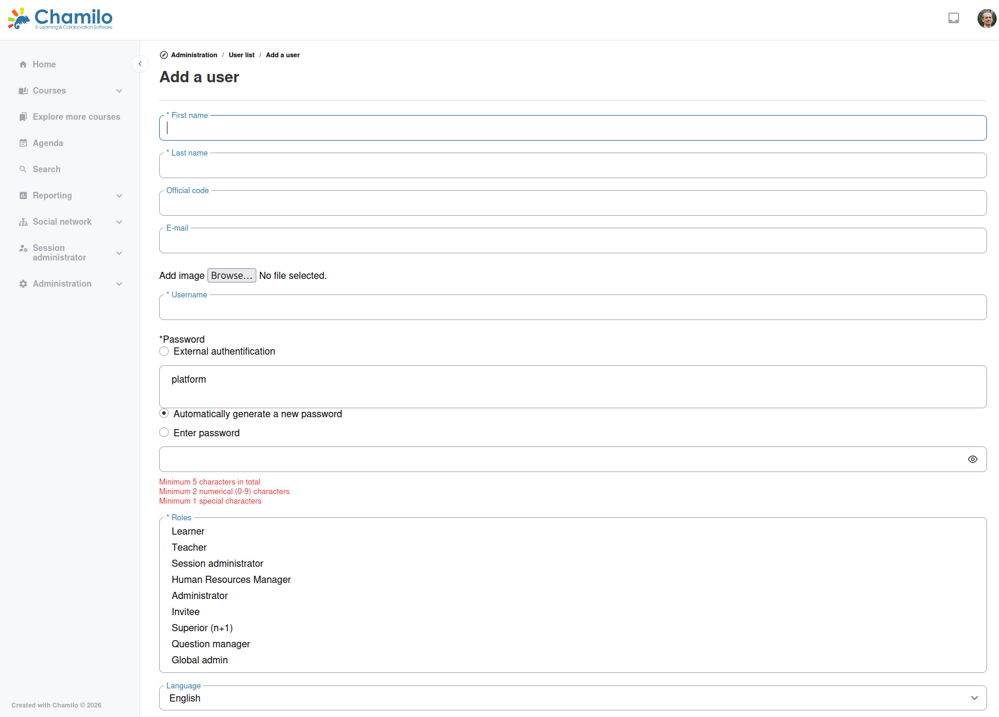
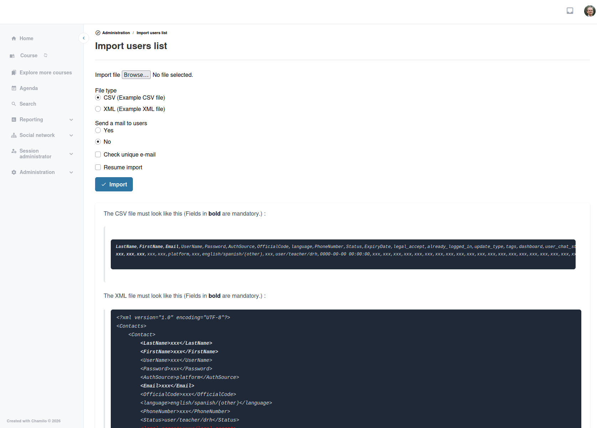

# Gestión de usuarios

Esta página cubre las tareas cotidianas de creación, edición y gestión de cuentas de usuario.

## Lista de usuarios

Desde el panel de administración, haga clic en **Lista de usuarios** para ver todos los usuarios de la plataforma. La lista muestra:

* Avatar
* Nombre
* Nombre de usuario
* Dirección de correo electrónico
* Roles
* Estado activo/inactivo
* Fecha de registro
* Fecha del último inicio de sesión

Utilice la herramienta **Búsqueda avanzada** para encontrar usuarios concretos por nombre, correo electrónico, rol u otros criterios.

## Creación de un usuario

1. Haga clic en **Añadir un usuario** desde el panel de administración
2. Rellene los campos obligatorios:
   * **Nombre** y **Apellidos**
   * **Correo electrónico**: debe ser único en la plataforma
   * **Nombre de usuario**: el nombre de inicio de sesión (debe ser único)
   * **Contraseña**: establezca una contraseña inicial
   * **Roles**: seleccione el rol o los roles de plataforma del usuario (estudiante, profesor, administrador, etc.)
   * **Idioma**: el idioma de interfaz preferido del usuario
3. Opcionalmente, rellene campos adicionales:
   * Código oficial (p. ej., identificador único en la organización)
   * Número de teléfono
   * Fecha de caducidad: desactiva automáticamente la cuenta a partir de una fecha
   * Estado activo/inactivo
   * Campos de perfil adicionales (si están configurados)
4. Guardar

## Importación de usuarios

Para la creación masiva de usuarios, puede importar usuarios desde un archivo:

1. Haga clic en **Importar usuarios** desde el panel de administración
2. Cargue un archivo **CSV** o **XML** con los datos de los usuarios
3. Asigne las columnas del archivo a los campos de usuario de Chamilo
4. Elija cómo tratar a los usuarios existentes (actualizar u omitir)
5. Importar

El archivo de importación debe contener, como mínimo, columnas para: nombre, apellidos, correo electrónico, nombre de usuario y contraseña.

Nota: La columna **Status** es el nombre heredado de **Role** y solo acepta unos pocos valores, como 1 para profesor y 5 para estudiante. Los ajustes adicionales de los roles solo pueden realizarse manualmente más adelante, editando el usuario.

## Exportación de usuarios

Haga clic en **Exportar usuarios** para descargar la lista de usuarios como archivo CSV o XML. Puede filtrar qué usuarios exportar por rol, fecha de registro u otros criterios.

## Edición de un usuario

Haga clic en el nombre de un usuario en la lista de usuarios para editar su cuenta. Puede modificar:

* Información personal (nombre, correo electrónico, teléfono)
* Roles
* Contraseña (restablecer)
* Estado activo/inactivo
* Fecha de caducidad
* Campos de perfil adicionales

## Eliminación de un usuario

Al eliminar usuarios (normalmente profesores) que han creado contenido en la plataforma, el sistema puede impedirle eliminarlos de forma permanente y mostrará un mensaje de advertencia que explica que el usuario sigue vinculado a algunos de los recursos. Si confirma la eliminación, el sistema no eliminará el contenido en sí, sino que lo asociará a un usuario neutro (lo denominamos «Fallback user», usuario de respaldo) por motivos de coherencia de los datos.

Para evitarlo, consulte los detalles del usuario, elimine cada uno de sus cursos uno por uno y, a continuación, elimine el usuario.

## Acciones de usuario

| Action | Description |
|--------|-------------|
| **Desactivar** | Deshabilita la cuenta de un usuario sin eliminarla. El usuario no puede iniciar sesión, pero sus datos se conservan. |
| **Activar** | Vuelve a habilitar una cuenta previamente desactivada. |
| **Iniciar sesión como** | Inicia sesión en la plataforma como este usuario (suplantación). Útil para la resolución de problemas. |
| **Anonimizar** | Borra toda la información personal de la cuenta, según lo definido por el RGPD de la UE. |
| **Eliminar** | Realiza una eliminación lógica de la cuenta de usuario. Utilice la pestaña **Usuarios eliminados** para eliminar de forma permanente la cuenta y los datos asociados. |

> **Iniciar sesión como** es una función potente. Utilícela de forma responsable y solo con fines legítimos de soporte.

## Operaciones por lotes

Seleccione varios usuarios en la lista de usuarios para realizar acciones por lotes:

* Activar o desactivar varios usuarios a la vez
* Eliminar varios usuarios
* Asignar usuarios a un curso o a una sesión

## Fusión de cuentas de usuario

La acción **Unificar** del informe de usuarios duplicados (**Administración > Informes > Usuarios duplicados**) fusiona las demás cuentas de un grupo de duplicados en la cuenta que se conserva. Las cuentas fusionadas se eliminan de forma lógica y, a continuación, se eliminan de forma permanente.

### Quién puede fusionar

* Solo los administradores (`ROLE_ADMIN` o `ROLE_GLOBAL_ADMIN`). Los administradores de sesión no pueden fusionar cuentas.
* Tanto la cuenta que se conserva como cada cuenta fusionada en ella deben estar dentro de las URL de acceso que usted administra: un administrador global restringido a un árbol de subportales solo puede fusionar usuarios de ese árbol; un administrador ordinario, solo los usuarios de la URL o las URL en las que está registrado. Los duplicados fuera de su ámbito se ignoran; si ninguno está dentro de su ámbito, la acción se rechaza.
* No puede fusionar su propia cuenta con otra.

### Qué se rechaza

La operación completa se cancela (no se fusiona nada) con un mensaje explícito cuando:

* la cuenta que se va a fusionar tiene un rol administrativo (administrador, administrador global, administrador de sesión) que la cuenta que se conserva no tiene: los roles nunca se transfieren, por lo que el privilegio desaparecería en silencio;
* la cuenta que se va a fusionar es un **docente** (rol de docente o de responsable de RR. HH.) y la cuenta que se conserva es un **estudiante** (ninguno de los roles de docente, responsable de RR. HH. o administrador). La dirección inversa (estudiante hacia docente) y las fusiones del mismo rol siguen permitidas.

### Qué se fusiona

Todo lo que pertenece al estudiante sigue a la cuenta conservada: suscripciones a cursos, sesiones, clases y URL, progreso en las lecciones, intentos de ejercicios y seguimiento, resultados del libro de calificaciones y certificados, asistencia, foro, blog, wiki, dropbox, tareas, encuestas (invitaciones y las respuestas de las encuestas no anónimas), tickets, mensajes, competencias, certificados/expedientes académicos, trayectoria profesional, documentos justificativos, enlaces de recursos compartidos (`resource_link.user_id`), autoría (quién creó o editó por última vez un elemento) y registros de auditoría.

Cuando ambas cuentas tienen una fila para el mismo elemento (el mismo curso, la misma lección, la misma evaluación, el mismo voto de curso...), prevalece la fila de la cuenta conservada y se descarta la fila de la cuenta fusionada (o, cuando otros datos dependen de ella, se deja en la cuenta fusionada). Las respuestas a una encuesta que ambas cuentas respondieron no se combinan: solo permanecen las de la cuenta conservada.

### Qué nunca se fusiona

Las credenciales y los datos privados se dejan en la cuenta fusionada (eliminada), de modo que la identidad de una persona nunca se entrega a otra cuenta: métodos de inicio de sesión (`user_auth_source`), tokens y consentimientos de OAuth, solicitudes de restablecimiento de contraseña, suscripciones push y claves de API, conversaciones del tutor de IA y del bot de soporte, bloques del panel, plantillas de usuario, búsquedas guardadas y suscripciones a eventos de notificación. Las respuestas de las encuestas anónimas nunca se modifican. El nombre de usuario, el correo electrónico y la contraseña de la cuenta conservada nunca se cambian.

## Consejos

* **Utilice la importación CSV para inscripciones numerosas** — Al incorporar a muchos usuarios al inicio de un programa de formación, prepare un archivo CSV e impórtelo de forma masiva
* **Establezca fechas de caducidad** — Para usuarios temporales (participantes de talleres, usuarios de prueba), establezca una fecha de caducidad para desactivar automáticamente sus cuentas
* **Desactive en lugar de eliminar** — Cuando un usuario se marcha, desactive primero su cuenta. Esto conserva sus registros de formación. Elimine solo si está seguro de que los datos ya no son necesarios.