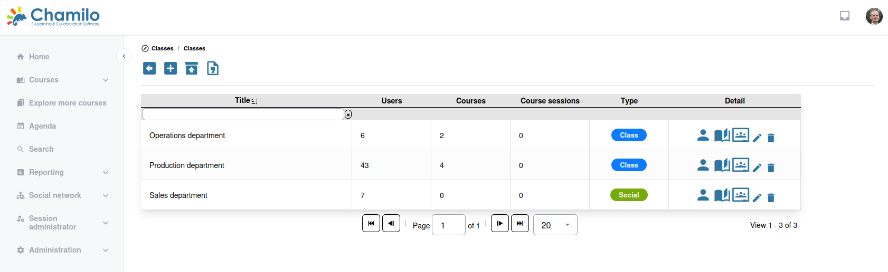

# Clases / Grupos de usuarios

Las clases del panel de administración son grupos de ámbito de plataforma que se utilizan para organizar a los usuarios con fines de gestión. Se distinguen de los grupos de nivel de curso (que son creados por los docentes dentro de un curso).

> Los grupos de usuarios y las [Clases](../../admin-guide/sessions/classes.md) comparten la misma interfaz. La única diferencia es la configuración del **tipo de grupo**: elija «Clase» para crear una clase (utilizada para la inscripción masiva en sesiones) o «Grupo de usuarios» para grupos más sociales que pueden disponer de su propio espacio en la red social interna. Consulte [Clases](../../admin-guide/sessions/classes.md) para obtener detalles sobre la inscripción en sesiones.

## Creación de un grupo

1. Desde el panel de administración, vaya a **Clases**
2. Haga clic en **Añadir clases**
3. Introduzca un **título** y una **descripción** opcional
4. Marque **Grupo social** si se tratará de un grupo social. Déjelo sin marcar si se tratará de una clase.
5. Añada una URL de referencia opcional y una imagen o logotipo.
6. Elija los **permisos** del grupo:
   * **Abierto** — Cualquier usuario puede unirse
   * **Cerrado** — Los usuarios deben ser añadidos por un administrador
7. Marque la opción si desea que los miembros puedan abandonar la clase por sí mismos.
8. Guarde.

## Adición de miembros

1. Abra la lista de clases/grupos de usuarios
2. Haga clic en el icono de usuario **Inscribir usuarios en la clase**
3. Busque usuarios por nombre, nombre de usuario o correo electrónico
4. Seleccione los usuarios que desea añadir, utilizando las flechas del lado derecho
5. Haga clic en el botón de confirmación para guardar

## Casos de uso

* **Organización por departamentos** — Agrupe a los usuarios por departamento o equipo
* **Inscripción masiva** — Añada a todos los miembros de un grupo a un curso o una sesión de una sola vez
* **Comunicación dirigida** — Envíe anuncios a grupos específicos
* **Informes** — Consulte el progreso de la formación filtrado por grupo

## Gestión de grupos

* **Editar** — Cambie el nombre, la descripción o la visibilidad del grupo
* **Gestionar miembros** — Añada o elimine miembros
* **Eliminar** — Elimine el grupo (no elimina las cuentas de los miembros)

## Orden de clasificación de las listas

El asistente que ordenaba varias listas aplicaba la dirección solicitada al revés: al elegir «ascendente» en el encabezado de una columna se devolvía primero el valor más alto, y «descendente» el más bajo. Ahora sigue la dirección solicitada. Si estaba acostumbrado a hacer clic dos veces en un encabezado para obtener el orden deseado, ahora el primer clic lo proporciona.

Listas afectadas (ordenadas al hacer clic en el encabezado de una columna):

* Lista de **Administración > Clases / grupos de usuarios** (columnas de título, usuarios, cursos, sesiones y tipo)
* La lista de grupos de usuarios de la pestaña **Clases** del curso
* Tres listas de las páginas de inicio del curso (servidas por `course_home.ajax.php`)

Sin cambios: la celda del día de la agenda, el bloque del siguiente ejercicio del portal del usuario (explícitamente ascendente, como antes) y la cuadrícula de **Ejercicios** de la sesión, cuyas filas son reordenadas posteriormente por la propia cuadrícula (orden inicial: el más antiguo primero).