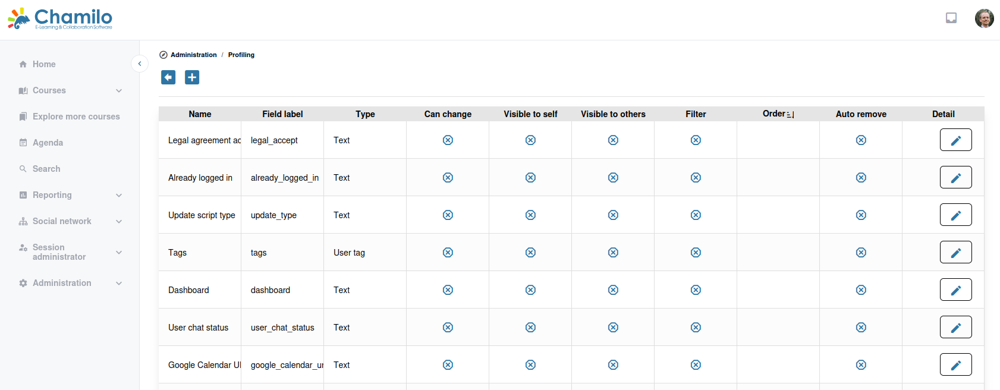

# Perfilado de usuarios

Chamilo le permite definir campos de perfil personalizados (campos adicionales) para recopilar información adicional sobre los usuarios más allá del nombre, el correo electrónico y el rol estándar.

## Campos de perfil adicionales

Los campos adicionales le permiten almacenar metadatos específicos de su organización, tales como:

* Identificador de empleado
* Departamento
* Cargo
* Ubicación/oficina
* Número de teléfono
* Identificadores personalizados

## Creación de campos adicionales

1. Desde el panel de administración, vaya a **Campos adicionales** o **Campos de perfil**
2. Haga clic en **Añadir**
3. Configure el campo:
   * **Nombre** — El título del campo que se muestra a los usuarios
   * **Descripción** — Descripción opcional
   * **Texto de ayuda** — Se muestra debajo del campo en cualquier formulario que lo incluya
   * **Tipo de campo** — Texto, lista desplegable, fecha, casilla de verificación, etc.
   * **Etiqueta del campo** — El nombre interno del campo, para la integración con plugins
   * **Valores posibles** — Si el campo es un selector entre esos valores
   * **Valor predeterminado** — Un valor predeterminado opcional
   * **Visible para sí mismo** — Si el campo es visible en el perfil del usuario para el propio usuario
   * **Visible para otros** — Si el campo es visible para otros usuarios de la plataforma
   * **Puede modificar** — Si el usuario puede modificar su propio campo por sí mismo (o si solo pueden hacerlo los administradores)
   * **Filtro** — Si se trata de un campo de tipo selector, si debe incluirse como filtro en las páginas administrativas (p. ej., para inscribir usuarios en cursos o sesiones)
   * **Orden** — Si desea gestionar el orden de visualización de los campos, deberá asignar un orden numérico a cada campo
   * **Eliminar al anonimizar** — Importante para las normas y leyes de privacidad: si el usuario se anonimiza pero no se elimina, ¿debe considerarse este campo como posible contenedor de datos de identificación personal?
4. Guardar

## Tipos de campo

El motor de campos adicionales admite un amplio conjunto de tipos de entrada. Entre los más habituales se incluyen:

| Tipo | Descripción |
|------|-------------|
| **Texto** | Un campo de texto de una sola línea |
| **Área de texto** | Un campo de texto de varias líneas |
| **Botón de opción** | Un grupo de botones de opción de selección única |
| **Lista desplegable / Lista desplegable múltiple** | Una lista de opciones predefinidas (selección única o múltiple) |
| **Selección doble** | Dos listas desplegables dependientes (p. ej., país → ciudad) |
| **Casilla de verificación** | Un interruptor de sí/no |
| **Fecha / Fecha y hora** | Selector de fecha o de fecha y hora |
| **Entero** | Un campo numérico |
| **Etiqueta** | Varios valores de etiqueta de formato libre |
| **Archivo** | Campo de carga de archivos |
| **URL de vídeo** | Una URL que apunta a un vídeo |
| **Número de teléfono móvil** | Un campo de número de teléfono con formato |
| **Zona horaria** | Un selector de zona horaria |
| **Perfil social** | Un enlace a un perfil de red social |
| **Separador** | Un separador visual dentro del formulario (sin valor) |

El conjunto exacto de tipos utilizables depende de la versión de Chamilo; la lista desplegable de tipos de campo en la página de administración de **Campos adicionales** es la fuente de referencia.

## Uso de los campos adicionales

Los campos adicionales aparecen:

* En los formularios de creación de usuarios (si son visibles para sí mismo) y de edición
* En las páginas de perfil de usuario (si son visibles para sí mismo)
* En las importaciones de usuarios (puede incluir valores de campos adicionales en las importaciones CSV)
* En las exportaciones y los informes (filtrar o agrupar por valores de campos adicionales)

## Consejos

* **Planifique antes de crear** — Defina qué información necesita antes de crear campos, ya que cambiar los tipos de campo después de haber introducido datos puede resultar problemático
* **Utilice listas desplegables para garantizar la coherencia** — Cuando un campo tiene un conjunto conocido de valores posibles, utilice una lista desplegable en lugar de texto libre para garantizar la coherencia de los datos
* **Utilícelos para la elaboración de informes** — Los campos adicionales son útiles para filtrar informes (p. ej., «mostrar todos los usuarios del Departamento X que completaron la Formación Y»)