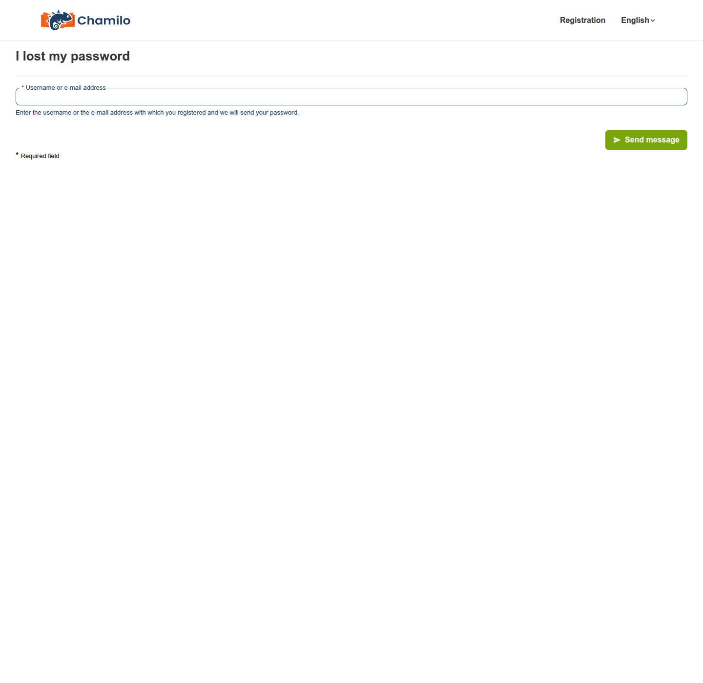
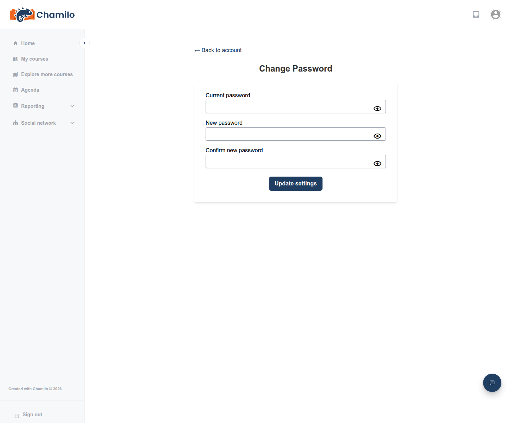

# Restablecer la contraseña

Si ha olvidado su contraseña —o simplemente desea cambiarla—, a continuación se explica cómo hacerlo en ambas situaciones: antes de iniciar sesión y cuando ya ha iniciado sesión.

## Antes de iniciar sesión

En la página de inicio de sesión, haga clic en **¿Ha olvidado su contraseña?**. Si este enlace no aparece, el administrador ha desactivado esta función; póngase en contacto con él directamente para recuperar el acceso.

1. Introduzca su **nombre de usuario o dirección de correo electrónico** en el único campo del formulario.
2. Si aparece un desafío CAPTCHA, resuélvalo (consulte [CAPTCHA](captcha.md)).
3. Haga clic en **Enviar mensaje**.

Lo que ocurra a continuación depende de cómo haya configurado esta función el administrador:

* **Recibe un enlace por correo electrónico.** Haga clic en él para abrir un formulario de restablecimiento de contraseña con los campos **Contraseña** y **Confirmar contraseña**: elija usted mismo una nueva contraseña y envíe el formulario. Este enlace es de un solo uso y caduca transcurrido un tiempo limitado (una hora de forma predeterminada, aunque el administrador puede cambiarlo); si ha caducado, la página de restablecimiento se lo indicará y deberá solicitar uno nuevo.
* **Recibe una nueva contraseña directamente por correo electrónico.** En algunas plataformas, en lugar de permitirle elegir su propia contraseña, el sistema genera una y se la envía en el correo electrónico. Inicie sesión con ella y, a continuación, considere cambiarla por otra que pueda recordar (véase más abajo).

Si utiliza autenticación externa (inicio de sesión único a través de su institución), los restablecimientos de contraseña no los gestiona Chamilo en absoluto: utilice el proceso de «contraseña olvidada» de su propia institución.

## Cuando ya ha iniciado sesión

Puede cambiar su contraseña en cualquier momento, sin esperar a olvidarla:

1. Abra el **menú del avatar** (esquina superior derecha) y haga clic en **Mi perfil**.
2. Haga clic en **Cambiar contraseña**.
3. Introduzca su contraseña actual y, a continuación, la nueva contraseña dos veces, y envíe el formulario.

Esta es la misma página en la que puede activar la [autenticación de dos factores](two-factor-authentication.md), si su plataforma la admite; en ese caso, también verá aquí una casilla «Activar la autenticación de dos factores», que no se muestra arriba porque no está activa en todas las plataformas.

## Consejos

* **Revise la carpeta de correo no deseado** si el correo de restablecimiento no llega en unos minutos.
* **Actúe con rapidez con los enlaces de restablecimiento**: caducan, y las plataformas suelen fijar esa caducidad en tan solo una hora.
* **¿Sigue sin poder acceder?** Si el restablecimiento de autoservicio no está activado o no funciona, el administrador de la plataforma siempre puede restablecer su cuenta manualmente.