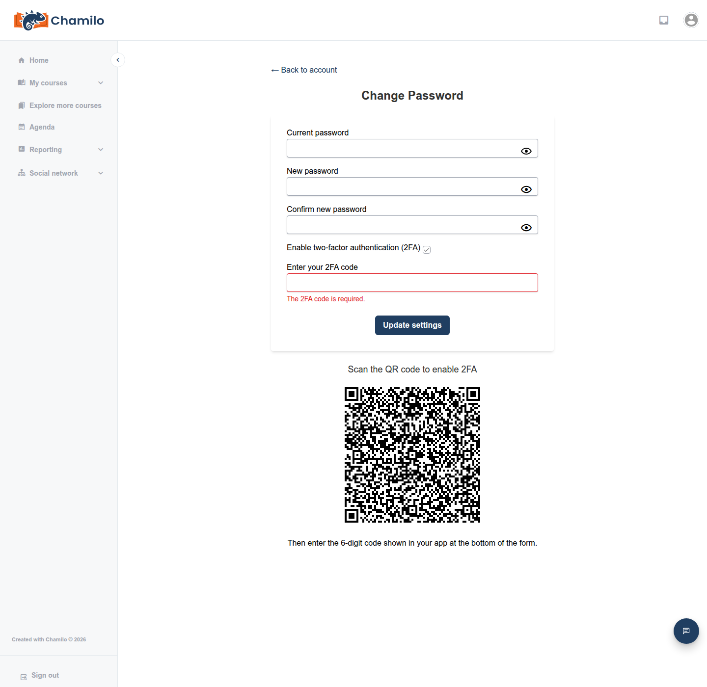

# Autenticación de dos factores

La autenticación de dos factores (2FA) añade un segundo paso al inicio de sesión —un código de 6 dígitos de una aplicación en el teléfono, además de la contraseña—, de modo que conocer solo la contraseña no basta para acceder a la cuenta.

Esta función solo aparece si el administrador la ha habilitado en toda la plataforma. Si no la ve en la página de su cuenta, no se ha activado para su plataforma.

## Activación de la 2FA

1. Abra el **menú del avatar** y haga clic en **Mi perfil**.
2. Haga clic en **Cambiar contraseña**.
3. Introduzca su **contraseña actual**, marque la casilla **Activar la autenticación de dos factores (2FA)** y haga clic en **Actualizar la configuración**.
4. La página se recarga con un código QR y el mensaje «Escanee el código QR para activar la 2FA». Escanéelo con una aplicación de autenticación en el teléfono (cualquier aplicación compatible con TOTP sirve, como Google Authenticator, Microsoft Authenticator o Authy).

5. Vuelva a introducir su contraseña actual, junto con el código de 6 dígitos que muestra ahora la aplicación, en el campo **Código 2FA**, y haga clic de nuevo en **Actualizar la configuración**. Verá una confirmación de que la 2FA se ha activado.

Marcar solo la casilla no muestra el código QR: solo lo verá después de ese primer envío, y los campos de contraseña se vacían cada vez que la página se recarga, por lo que también deberá volver a introducir su contraseña actual en este segundo envío.

## Inicio de sesión con la 2FA activada

Tras introducir el nombre de usuario y la contraseña como de costumbre, el formulario de inicio de sesión muestra un campo adicional **Código 2FA** en la misma pantalla: introduzca el código de 6 dígitos vigente de su aplicación de autenticación y envíelo (en ese momento el botón indica **Enviar código** en lugar de **Iniciar sesión**).

## Si pierde el acceso a su aplicación de autenticación

Chamilo no genera códigos de respaldo ni de recuperación para la 2FA. Si pierde el dispositivo con la aplicación de autenticación, no podrá generar usted mismo un código válido: póngase en contacto con el administrador de la plataforma, que puede desactivar la 2FA en su cuenta para que pueda iniciar sesión de nuevo y, si lo desea, configurarla en un dispositivo nuevo.

## Desactivación de la 2FA

Vuelva a **Cambiar contraseña**, desmarque **Activar la autenticación de dos factores (2FA)**, introduzca su contraseña actual y envíe el formulario.

## Consejos

* **Configúrela antes de necesitarla**: activar la 2FA lleva un minuto y protege de forma significativa su cuenta.
* **Mantenga accesible su aplicación de autenticación**: perderla implica depender del administrador para volver a entrar, ya que no hay códigos de respaldo.
* **No comparta sus códigos 2FA**: cualquiera que tenga su contraseña y un código válido puede iniciar sesión como usted.