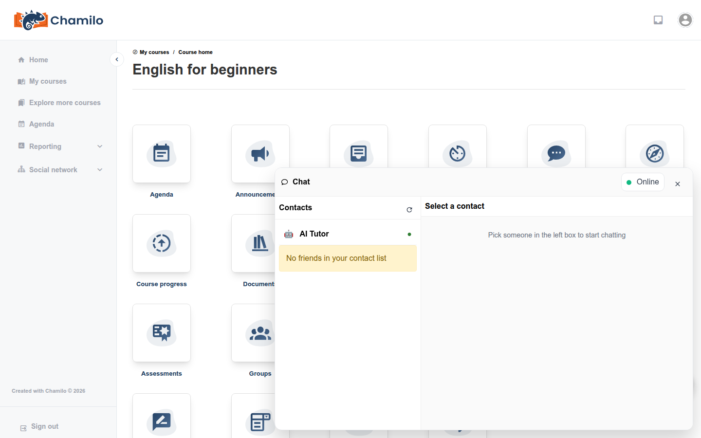
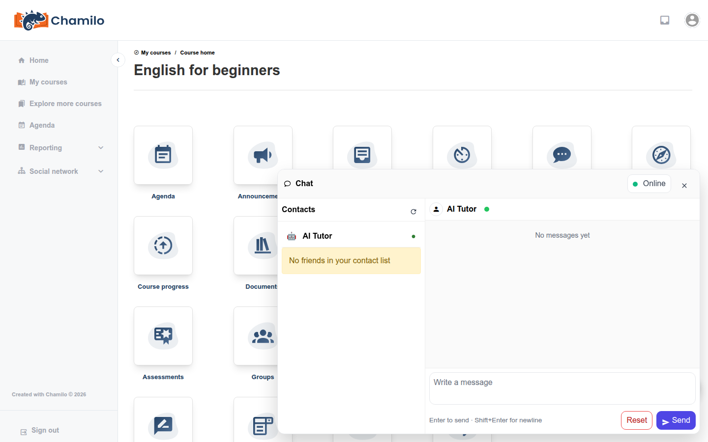

# Chatbot del Tutor de IA

Si su plataforma y su curso lo tienen habilitado, dispone de un **Tutor de IA**: un asistente de chat al que puede formular preguntas y del que obtiene respuestas instantáneas y contextualizadas, sin esperar a que responda su profesor.

## Si tiene acceso

El Tutor de IA depende de la configuración en dos niveles, ambos fuera de su control:

* **Nivel de plataforma** — Su administrador debe habilitar los asistentes de IA y configurar un proveedor de IA.
* **Nivel de curso** — Su profesor debe activar el Tutor de IA para ese curso concreto.

Consulte [Tutor de IA](../../teacher-guide/ai-tools/ai-tutor.md) en la Guía del profesorado para ver cómo se configura desde el lado del profesor. Si no ve en ningún sitio la opción descrita a continuación, no se ha habilitado para usted: ni en general, ni para el curso en el que se encuentra.

Algunas plataformas también habilitan el Tutor de IA **fuera de cualquier curso**. En ese caso, cambia de enfoque: en lugar de responder sobre un curso concreto, ayuda con preguntas genéricas sobre el uso de la plataforma, como cómo encontrar o utilizar una función. Este modo para toda la plataforma es un interruptor distinto del de cada curso, de modo que uno puede estar activado sin el otro.

## Abrir el chat

Busque el botón de chat (un icono flotante de bocadillo de diálogo) en la parte inferior de la pantalla. Al abrirlo se muestran sus contactos y, si está habilitado, una entrada dedicada al **Tutor de IA** con un icono de robot y un punto de «en línea». Haga clic en ella para iniciar o continuar su conversación con la IA.

Escriba su pregunta y pulse **Enter** para enviarla (**Shift+Enter** inserta un salto de línea en lugar de enviar). El Tutor de IA da formato a sus respuestas con encabezados, listas, texto en negrita y bloques de código cuando resulta útil, de modo que las explicaciones más largas sigan siendo legibles.

## Preguntar sobre algo que está leyendo

Mientras consulta un documento, una publicación del foro, una página de la wiki, una entrada del portafolio o un paso de un itinerario de aprendizaje, puede seleccionar un fragmento de texto de la página antes de formular su pregunta. Aparece una pequeña etiqueta «Selección» encima del cuadro de mensaje: envíe su mensaje y ese texto seleccionado se incluye como contexto, de modo que el Tutor de IA pueda responder específicamente sobre el pasaje que ha resaltado. Haga clic en la **×** de la etiqueta para descartar la selección si no desea incluirla.

## Empezar de nuevo

Si una conversación se desvía, utilice la opción **Restablecer** del compositor de chat para borrarla y empezar de cero. Esto solo borra su conversación con el Tutor de IA: no afecta a sus mensajes habituales con su profesor o sus compañeros.

## Cuando no está disponible

El Tutor de IA se desactiva automáticamente mientras realiza un ejercicio o trabaja en una tarea, de modo que no pueda utilizarse para obtener respuestas durante una evaluación. Tampoco aparecerá si el proveedor de IA subyacente no está disponible temporalmente. Chamilo intenta conmutar automáticamente a otro proveedor configurado, pero si ninguno es accesible, el Tutor de IA puede no estar disponible durante un breve periodo.

## Consejos

* **Utilícelo para aclaraciones rápidas**: resulta especialmente útil para preguntas por las que, de otro modo, tendría que esperar una respuesta.
* **Verifique igualmente la información importante**: como cualquier sistema de IA, puede cometer errores. Contraste cualquier dato crítico con el material del curso o con su profesor.
* **Es un complemento, no un sustituto**: para cualquier asunto que requiera el criterio real de su profesor (disputas de calificación, prórrogas, circunstancias personales), diríjase a él directamente.