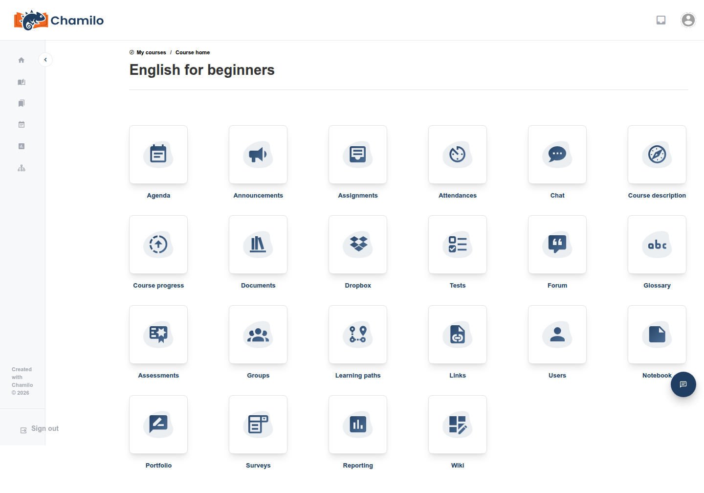
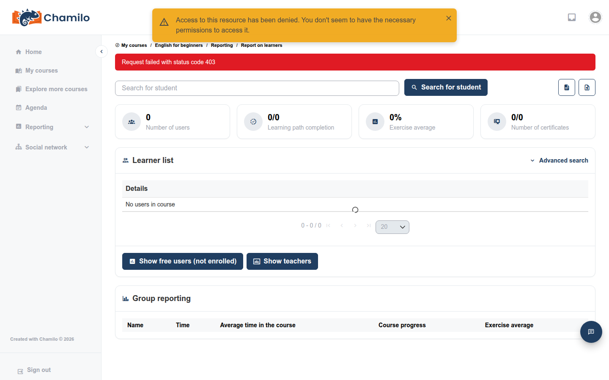

# Cómo orientarse en un curso

Al abrir un curso, verá su página de inicio con una cuadrícula de iconos de herramientas. Esta página explica qué significa cada herramienta para usted como estudiante y enlaza con el lugar donde la funcionalidad subyacente se describe con más detalle.

Solo las herramientas que su profesor ha hecho visibles para los estudiantes aparecen en su cuadrícula; su profesor puede ver herramientas adicionales ocultas que no se le muestran. Si una herramienta que espera no está ahí, puede que simplemente esté oculta o desactivada para todo el curso; pregunte a su profesor.

## La cuadrícula de herramientas

| Herramienta | Icono | Qué significa para usted | Más información |
|------|------|------------------------|------------|
| Documentos |  | Lea y descargue los archivos que su docente ha subido | [Documentos](../../teacher-guide/adding-content/documents.md) |
| Lecciones |  | Siga una secuencia guiada de actividades en orden y registre su propio progreso a medida que avanza | [Lecciones](../../teacher-guide/adding-content/learning-paths.md) |
| Enlaces |  | Abra los recursos externos seleccionados por su docente | [Enlaces](../../teacher-guide/adding-content/links.md) |
| Tests (Ejercicios) |  | Realice cuestionarios y exámenes; algunos se califican automáticamente y otros los califica su docente | [Ejercicios](../../teacher-guide/assessing-learners/exercises.md) |
| Anuncios |  | Lea las actualizaciones importantes publicadas por su docente | [Anuncios](../../teacher-guide/adding-content/announcements.md) |
| Evaluaciones (Libro de calificaciones) |  | Consulte sus propias puntuaciones en las actividades calificadas del curso y cualquier certificado que haya obtenido | [Libro de calificaciones](../../teacher-guide/assessing-learners/gradebook.md) |
| Glosario |  | Consulte los términos clave definidos para el curso | [Glosario](../../teacher-guide/adding-content/glossary.md) |
| Asistencias |  | Consulte su propia asistencia registrada, si su docente la lleva | [Asistencia](../../teacher-guide/assessing-learners/attendance.md) |
| Progreso del curso |  | Consulte un resumen de cuánto ha avanzado en el curso | [Progreso del curso](../../teacher-guide/additional-tools/course-progress.md) |
| Agenda |  | Consulte los eventos y plazos específicos del curso | — |
| Foro |  | Lea y publique en debates organizados por hilos con su docente y sus compañeros | [Foros](../../teacher-guide/collaboration-and-communication/forums.md) |
| Dropbox |  | Intercambie archivos de forma privada con su docente o sus compañeros | [Dropbox](../../teacher-guide/additional-tools/dropbox.md) |
| Usuarios |  | Vea quién más está inscrito en el curso | — |
| Grupos |  | Trabaje en un grupo más reducido asignado por su docente, con sus propias herramientas compartidas | [Grupos](../../teacher-guide/collaboration-and-communication/groups.md) |
| Chat |  | Envíe mensajes a su docente o a sus compañeros en tiempo real | [Chat](../../teacher-guide/collaboration-and-communication/chat.md) |
| Tareas |  | Envíe archivos o texto para que su docente los revise y califique | [Tareas](../../teacher-guide/assessing-learners/assignments.md) |
| Encuestas |  | Responda cuestionarios, a veces de forma anónima | [Encuestas](../../teacher-guide/assessing-learners/surveys.md) |
| Wiki |  | Redacte y edite páginas compartidas de forma colaborativa | [Wiki](../../teacher-guide/collaboration-and-communication/wiki.md) |
| Cuaderno |  | Guarde sus propias notas privadas dentro del curso | [Cuaderno](../../teacher-guide/additional-tools/notebook.md) |
| Portafolio |  | Elabore una colección personal de trabajos para mostrar o entregar | [Portafolio](../../teacher-guide/additional-tools/portfolio.md) |
| Informes |  | Nada, para usted — véase más abajo | — |

## Herramientas que no verá — y una que no funcionará

Algunas entradas existen únicamente para que los docentes y los administradores del curso configuren el curso en sí: la configuración del curso, el mantenimiento del curso (copia de seguridad/importación/exportación), el editor de la página de inicio del curso y (en la mayoría de las plataformas) la herramienta Blog se encuentran en un menú «Más acciones» que solo aparece a las personas con derechos de edición en el curso. Como estudiante, no verá este menú en absoluto.

El mosaico **Informes** es un caso especial: sí aparece en su cuadrícula, pero abre la vista de seguimiento de toda la clase destinada a los docentes, por lo que al hacer clic en él obtiene un mensaje de acceso denegado en lugar de algo útil:

No se preocupe: su propio progreso está disponible en otro lugar: desde **Mi progreso** en la barra lateral principal (consulte [Comprender la interfaz](../getting-started/understanding-the-interface.md) y [Mi progreso](../my-progress.md)), y desde las herramientas **Progreso del curso** y **Evaluaciones** anteriores, ambas muestran sus propios datos.

Si su curso tiene funciones de IA habilitadas, también puede notar que la opción «Analizador de IA» del docente (utilizada para preentrenar al Tutor de IA con el contenido propio del curso) es distinta del chat **Tutor de IA** orientado al estudiante; consulte [Chatbot del Tutor de IA](ai-tutor.md).

## Consejos

* **¿Falta una herramienta?** Pregunte a su docente: lo más probable es que esté oculta o desactivada, y no averiada.
* **La descripción del curso y los anuncios** pueden ser desactivados por completo por su docente; si es así, no aparecerán para nadie, incluido el docente.
* **Todo esto puede variar según el curso**: su docente decide qué herramientas están activas y visibles en cada curso de forma individual.