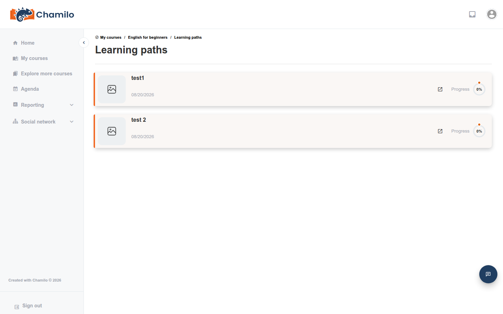

# Seguir un itinerario de aprendizaje

Un **itinerario de aprendizaje** le guía a través de una secuencia estructurada de actividades — documentos, pruebas, enlaces y más — en un orden definido por su docente. En muchos cursos, es la herramienta principal (o la única) que realmente necesitará utilizar, ya que puede agrupar todo lo demás en su interior.

## Abrir un itinerario de aprendizaje

Abra la herramienta **Itinerarios de aprendizaje**  desde la página de inicio del curso y haga clic en uno para comenzar. Si su docente ha activado el **inicio automático**, el itinerario de aprendizaje puede abrirse automáticamente en cuanto entre en el curso.

## Avanzar por el itinerario

Dentro de un itinerario de aprendizaje, verá:

* Una **lista de elementos** (pasos) en un panel, organizados en secciones que su docente puede haber agrupado como capítulos
* El **contenido del elemento actual** en el área principal: un documento, una prueba incrustada, un enlace, etc.

A medida que completa los elementos, se marcan con una marca de verificación, y una **barra de progreso** muestra su porcentaje global de finalización de todo el itinerario. Si sale y vuelve más tarde, reanuda exactamente donde lo dejó: no se pierde nada.

## Elementos bloqueados y prerrequisitos

Algunos elementos pueden aparecer **bloqueados** hasta que cumpla un prerrequisito establecido por su docente, normalmente terminar un elemento anterior o alcanzar una puntuación mínima en una prueba anterior del itinerario. Si no puede abrir un paso, compruebe si alguno anterior sigue incompleto.

## Pruebas y certificados dentro de un itinerario

Un itinerario de aprendizaje puede incluir una prueba como uno de sus pasos; realizarla funciona igual que se describe en [Realizar pruebas](taking-tests.md). Algunos itinerarios terminan con un paso de **certificado**: al alcanzarlo (habiendo cumplido los requisitos de puntuación a lo largo del camino) se genera su certificado de finalización, si su docente ha configurado uno para el curso.

## SCORM y otro contenido importado

Algunos elementos del itinerario de aprendizaje no se crean directamente en Chamilo, sino que se importan como un paquete **SCORM**, un paquete **CMI5/xAPI** o se elaboran con el complemento C-Studio. Por lo general, se ven y se comportan como cualquier otro contenido interactivo: Chamilo registra su progreso y su puntuación de la misma manera, aunque el contenido en sí se haya creado en otro lugar.

## Asistente de estudio con IA

Si su administrador ha activado los asistentes de IA, los pasos de documento de un itinerario de aprendizaje pueden ofrecer un **asistente de estudio con IA**. Seleccione un pasaje del documento y aparecerá una pequeña acción de robot junto a la selección. Ábrala, elija una **técnica de aprendizaje** (por ejemplo, técnica de Feynman, mapas mentales, repetición espaciada o SQ3R) y, a continuación, haga clic en **Generar**.

Chamilo envía el pasaje seleccionado y la técnica al servicio de IA configurado y muestra la explicación generada en un cuadro de diálogo. El asistente está pensado para apoyar su comprensión del material; no modifica sus respuestas, su puntuación ni el progreso del itinerario de aprendizaje.

## Consejos

* **Utilice la barra de progreso** para estimar cuánto queda del itinerario.
* **No se preocupe por perder su lugar**: Chamilo recuerda exactamente dónde se encuentra en un itinerario entre sesiones.
* **Un paso bloqueado suele indicar trabajo pendiente en una parte anterior del itinerario**: vuelva atrás y compruébelo en lugar de suponer que el acceso se denegó por error.