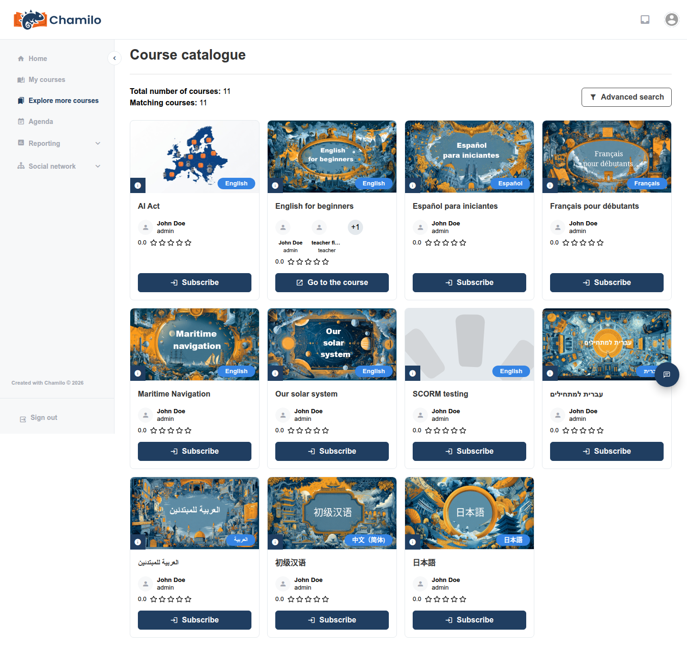

# Suscribirse a un curso

Antes de poder acceder al contenido de un curso, debe estar suscrito (inscrito) en él. Según su plataforma, esto puede ocurrir de varias formas distintas; en la mayoría de los casos, no es necesario que usted haga nada.

| Cómo ocurre | Qué debe hacer |
|-----------------|----------------------|
| Un administrador lo inscribe | Nada: el curso aparece en **Mis cursos** una vez hecho |
| Un docente lo inscribe manualmente | Nada: igual que en el caso anterior |
| Usted se autoinscribe a través del catálogo de cursos | Explore **Explorar más cursos** y, a continuación, haga clic para unirse |
| Recibe una invitación al curso por correo electrónico | Haga clic en el enlace; regístrese si aún no tiene una cuenta |

## Comprobar sus cursos

Haga clic en **Mis cursos** en la barra lateral en cualquier momento para ver todo aquello en lo que está inscrito actualmente. Si un curso que espera no aparece en la lista, aún no se le ha suscrito a él: utilice uno de los métodos que se indican a continuación o póngase en contacto con su docente o administrador.

## Autoinscripción a través del catálogo de cursos

Si la visibilidad de un curso lo permite, puede suscribirse usted mismo sin esperar a nadie más:

1. Haga clic en **Explorar más cursos** en la barra lateral para abrir el catálogo de cursos.
2. Explore o busque el curso al que desea unirse.
3. Haga clic en el curso para abrir sus detalles y, a continuación, haga clic en el botón para unirse.

Un curso en el que ya está inscrito muestra **Ir al curso** en lugar de un botón de suscripción.

Algunos cursos requieren una contraseña para la autoinscripción; si es así, su docente se la habrá comunicado por separado. Si un curso no ofrece ningún botón para unirse, la autoinscripción no está abierta para él; pida al docente o a un administrador que lo suscriba en su lugar.

Si su plataforma utiliza **sesiones**, la misma idea se aplica a **Mis sesiones**: algunas sesiones pueden estar abiertas a la autoinscripción a través del catálogo, aunque esto suele gestionarlo un administrador o un tutor de sesión, ya que suscribirse a una sesión lo suscribe a todos los cursos que contiene.

## Aceptar una invitación a un curso

En lugar de una entrada en el catálogo, un docente puede enviarle una **invitación al curso** por correo electrónico: este es el único método que no exige que ya tenga una cuenta en la plataforma. Al abrir el enlace del correo electrónico:

* Se rellena y se bloquea el campo de correo electrónico del formulario de registro con la dirección a la que se le invitó.
* Puede registrarse aunque el autorregistro general esté cerrado en ese momento en la plataforma.
* Se le suscribe automáticamente al curso (o a toda la sesión, si el curso se abre dentro de una) en cuanto termina de registrarse, y se inicia su sesión.

El enlace es de un solo uso y caduca a los 7 días: si deja de funcionar, pida al docente que lo invitó que envíe uno nuevo. Consulte [Qué ve la persona invitada](../../teacher-guide/assessing-learners/subscribing-users.md#what-the-invited-person-sees) para obtener más detalles sobre este flujo, y [Crear una cuenta](../getting-started/creating-an-account.md) para ver el aspecto del propio formulario de registro.

## Consejos

* **Consulte «Explorar más cursos» antes de preguntar**: muchas plataformas dejan abierta la autoinscripción en los cursos, por lo que es posible que pueda unirse de inmediato sin esperar a nadie.
* **Esté atento a su bandeja de entrada**: tanto las invitaciones a cursos como las notificaciones de aprobación de cuenta llegan por correo electrónico.
* **¿Sigue sin poder acceder?** Los métodos de inscripción pueden restringirse o desactivarse en toda la plataforma, de modo que, si ninguna de las opciones anteriores funciona, su docente o administrador siempre puede suscribirlo directamente.