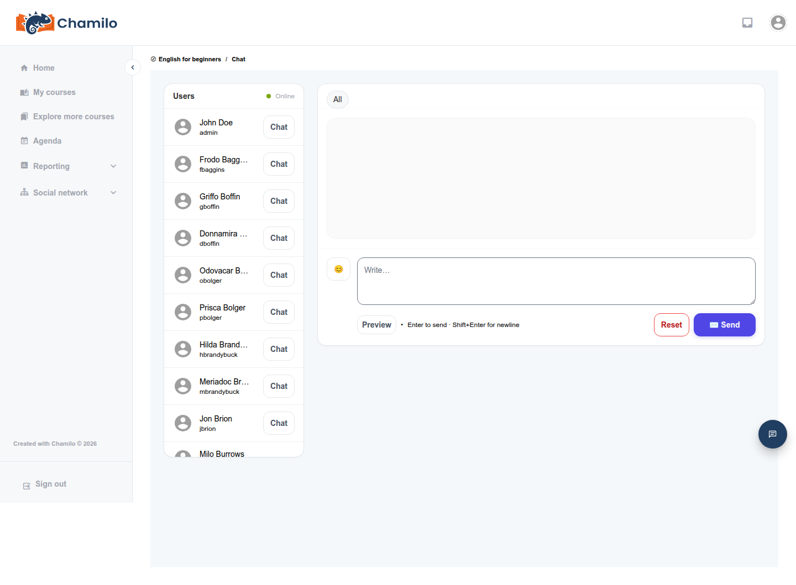

# Uso de la herramienta de chat

Algunos cursos incluyen una herramienta de **Chat** — mensajería de texto en tiempo real vinculada a ese curso concreto, útil para intercambios rápidos o para sesiones de preguntas y respuestas en directo mientras el docente está presente.

## Envío de mensajes

Abra la herramienta de **Chat**  desde la página de inicio del curso. Verá una lista de **Usuarios** con todas las personas conectadas actualmente en el curso, cada una con su propio botón de **Chat**, además de una pestaña **Todos** para el grupo completo:

Elija a una persona (o **Todos**) y escriba su mensaje en el cuadro de la parte inferior. Pulse **Enter** para enviarlo, o **Shift+Enter** para empezar una nueva línea sin enviarlo. La opción **Vista previa** le permite comprobar el formato antes de enviar, y **Restablecer** borra lo que haya escrito.

## Si el chat está restringido a los tutores

El administrador puede restringir el chat del curso de modo que solo su docente (u otros tutores del curso) pueda publicar; en ese caso, el resto puede leer, pero no participar directamente. Si no puede enviar un mensaje en el chat de un curso, lo más probable es que se deba a este ajuste, y no a un error.

## No confundir con

Chamilo dispone de tres funciones distintas relacionadas con la mensajería, y es fácil confundirlas:

* **Esta herramienta de Chat del curso** — en tiempo real, vinculada a un curso concreto y accesible únicamente desde la página de inicio de ese curso.
* **[Bandeja de entrada](../inbox.md)** — mensajes privados y asíncronos con cualquier persona de la plataforma, sin relación con un curso concreto.
* **El panel de chat flotante** (en la parte inferior de la pantalla, disponible en casi todas partes) — se utiliza para la mensajería directa, las [videollamadas individuales](../video-calls.md) cuando están habilitadas y el [Tutor de IA](ai-tutor.md), con independencia de esta herramienta del curso.

Si busca una de las otras dos, consulte sus páginas respectivas.

## Consejos

* **Utilícela para intercambios en directo y en el momento** — para todo lo que desee volver a encontrar más adelante, use el [Foro](using-the-forum.md).
* **Compruebe si hay una sesión de chat en directo programada** — a veces los docentes anuncian horarios concretos en los que estarán disponibles en el chat del curso, a menudo a través de la Agenda.
* **Si su curso tiene configurada la videoconferencia**, es posible que su docente prefiera esa opción para las sesiones en directo en lugar del chat de texto.