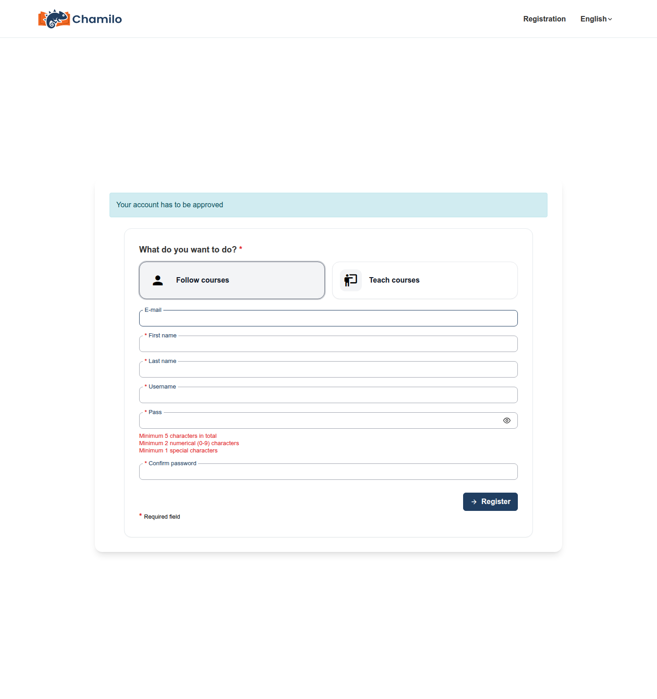

# Crear una cuenta

La posibilidad de crear su propia cuenta depende de cómo esté configurada su plataforma. Esta página describe qué puede esperar del formulario de autorregistro y qué ocurre si no está disponible para usted.

## Si el autorregistro no está disponible

No todas las plataformas Chamilo permiten que los visitantes se registren por sí mismos: una escuela o una empresa suele preferir crear las cuentas de sus miembros directamente, o restringir el registro a quienes hayan recibido una invitación específica. Si no ve un enlace **Registrarse** (o **Crear cuenta**) en la página de inicio de sesión, esta es la razón. En ese caso:

* Pida a su institución o al administrador de la plataforma que cree una cuenta para usted, o
* Pida a su docente una **invitación al curso**: un enlace de un solo uso enviado a su dirección de correo electrónico que le permite registrarse directamente, incluso en una plataforma donde el registro general está cerrado, y que le inscribe de inmediato en el curso de ese docente una vez que finalice. Consulte [Qué ve la persona invitada](../../teacher-guide/assessing-learners/subscribing-users.md#what-the-invited-person-sees) para saber cómo se presenta esto desde su lado.

## Completar el formulario de registro

Si el autorregistro está habilitado, haga clic en **Registrarse** en la página de inicio de sesión. El formulario solicita alguna combinación de los siguientes datos, según lo que haya configurado su administrador:

* Dirección de correo electrónico y/o nombre de usuario
* Nombre y apellidos
* Contraseña (con un indicador de fortaleza mientras escribe)
* Número de teléfono, idioma, código oficial o fecha de nacimiento
* Campos de perfil adicionales específicos de su plataforma

No debe preocuparse si su formulario se ve distinto de esta lista: los administradores pueden mostrar, ocultar o exigir campos individuales.

## Este formulario solo crea cuentas de estudiante

De forma predeterminada, el formulario de registro público no ofrece ninguna opción para registrarse como docente: todas las cuentas creadas a través de él son cuentas de estudiante. No hay un menú desplegable, una casilla de verificación ni una opción deshabilitada que sugiera un rol de docente; esa elección simplemente no forma parte del formulario.

Algunas plataformas sí habilitan un paso **"¿Qué desea hacer?"** con dos tarjetas — **Seguir cursos** y **Impartir cursos** —, pero esto solo aparece si su administrador ha activado específicamente el registro como docente. Incluso entonces, elegir impartir cursos puede requerir que su cuenta sea aprobada antes de que obtenga derechos de docente.

Si necesita una cuenta de docente y no ve esta opción, pida al administrador de su plataforma que cree una para usted o que actualice su cuenta existente.

## Términos y condiciones y CAPTCHA

Según la configuración de su plataforma, el formulario también puede incluir:

* Una casilla de **Términos y condiciones** cerca de la parte inferior del formulario ("He leído y acepto los Términos y condiciones"), con el texto completo mostrado en un cuadro desplazable encima de ella.
* Un desafío **CAPTCHA** al final del formulario, que le pide escribir las letras que aparecen en una imagen. Consulte [CAPTCHA](../account-and-security/captcha.md) para saber por qué está presente.

En algunas plataformas, al enviar el formulario se muestra un paso de confirmación ("Confirma que realmente desea suscribirse a esta plataforma.") antes de que su cuenta se cree realmente: se trata de una medida de protección contra envíos accidentales, no de un paso adicional de aprobación.

## Qué ocurre después de enviar el formulario

Según cómo haya configurado el registro su administrador, ocurre una de estas tres cosas:

* **Inicia sesión de inmediato**: la configuración más habitual, especialmente en plataformas abiertas.
* **Su cuenta necesita aprobación**: su cuenta se crea, pero permanece deshabilitada hasta que un administrador la apruebe manualmente. Se le notificará cuando eso ocurra.
* **Debe confirmar su dirección de correo electrónico**: recibirá un enlace de confirmación por correo electrónico; su cuenta permanece deshabilitada hasta que haga clic en él.

Si no está seguro de cuál se aplica a usted y no parece ocurrir nada después de registrarse, revise su bandeja de entrada (incluido el correo no deseado) en busca de un mensaje de la plataforma, o contacte a su administrador.

## Consejos

* **Use una dirección de correo electrónico que revise con regularidad**: es el medio por el que recibirá restablecimientos de contraseña, invitaciones a cursos y confirmaciones de cuenta.
* **Elija una contraseña segura**: el indicador de fortaleza del formulario le ofrece comentarios en tiempo real mientras escribe.
* **¿No puede registrarse en absoluto?** Contacte a quien administre su plataforma: que el autorregistro esté cerrado es una decisión deliberada en muchas plataformas institucionales y corporativas.