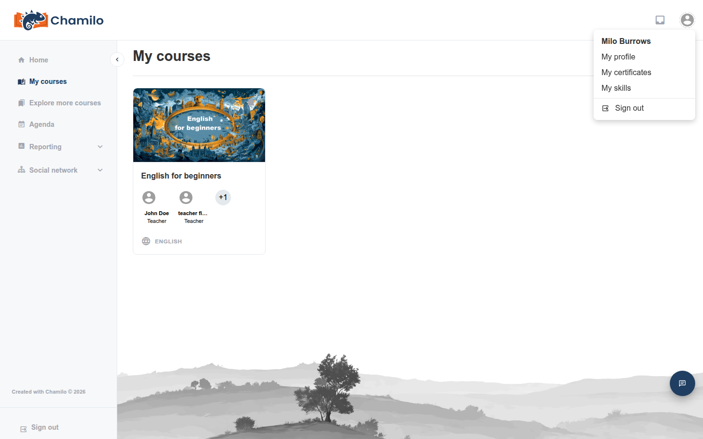
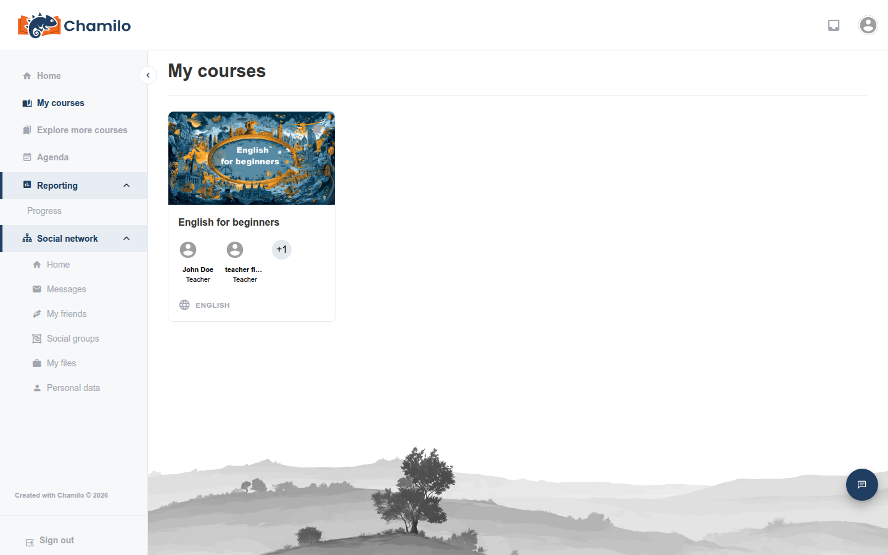

# Comprender la interfaz

Chamilo 3.0 tiene una interfaz limpia y moderna, diseñada para que la navegación sea sencilla. Esta página explica cada parte de la interfaz desde el punto de vista del estudiante.

## La barra superior

La barra superior está siempre visible en la parte superior de cada página. Contiene:

* **Logotipo de la plataforma** — Haga clic en él para volver a la página de inicio en cualquier momento.
* **Icono de bandeja de entrada**  — Muestra sus mensajes. Una insignia roja indica mensajes no leídos. Haga clic para abrir su [Bandeja de entrada](../inbox.md).
* **Icono de ticket de soporte**  — Si el administrador lo ha habilitado, le da acceso al sistema de tickets de soporte. No todas las plataformas lo habilitan, por lo que es posible que solo vea el icono de la bandeja de entrada y su avatar.
* **Su avatar** — Una imagen circular en la esquina superior derecha. Haga clic en ella para abrir un menú desplegable:

* **Mi perfil** — Edite su información personal, cambie su contraseña y (si está habilitado) configure la autenticación de dos factores
* **Mis certificados** — Todos los certificados que ha obtenido, en todos sus cursos
* **Mi expediente** — Si su plataforma utiliza expedientes, el [expediente](../account-and-security/my-transcript.md) de los cursos que ha completado
* **Mis competencias** — Insignias de competencia que se le han otorgado
* **Cerrar sesión**

## La barra lateral

La barra lateral de la izquierda es su navegación principal. Puede contraerse para dar más espacio al área de contenido. Haga clic en la flecha de alternancia de su borde derecho para expandirla o contraerla. Chamilo recuerda su preferencia.

La barra lateral contiene los siguientes enlaces (algunos pueden estar ocultos según la configuración de su plataforma):

| Elemento del menú | Icono | Descripción |
|-----------|------|-------------|
| **Inicio** |  | Vuelve al panel principal |
| **Mis cursos** |  | Lista todos los cursos en los que está inscrito |
| **Mis sesiones** |  | Lista sus sesiones de formación (actuales, pasadas y próximas) |
| **Explorar más cursos** |  | Explore el catálogo de cursos para encontrar nuevos cursos e inscribirse por su cuenta |
| **Agenda** |  | Su calendario personal y de cursos |
| **Informes** |  | Se expande a **Progreso** — su propia vista general de [Mi progreso](../my-progress.md) |
| **Red social** |  | Se expande a la [Red social](../social-network.md) y a los enlaces relacionados, si está habilitada |
| **Videoconferencia** |  | Acceda a sesiones de vídeo en directo (si está configurado) |

**Informes** y **Red social** no son enlaces simples: al hacer clic en ellos se expande una pequeña lista de subelementos directamente en la barra lateral:

* En **Informes**: solo **Progreso**, que le lleva a [Mi progreso](../my-progress.md).
* En **Red social**: **Inicio** (el muro social), **Mensajes** (un acceso directo a su [Bandeja de entrada](../inbox.md)), **Mis amigos**, **Grupos sociales** — y, agrupados aquí de forma algo inesperada, **Mis archivos** (su almacenamiento personal de archivos) y **Datos personales** (una exportación de los datos personales que la plataforma conserva sobre usted). Estos dos últimos no son realmente funciones «sociales»; simplemente se encuentran en esta parte de la barra lateral.

Si su cuenta tiene roles adicionales (por ejemplo, también imparte un curso), es posible que vea elementos adicionales en la barra lateral —como **Administración**— que una cuenta solo de estudiante nunca ve.

En la parte inferior de la barra lateral encontrará una opción de **Cerrar sesión** para cerrar sesión rápidamente cuando haya terminado. Esta opción también está disponible en el menú desplegable del icono de su avatar, en la esquina superior derecha.
Si la plataforma se gestiona mediante métodos de autenticación externos, es posible que estas opciones de cierre de sesión no estén disponibles.

## El área de contenido principal

El área central de la pantalla muestra el contenido de la página actual. En la parte superior, a menudo verá una **ruta de navegación** que indica su ubicación actual en la plataforma (por ejemplo: Inicio > Rock music > Documentos). Utilice las migas de pan para volver a una página superior.

## La página de inicio del curso

Al entrar en un curso, se muestra la **página de inicio del curso**:

* **Título del curso** — Se muestra de forma destacada en la parte superior
* **Introducción del curso** — Una descripción opcional en texto enriquecido redactada por el docente
* **Cuadrícula de herramientas** — Una cuadrícula de iconos que representan las herramientas disponibles en este curso (Documentos, Ejercicios, Foros, etc.)

En esta cuadrícula solo aparecen las herramientas que el docente ha hecho visibles; consulte [Orientarse en un curso](../courses/course-tools-overview.md) para saber qué hace cada una. Los controles para editar el propio curso (previsualizar como estudiante, mostrar u ocultar herramientas, reordenarlas) solo aparecen para docentes y administradores del curso; no los verá en un curso en el que esté inscrito como estudiante.

## Colores de los iconos

Esto sigue siendo experimental y no está del todo completo en Chamilo 3.0, pero se intenta aplicar las siguientes reglas a todos los botones e iconos de acción de la interfaz:

* **Verde** para las acciones de creación. Incluye añadir, crear, importar, guardar y copiar contenido.
* **Azul** para las acciones de visualización. Incluye exportar, ver, previsualizar en listas o en vistas de detalle, buscar y descargar.
* **Naranja** para las acciones de edición. Incluye editar, mover, configurar, activar o desactivar, ocultar y mostrar.
* **Rojo** para las acciones de eliminación o retirada. Incluye eliminar, retirar y darse de baja.
* **Gris** para las acciones de cancelación. Simplemente dejar las cosas en el estado actual.

## Diseño adaptable

Chamilo 3.0 se adapta a distintos tamaños de pantalla. En un dispositivo móvil o en una ventana estrecha del navegador:

* La barra lateral está oculta de forma predeterminada y puede abrirse pulsando el icono del menú
* Las tarjetas de curso se muestran en una sola columna en lugar de en una cuadrícula
* Las tablas se pueden desplazar horizontalmente

Esto significa que puede acceder a sus cursos desde un teléfono, una tableta o un ordenador, aunque la interfaz puede verse ligeramente distinta según el dispositivo.