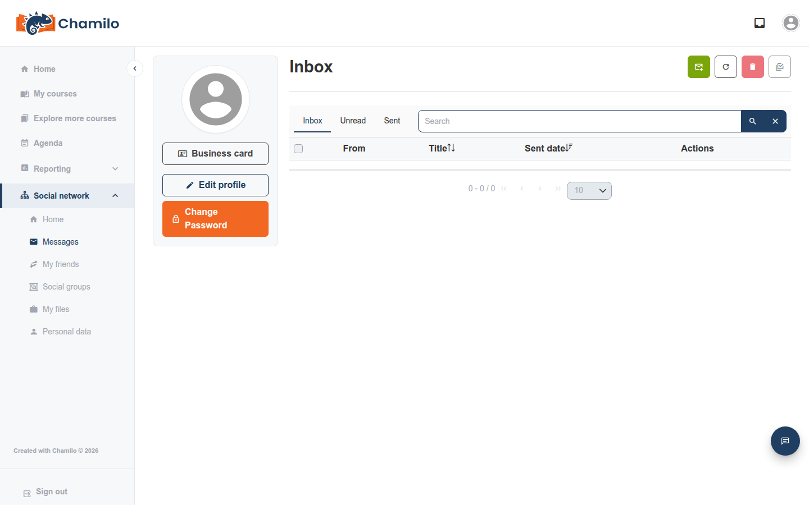

# Bandeja de entrada

La **Bandeja de entrada** es el sistema de mensajería privada de Chamilo: mensajes asíncronos, similares al correo electrónico, entre usted y otros usuarios de la plataforma, independientes de cualquier curso concreto.

## Acceder a su bandeja de entrada

Haga clic en el icono **Bandeja de entrada**  de la barra superior. Una insignia roja indica cuántos mensajes no leídos tiene. Si este icono no aparece en absoluto, su administrador ha desactivado la mensajería de la plataforma.

## Leer y responder

Su bandeja de entrada enumera los mensajes recibidos e indica cuáles no se han leído. Abra uno para leerlo y utilice **Responder** para contestar: puede incluir varios destinatarios en una misma respuesta, lo que resulta útil para mantener informada a un pequeño grupo de personas sin crear un curso formal ni un grupo social.

## Responder desde el correo electrónico

Si su administrador ha habilitado las respuestas por correo electrónico para los mensajes directos, el correo de notificación de un mensaje de Chamilo incluye una dirección de respuesta especial. Puede responder desde su cliente de correo habitual; Chamilo valida la respuesta y la añade a la misma conversación en su bandeja de entrada.

Envíe la respuesta desde la misma dirección de correo electrónico registrada en su cuenta de Chamilo y escriba su respuesta por encima del marcador **Reply above this line**. No todas las notificaciones de la plataforma admiten respuesta: esta función se aplica a las notificaciones de mensajes directos cuando el administrador ha configurado el correo entrante.

## Redactar un mensaje nuevo

Haga clic en el botón **mensaje nuevo** , elija uno o varios destinatarios, escriba un asunto y un cuerpo, y envíelo. Al igual que una respuesta, un mensaje nuevo puede dirigirse a varias personas a la vez.

## Insertar un gráfico de función

Puede añadir un gráfico de una función matemática a un mensaje nuevo de la bandeja de entrada o a una respuesta:

1. En el editor de mensajes, seleccione **Gráfico** (la acción **Insertar gráfico**).
2. Introduzca una función de `x`, por ejemplo `x^3`, `sin(x)` o `2*x+1`.
3. Seleccione **Insertar gráfico**, revise el resultado en su mensaje y envíelo.

La expresión puede utilizar `x`, números, `pi`, `e`, paréntesis, `+`, `-`, `*`, `/`, `^` y las funciones `sin`, `cos`, `tan`, `sqrt`, `abs`, `log` y `exp`. Utilice `*` para la multiplicación y paréntesis para los argumentos de las funciones. Las expresiones están limitadas a 120 caracteres. El gráfico muestra una ventana fija de aproximadamente **x = -3 a 3** e **y = -10 a 10**, por lo que los valores fuera de esa ventana no se muestran.

Los destinatarios pueden ver el gráfico generado en el mensaje de la bandeja de entrada. Esta función es independiente de la redacción de [fórmulas matemáticas en LaTeX](../teacher-guide/adding-content/math-formulas.md); representa funciones admitidas en lugar de evaluar scripts arbitrarios o un lenguaje completo de calculadora gráfica. Consulte [PR #9439](https://github.com/chamilo/chamilo-lms/pull/9439).

## Pestañas y acciones

Además de su **Bandeja de entrada**, una pestaña muestra solo sus mensajes **No leídos** y otra muestra **Enviados**: lo que ha enviado, para su propia referencia. Un cuadro de búsqueda le permite encontrar un mensaje por palabra clave. Los botones situados encima de la lista le permiten redactar un mensaje nuevo, actualizar, eliminar los mensajes seleccionados y marcar los mensajes seleccionados como leídos.

## Estado de las notificaciones por correo electrónico

Si su administrador ha habilitado el seguimiento de apertura del correo electrónico, la lista **Enviados** puede mostrar una fecha de **Notificaciones por correo electrónico** para los mensajes cuya imagen de seguimiento de la notificación fue solicitada. Esto solo indica que el correo electrónico puede haberse abierto; no constituye una prueba de que se haya leído.

## Etiquetas de mensajes

Si su plataforma utiliza etiquetas de mensajes, verá en su bandeja de entrada una lista de etiquetas en las que puede hacer clic para filtrar los mensajes por esa etiqueta, lo que resulta práctico para localizar fácilmente las conversaciones relacionadas a medida que crece su bandeja de entrada.

## Relación con otras funciones de mensajería

La bandeja de entrada es independiente de la herramienta de [Chat](courses/using-the-chat-tool.md) del curso y del panel de chat flotante utilizado para la mensajería directa y el [Tutor de IA](courses/ai-tutor.md): cada una es una función realmente independiente, aunque todas impliquen el intercambio de mensajes. La [Red social](social-network.md), si está habilitada, utiliza esta misma bandeja de entrada para la mensajería privada en lugar de disponer de la suya propia.

## Consejos

* **Compruebe la insignia del icono de la bandeja de entrada**: es la forma más rápida de advertir los mensajes nuevos sin abrir la página.
* **Utilice la bandeja de entrada para todo lo que no esté vinculado a un único curso**: el debate específico de un curso suele corresponder al Foro o al Chat de ese curso.
* **El enlace «Mensajes» de la Red social conduce a esta misma bandeja de entrada**: no le falta un buzón independiente si accede desde allí en lugar de desde la barra superior.