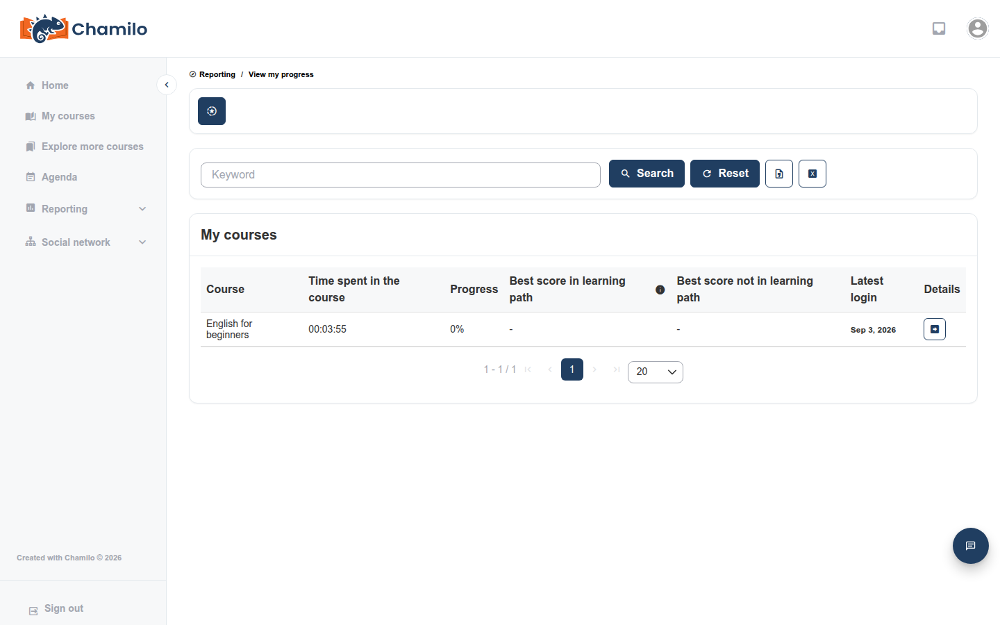
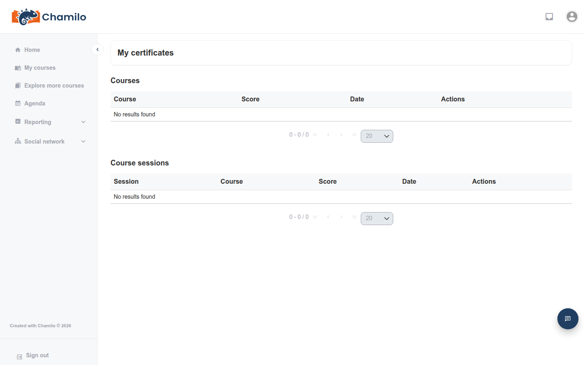

# Mi progreso

**Mi progreso** le ofrece una visión general única y rápida de su actividad y sus resultados en todos los cursos en los que está inscrito: no es necesario abrir cada curso por separado para comprobar su situación.

## Cómo acceder

Haga clic en **Informes**  en la barra lateral para expandirlo y, a continuación, haga clic en **Progreso**. Esta es su vista personal: solo muestra sus propios datos, nunca los de sus compañeros.

## Qué verá

Una tabla que enumera todos los cursos en los que está inscrito, con:

* **Tiempo dedicado al curso**
* **Progreso**: el porcentaje de finalización de su itinerario de aprendizaje
* **Mejor puntuación en el itinerario de aprendizaje** y **mejor puntuación fuera del itinerario de aprendizaje**: sus mejores resultados, diferenciados según si proceden de una prueba integrada en un itinerario de aprendizaje o de una independiente
* **Último acceso**: la última vez que accedió a ese curso

Haga clic en el botón **Detalles** junto a cualquier curso para expandir tres subtablas sin salir de la página:

* **Pruebas**: sus intentos, la mejor puntuación y la clasificación entre compañeros (si su docente muestra las clasificaciones)
* **Itinerarios de aprendizaje**: tiempo dedicado, progreso y puntuación de cada uno
* **Competencias adquiridas**: las insignias de competencia que haya obtenido en ese curso

## Sus certificados

Los certificados no forman parte de esta página: encuéntrelos en **Mis certificados**, en el menú de su avatar, en la parte superior derecha de la pantalla. Enumera todos los cursos y sesiones en los que ha obtenido un certificado, con la puntuación, la fecha y botones para **verlo** o **descargarlo**.

El menú de su avatar también incluye un enlace **Mis competencias**, que enumera las insignias de competencia que se le han otorgado, independiente de las dos páginas anteriores.

## En otras partes de un curso

Algunas cifras relacionadas se encuentran dentro del propio curso y no aquí:

* La herramienta **Evaluaciones** (libro de calificaciones) muestra su propia puntuación en ese curso y, a veces, su clasificación, la mejor puntuación y la media de la clase, si su docente ha habilitado ese nivel de detalle.
* Desde los resultados de su libro de calificaciones, también puede encontrar una opción **Exportar insignias** para las competencias que haya obtenido.

## Consejos

* **Consulte «Mi progreso» antes de una reunión con un docente**: es la forma más rápida de ver su situación en todos sus cursos a la vez.
* **El tiempo dedicado y el progreso no son lo mismo**: puede dedicar mucho tiempo sin avanzar mucho, o viceversa; utilice ambos conjuntamente para valorar su rendimiento.
* **Los certificados están en otro menú**: recuerde consultar el enlace «Mis certificados» de su avatar, no esta página, cuando busque un certificado.