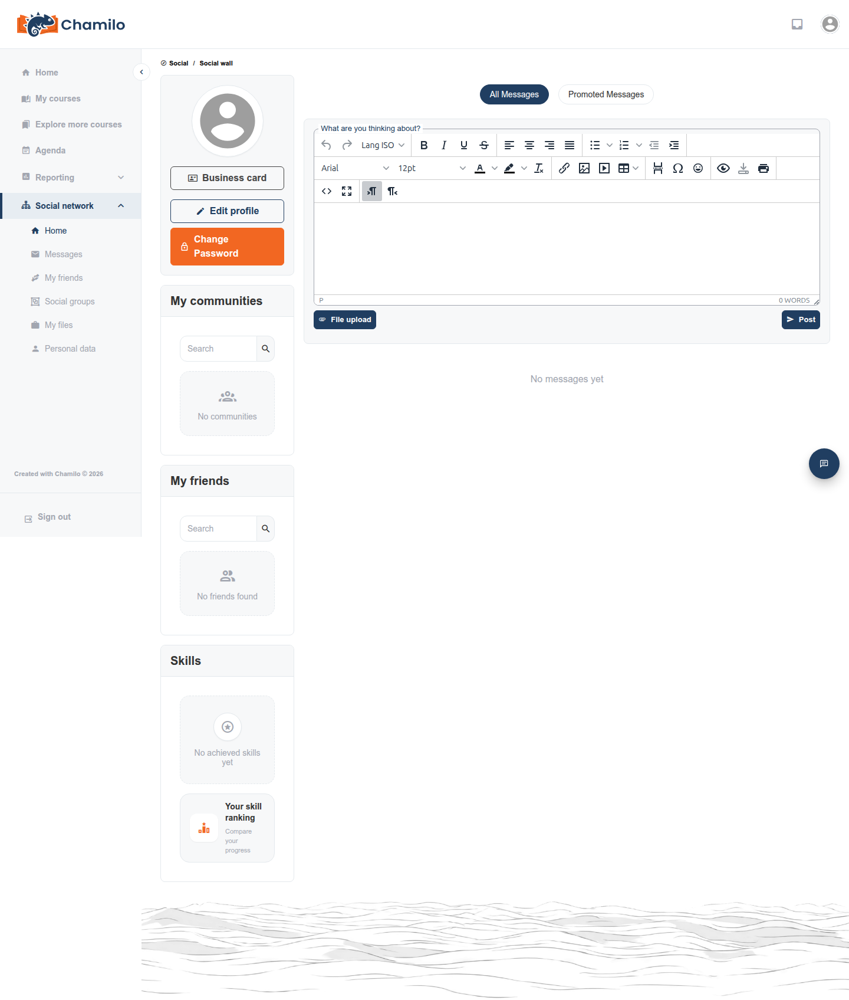

# Red social

Chamilo incluye una red social integrada para conectar con otros usuarios de la plataforma, independiente de cualquier curso concreto. Que tenga acceso a ella depende por completo de su administrador: está activada de forma predeterminada, pero puede desactivarse en toda la plataforma.

## Si tiene acceso

Haga clic en **Red social**  en la barra lateral para expandirla y, a continuación, haga clic en **Inicio**. Si esta opción no aparece en absoluto, su administrador la ha desactivado en su plataforma: no falta nada por su parte.

La misma sección expandida también muestra **Mensajes**, **Mis amigos**, **Grupos sociales** y, de forma un tanto inesperada, **Mis archivos** (su almacenamiento personal de archivos) y **Datos personales** (una exportación de los datos personales que la plataforma conserva sobre usted). Estos dos últimos no son funciones sociales; simplemente están agrupados en esta parte de la barra lateral.

## Su muro social

Una vez dentro, su **muro** muestra un feed de actividad suya y de las personas con las que está conectado. Puede publicar actualizaciones y, si su administrador lo ha habilitado, indicar que le gusta o no le gusta, y comentar las publicaciones de sus contactos.

## Conectar con otros

Puede buscar a otros usuarios y enviarles una solicitud de conexión. Como **estudiante, solo puede conectar con otros estudiantes**: no puede enviar una solicitud de conexión a un docente. Un docente, en cambio, sí puede enviarle una a usted. En algunas plataformas, el administrador configura que los docentes aparezcan automáticamente como amigos de cada estudiante, sin que ninguna de las partes tenga que solicitarlo: si ve docentes ya listados como contactos sin haberlo pedido, esta es la razón.

## Mensajería desde la red social

Las publicaciones y las conexiones son el aspecto social; enviar un mensaje privado a alguien se gestiona mediante la [Bandeja de entrada](inbox.md) independiente de la plataforma: la red social enlaza con ella en lugar de disponer de un sistema de mensajería propio.

## Chat flotante y videollamadas

El panel de chat flotante es una función de mensajería en tiempo real independiente de la [Bandeja de entrada](inbox.md) y de la herramienta Chat propia de un curso. Seleccione un contacto en línea para chatear directamente.

Si su administrador ha habilitado el chat de vídeo y su navegador admite WebRTC, un contacto en línea también puede mostrar **Iniciar videollamada**. Las llamadas son individuales: una llamada entrante puede **Aceptarse** o **Rechazarse** y, durante la llamada, puede silenciar el micrófono, activar o desactivar la cámara, o colgar. Su navegador puede solicitar permiso para la cámara y el micrófono.

Si no se muestra la acción de vídeo, es posible que el administrador haya desactivado la función, que el otro usuario esté desconectado o que el navegador no admita las API multimedia necesarias.

## Grupos sociales

Puede unirse a **grupos sociales** existentes creados en torno a intereses compartidos y, si su administrador permite que los estudiantes creen grupos, iniciar el suyo propio. Los grupos sociales son de ámbito de plataforma y no guardan relación con la herramienta **Grupos** propia de un curso (véase [Orientarse en un curso](courses/course-tools-overview.md)); unirse a un grupo social o publicar en él no tiene ningún efecto sobre ningún curso en el que esté inscrito.

## Consejos

* **No espere añadir usted mismo a un docente como amigo**: solo funciona en sentido inverso, salvo que su administrador haya configurado conexiones automáticas.
* **Los grupos sociales y los grupos de curso no están relacionados**: no confunda un grupo de proyecto de un curso con un grupo de la red social que tenga el mismo nombre.
* **¿No ve las opciones de me gusta o no me gusta?** Su administrador puede habilitar, o desactivar parcialmente (conservando solo «me gusta»), esa función en toda la plataforma.