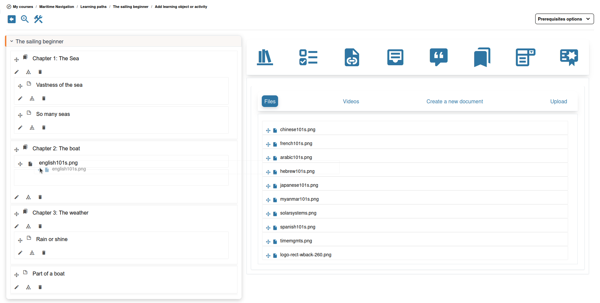
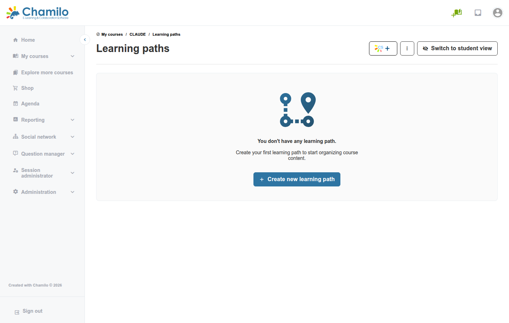
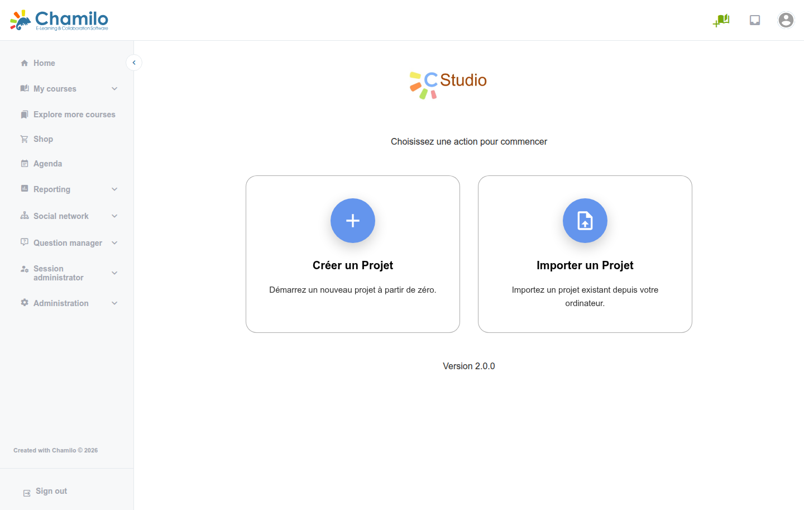
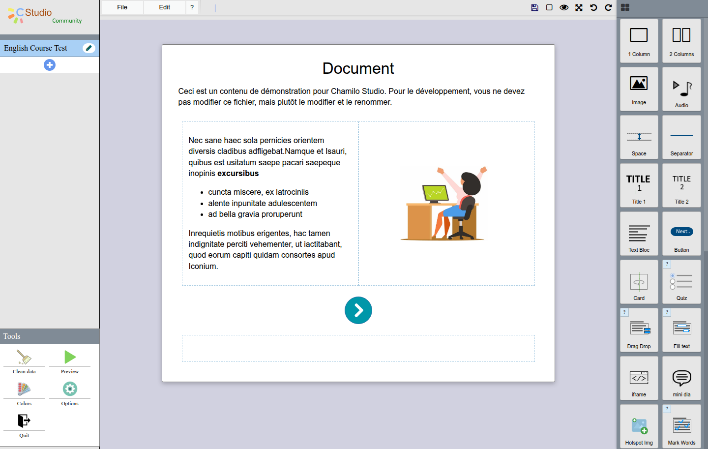
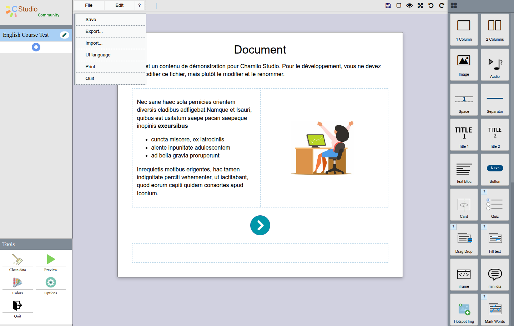

# Rutas de aprendizaje

Las rutas de aprendizaje permiten crear secuencias estructuradas de actividades de aprendizaje. Una ruta de aprendizaje guía a los estudiantes a través de un orden específico de documentos, ejercicios, enlaces y otros recursos, con requisitos previos opcionales y seguimiento del progreso.

Esta herramienta es, posiblemente, la herramienta del curso más utilizada, porque actúa como un compositor de muchas otras herramientas y puede ser, en gran medida, la ***única*** herramienta visible para los estudiantes.

## ¿Por qué usar rutas de aprendizaje?

Las rutas de aprendizaje son útiles cuando se desea:

* **Controlar el orden** de consumo del contenido: garantizar que los estudiantes completen el material fundamental antes de avanzar
* **Seguir el progreso**: ver exactamente en qué punto de la secuencia se encuentra cada estudiante
* **Establecer requisitos previos**: exigir que los estudiantes aprueben un ejercicio antes de acceder a la sección siguiente
* **Otorgar la finalización**: vincular la finalización de la ruta de aprendizaje con el libro de calificaciones y los certificados
* **Empaquetar el contenido**: crear módulos de aprendizaje autónomos que los estudiantes puedan recorrer a su propio ritmo

## Crear una ruta de aprendizaje

1. Abra la herramienta **Rutas de aprendizaje**  desde la página de inicio del curso
2. Haga clic en **Crear una ruta de aprendizaje**
3. Introduzca un **título** y una descripción opcional
4. Guarde: se le llevará al editor de la ruta de aprendizaje

## El editor de rutas de aprendizaje

El editor tiene dos áreas principales:

* **Panel izquierdo**: la lista de elementos (pasos) de la ruta de aprendizaje, mostrada como una estructura de árbol
* **Panel derecho**: el contenido del elemento seleccionado

### Añadir elementos

Haga clic en **Añadir un elemento** y elija qué añadir:

| Tipo de elemento | Descripción |
|-----------|-------------|
| **Sección** | Un encabezado que agrupa elementos relacionados (como el título de un capítulo). Las secciones no contienen contenido por sí mismas. |
| **Documento** | Un archivo o una página web de la herramienta Documentos del curso |
| **Ejercicio** | Un cuestionario o una prueba de la herramienta Ejercicios |
| **Enlace** | Una URL externa |
| **Tarea** | Una publicación de estudiante de la herramienta Tareas |
| **Foro** | Un enlace a un foro del curso |
| **Encuesta** | Un enlace a una encuesta |
| **Certificado** | Una página especial para activar la generación de un certificado de finalización o la concesión de competencias |

### Organizar elementos

* **Arrastre y suelte** los elementos para reordenarlos
* **Anide elementos** bajo secciones arrastrándolos hacia la derecha
* **Elimine** los elementos que ya no necesite

### Establecer requisitos previos

Los requisitos previos garantizan que los estudiantes completen determinados pasos antes de acceder a otros:

1. Seleccione un elemento de la ruta de aprendizaje
2. Abra su configuración de **requisitos previos**
3. Elija qué elemento o elementos precedentes deben completarse primero
4. En el caso de los ejercicios, puede exigir una **puntuación mínima** (por ejemplo, «Debe obtener al menos un 70 % en el Cuestionario 1 antes de acceder al Módulo 2»)

### Editar elementos existentes y enlaces antiguos

Utilice el **Editor de rutas de aprendizaje** (el constructor Vue) para editar un paso, ajustar sus requisitos previos, moverlo en el árbol o eliminarlo. Seleccione un elemento y utilice **Editar** para abrir su formulario (en el caso de elementos de prueba vinculados, la edición puede abrir la herramienta Ejercicios); utilice **Requisitos previos** para cambiar sus condiciones de acceso, arrastre los elementos para cambiar su orden y utilice la acción de eliminación (con confirmación) para quitar un elemento. Estos cambios requieren permiso para editar la ruta de aprendizaje en su curso.

Los marcadores o las integraciones más antiguos pueden seguir apuntando a `public/main/lp/lp_controller.php` con una acción de elemento como `edit_item`, `edit_item_prereq`, `move_item`, `delete_item` o `deleteitem`. Estas acciones ahora **redirigen al constructor Vue en lugar de modificar el elemento**. Un enlace de elemento válido puede seleccionar el elemento y abrir el panel de edición o de requisitos previos; un enlace anterior de movimiento o eliminación solo abre el constructor, de modo que el docente debe completar esa acción allí. Si un enlace no abre el elemento previsto, vaya a la ruta de aprendizaje desde su curso actual y selecciónela manualmente.

## Experiencia del estudiante

Cuando un estudiante abre una ruta de aprendizaje:

* Ve la lista de elementos en el panel izquierdo
* Los elementos completados se marcan con una marca de verificación
* Los elementos cuyos requisitos previos no se han cumplido están bloqueados
* El progreso se registra automáticamente: si un estudiante sale y vuelve, reanuda donde lo dejó
* Una barra de progreso muestra el porcentaje global de finalización

### Enlaces externos que no se pueden incrustar

Un paso de **Enlace** externo normalmente se abre dentro de la ruta de aprendizaje cuando el sitio web de destino permite la incrustación. Algunos sitios impiden mostrarse en un iframe mediante `X-Frame-Options` o una Content Security Policy (`frame-ancestors`); una página HTTPS de Chamilo tampoco puede incrustar una página HTTP no segura en este flujo.

Cuando Chamilo detecta que un enlace externo no se puede incrustar, el reproductor muestra **Este enlace no se puede mostrar dentro de la ruta de aprendizaje** con un enlace **Abrir en una pestaña nueva**. El estudiante puede usar ese enlace para ver la página por separado y volver después a la ruta de aprendizaje. No intente eludir las restricciones de incrustación de otro sitio.

Que una página remota se pueda incrustar depende de sus propias cabeceras de respuesta y de la disponibilidad de la red. Esta alternativa se añadió en [PR #9164](https://github.com/chamilo/chamilo-lms/pull/9164).

### Pasos de foro y navegación de la discusión

Cuando una ruta de aprendizaje incluye una discusión de **Foro**, los estudiantes leen sus respuestas con las publicaciones más recientes primero, permaneciendo en el contexto de la ruta de aprendizaje. Los botones de retroceso específicos del foro se ocultan en esa vista, así que use los controles de la ruta de aprendizaje para continuar al siguiente paso. Fuera de la ruta de aprendizaje, el mismo hilo conserva la navegación estándar de Foros y la visualización cronológica. Consulte [Foros](../collaboration-and-communication/forums.md#forum-discussions-inside-a-learning-path) ([PR #9163](https://github.com/chamilo/chamilo-lms/pull/9163)).

## Contenido SCORM

La herramienta de rutas de aprendizaje de Chamilo puede importar paquetes **SCORM 1.2** — el estándar de e-learning más utilizado — y, con soporte parcial, paquetes **SCORM 2004**. Cargue un archivo ZIP de SCORM y Chamilo creará una ruta de aprendizaje a partir de él, registrando el progreso y las puntuaciones según la especificación SCORM.


**El soporte de SCORM 2004 es parcial.** El contenido, el progreso y el registro de puntuaciones funcionan, pero las *reglas de secuenciación y navegación* de SCORM 2004 (que controlan el orden en el que un estudiante puede visitar el contenido) no se aplican. Los estudiantes pueden avanzar libremente por la ruta de aprendizaje, como en cualquier otra ruta de aprendizaje. Use los [prerrequisitos](#setting-prerequisites) propios de Chamilo si necesita imponer un orden.


Para importar un paquete SCORM:

1. En la herramienta **Rutas de aprendizaje**, haga clic en el botón **⋮** (más acciones) en la parte superior derecha de la página y, a continuación, haga clic en **Importar**

   

2. Haga clic en **Elegir archivo** y seleccione el archivo `.zip` de SCORM. No lo descomprima antes: Chamilo espera el paquete exactamente como lo exportó su herramienta de autoría.
3. Opcionalmente, ajuste la configuración (véase más abajo) y, a continuación, haga clic en **Importar**

   

4. Chamilo descomprime el paquete y crea la ruta de aprendizaje automáticamente. Aparece en la lista de rutas de aprendizaje, donde puede editar su título, visibilidad y otros ajustes como en cualquier otra ruta de aprendizaje.

| Configuración | Efecto |
| --- | --- |
| **Usar la puntuación máxima predeterminada de 100** | Activada de forma predeterminada. Déjela activada salvo que tenga un motivo específico para cambiar cómo se gestiona la puntuación máxima del paquete. |
| **Contenido** (avanzado) | **Local** es el valor predeterminado y significa que el paquete se almacena en su servidor de Chamilo. Déjelo así para una carga normal. |
| **Autoría** (avanzado) | Una etiqueta que registra qué herramienta creó el paquete. El valor predeterminado (`Scorm`) es adecuado para la mayoría de los paquetes. |

### Paquetes CMI5 / xAPI

Los paquetes CMI5 (el sucesor moderno de SCORM basado en xAPI) se admiten a través del complemento **XApi**. Una vez que el administrador habilita el complemento, puede importar un paquete CMI5 y los estudiantes pueden iniciarlo desde el curso; sus declaraciones se reenvían al Learning Record Store configurado.

## Creación de contenido con C-Studio

*Disponible si el administrador ha habilitado el complemento C-Studio.*

C-Studio añade un editor visual integrado de arrastrar y soltar para crear contenido interactivo directamente dentro de una ruta de aprendizaje: una alternativa a importar un paquete SCORM cuando no dispone de (o no desea aprender) una herramienta de autoría independiente como Articulate o iSpring. Usted crea el contenido página a página directamente en Chamilo, y se almacena y se registra como cualquier otro elemento de la ruta de aprendizaje.

### Iniciar un proyecto de C-Studio

Cuando el complemento está activo, la lista de itinerarios de aprendizaje muestra un botón adicional junto al menú de acciones habitual, marcado con un «+» y una información sobre herramientas «Studio Tools»:

Haga clic en él para comenzar. Se le pedirá que cree un proyecto nuevo desde cero o que importe uno existente:

Esta pantalla en particular solo está disponible actualmente en francés, independientemente del idioma de su plataforma o de su curso: una limitación conocida de la versión del complemento en uso. Asigne un título a su proyecto y se abrirá directamente en el editor.

### El editor

El editor es un constructor visual página por página:

* **Panel izquierdo**: las páginas de su proyecto, con un «+» para añadir más, y una sección **Tools** en la parte inferior (Clean data, Preview, Colors, Options, Quit)
* **Lienzo central**: la página que está construyendo; haga clic en cualquier elemento para editarlo in situ
* **Panel derecho**: la paleta de componentes, que se arrastra hasta el lienzo

La paleta incluye bloques de construcción básicos (columnas, imágenes, audio, títulos, texto, botones, tarjetas), así como varios tipos de ejercicios interactivos: **Drag Drop**, **Fill text**, **Hotspot Img**, **Mark Words**, **Find Words** y **Sort paragraphs**, además de un bloque **iframe** para incrustar contenido externo y un bloque **Quiz**.

### Idioma

La interfaz propia de C-Studio puede aparecer por defecto en francés la primera vez que la abre, con independencia del idioma de la interfaz de Chamilo o del idioma del curso. Si es así, vaya a **File > UI language** y elija su idioma: el editor se recarga de inmediato y recuerda su elección a partir de entonces.

### Guardar y exportar

Utilice **File > Save** mientras trabaja. **File > Export...** empaqueta su proyecto como un archivo SCORM que puede descargar, respaldar o reutilizar en otro lugar mediante **Import...**. **File > Quit** le devuelve a la lista de itinerarios de aprendizaje, donde su proyecto de C-Studio aparece ahora como un elemento normal.

## Configuración del itinerario de aprendizaje

Configure el comportamiento del itinerario de aprendizaje:

| Configuración | Descripción |
|---------|-------------|
| **Visibilidad** | Ocultar o mostrar el itinerario de aprendizaje a los estudiantes |
| **Prerrequisitos** | Exigir la finalización de otros itinerarios de aprendizaje antes de este |
| **Inicio automático** | Abrir automáticamente este itinerario de aprendizaje cuando los estudiantes entren en el curso |
| **Tiempo SCORM acumulado** | Si se acumula el tiempo a lo largo de varias sesiones |

## Vinculación con el libro de calificaciones

Puede incluir la finalización del itinerario de aprendizaje como una actividad calificada en el libro de calificaciones. Esto permite que el progreso en el itinerario de aprendizaje contribuya a la calificación global del curso del estudiante y a su elegibilidad para el certificado.

## Uso de la IA

Si el administrador ha habilitado la generación de itinerarios de aprendizaje asistida por IA, encontrará una opción de generador de IA en el menú desplegable de acciones. Proporcione a la IA un contexto tan preciso como desee para su itinerario de aprendizaje, solicite un número de páginas y un número aproximado de palabras por página, indíquele si desea completarlo con pruebas y, a continuación, inícielo. Unos minutos después, tendrá ante sí un itinerario de aprendizaje completo basado en texto.

Edite los documentos para generar ilustraciones con más IA y solo le quedará realizar una revisión antes de poder compartirlo con sus estudiantes.

### Asistente de estudio con IA para los estudiantes

Cuando está habilitada la configuración global `ai_helpers.enable_ai_helpers`, los estudiantes pueden utilizar un **asistente de estudio con IA** mientras leen un elemento de documento en el reproductor normal del itinerario de aprendizaje. Seleccionan un pasaje de texto, abren la pequeña acción del asistente de IA que aparece junto a la selección, eligen una **técnica de aprendizaje** y hacen clic en **Generate**.

Las técnicas disponibles incluyen mapas mentales, la técnica de Feynman, la interrogación elaborativa, la repetición espaciada, SQ3R, analogías y metáforas, la codificación dual, la narración de historias, las conexiones temáticas, el aprendizaje intercalado y los palacios de la memoria. La explicación generada se basa en el pasaje seleccionado y utiliza el contexto de idioma del curso y del usuario.

El asistente solo está disponible para elementos de documento en el tiempo de ejecución habitual; no se muestra en los informes ni en el modo Impress.

## Consejos

* **Empiece con un esquema** — Planifique las secciones y los elementos antes de construir la ruta
* **Utilice las secciones como capítulos** — Agrupe los elementos relacionados bajo encabezados de sección para mayor claridad
* **Establezca prerrequisitos para las evaluaciones** — Exija que los estudiantes estudien el contenido antes de realizar un cuestionario
* **Combine tipos de contenido** — Combine materiales de lectura, vídeos, ejercicios interactivos y recursos externos para una experiencia de aprendizaje atractiva
* **Compruebe la vista del estudiante** — Utilice la función Vista de estudiante para experimentar la ruta de aprendizaje como lo haría un estudiante
* **Utilice SCORM para la interactividad** — Si tiene acceso a herramientas de autoría SCORM (como Articulate, iSpring o similares), cree contenido interactivo enriquecido e impórtelo en Chamilo. Si su administrador ha habilitado el plugin C-Studio, puede crear contenido interactivo similar directamente en Chamilo — consulte [Creación de contenido con C-Studio](#content-authoring-with-c-studio) más arriba