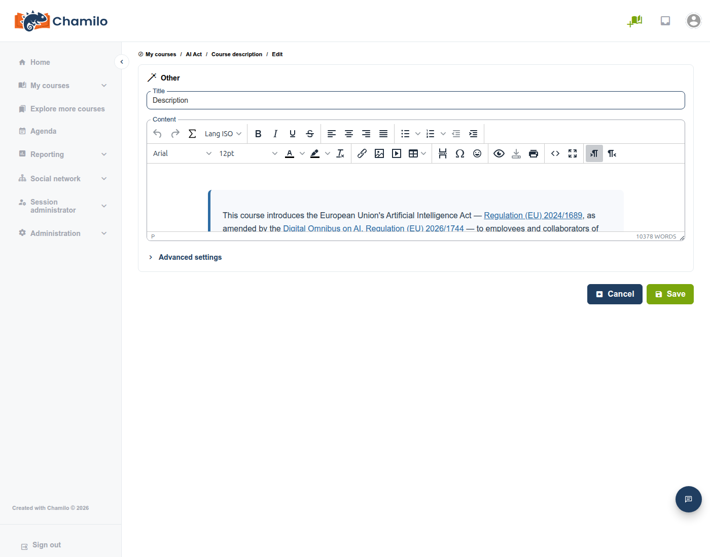
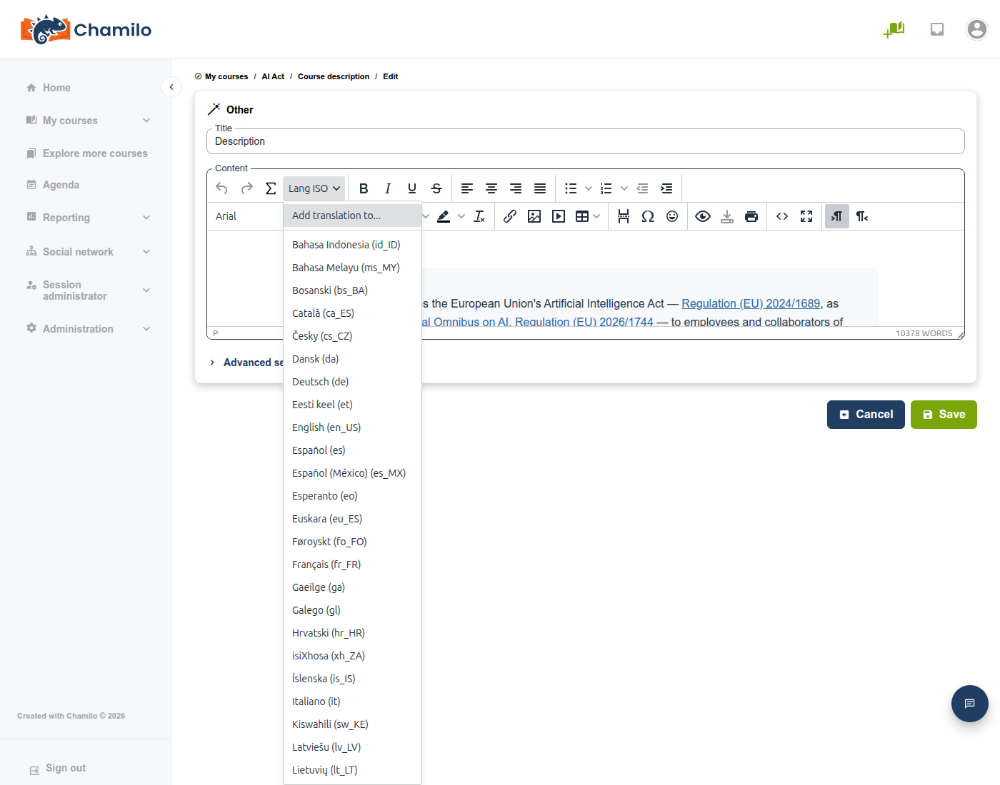
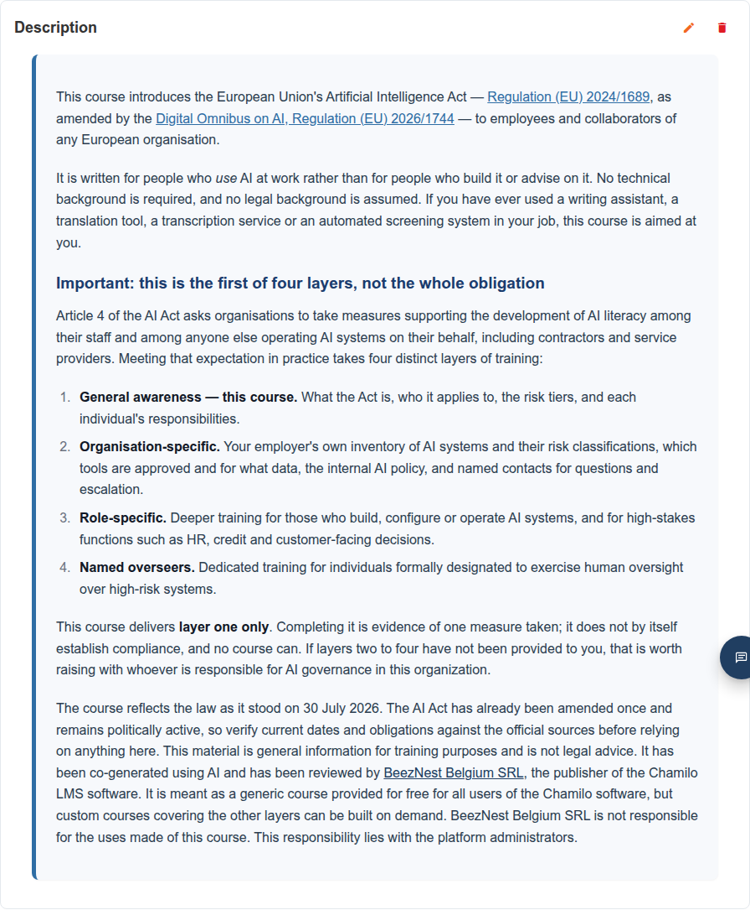
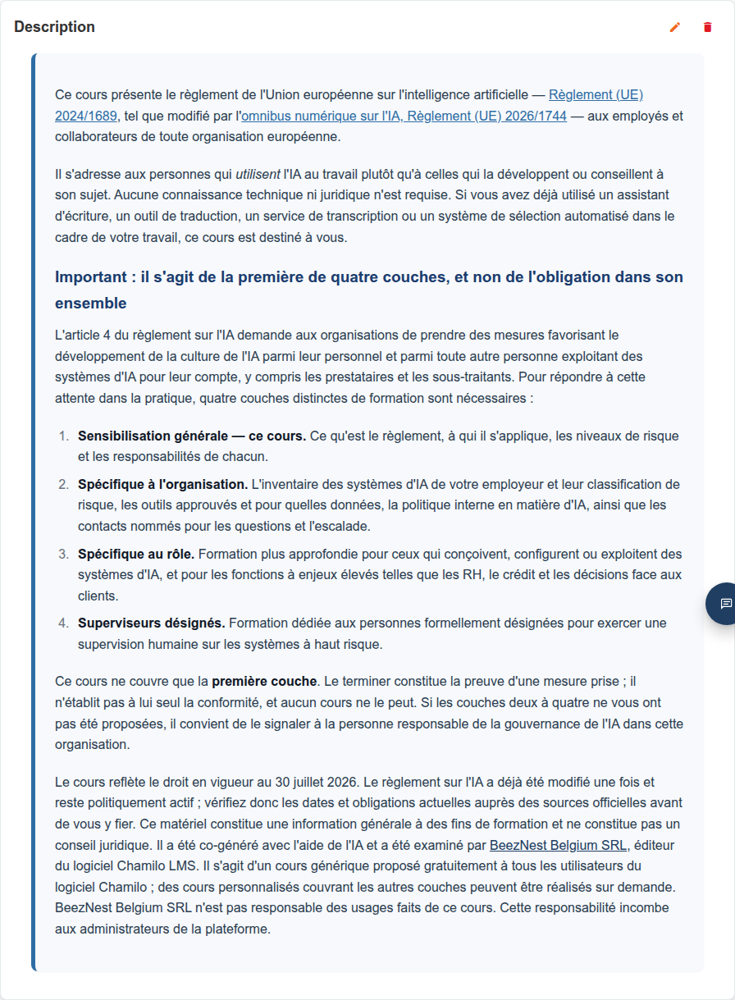
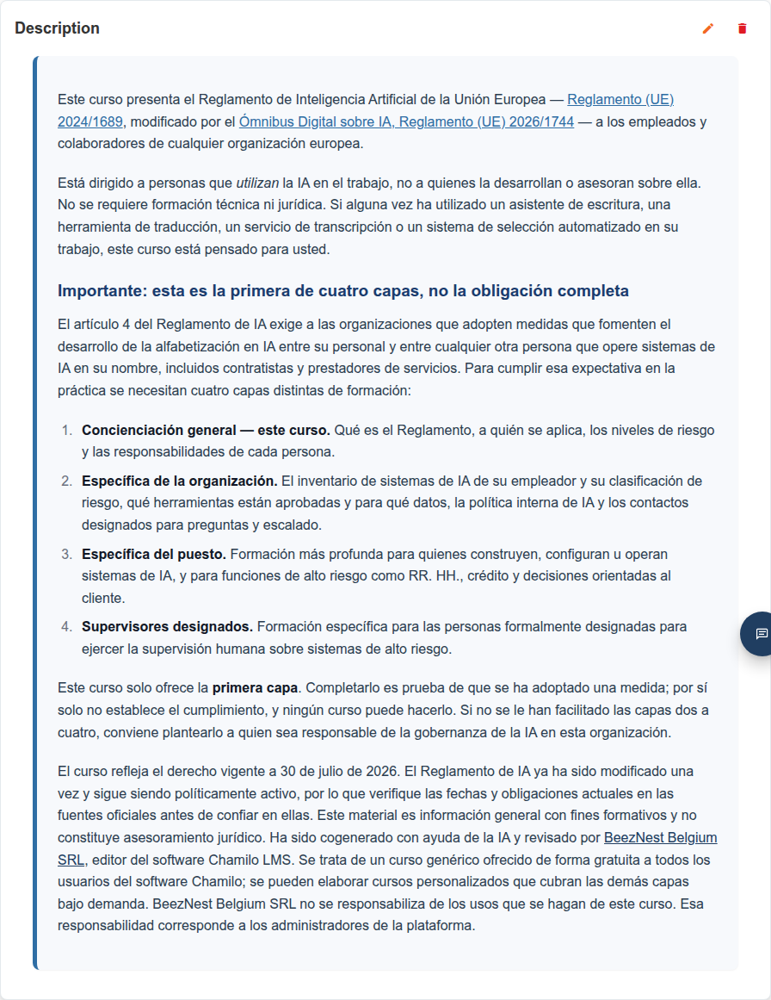
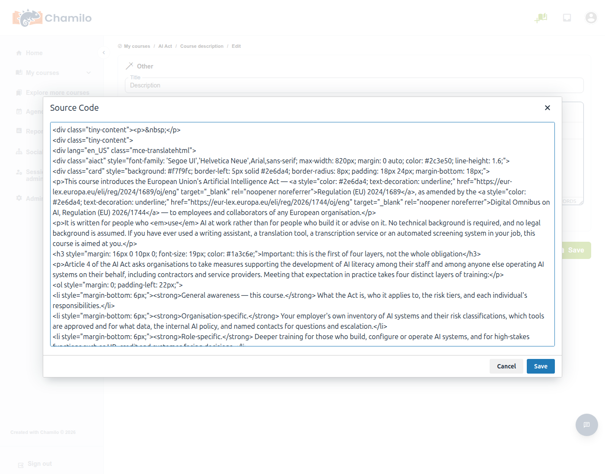

# Contenido multilingüe

Chamilo permite escribir **varias versiones lingüísticas del mismo contenido en un único campo** — una sección de la descripción del curso, un documento, una pregunta de un test, una encuesta — y hacer que cada estudiante vea automáticamente solo la versión escrita en su propio idioma. Esta es la función **translate_html**, denominada así por el ajuste de la plataforma que la controla.

Implica a tres personas distintas, cada una de las cuales ve un aspecto diferente:

* **El administrador** debe activar la función en toda la plataforma antes de que nadie pueda usarla.
* **Usted (el docente)** escribe las distintas versiones lingüísticas mediante un botón del editor de texto enriquecido.
* **El estudiante** se beneficia de ella sin saber siquiera que existe: simplemente ve el contenido en su propio idioma, sin ningún ajuste que buscar o activar.

## Activación de la función

Esta es una tarea del administrador, no del docente. En **Administración > Ajustes de configuración > Editor**, el ajuste **Compatibilidad con contenido HTML multilingüe** (`translate_html`) debe estar activado. Si no ve el botón **Lang ISO** descrito más abajo en la barra de herramientas del editor, esta es casi con toda seguridad la causa: consulte a su administrador. Consulte [Ajustes del editor](../../admin-guide/platform-settings/editor-settings.md) para la referencia completa de los ajustes. A partir de la versión 3.0.0, este ajuste está activado de forma predeterminada (no lo estaba antes de esta versión), salvo que haya actualizado desde una versión anterior en la que el ajuste estuviera desactivado.

Desactivar de nuevo este ajuste no elimina ni daña ningún contenido ya escrito de esta forma; consulte [Qué ven los estudiantes](#what-learners-see) más abajo.

## Redacción de contenido multilingüe

La función está disponible en cualquier lugar donde disponga del editor de texto enriquecido completo: secciones de la [descripción del curso](../creating-your-course/course-description.md), [documentos](documents.md), preguntas de tests y encuestas, y más.

1. Escriba (o pegue) el contenido en su idioma predeterminado, como de costumbre.
2. Seleccione ese texto y, a continuación, haga clic en el botón **Lang ISO** de la barra de herramientas del editor.

3. En el menú, elija el idioma en el que acaba de escribir: la lista incluye todos los idiomas activos en su plataforma. Si el que necesita no aparece, use **Custom Chamilo ISO code...** al final e introdúzcalo (p. ej., `en_US`, `fr_FR`, `es`).

4. Chamilo envuelve la selección con esa etiqueta de idioma. Ahora escriba (o pegue) la versión del siguiente idioma justo después, selecciónela y repita el proceso con un idioma distinto.

Continúe con tantos idiomas como desee cubrir. Todos conviven en el mismo campo: mientras edita, verá cada versión lingüística una tras otra; solo cuando alguien *visualiza* realmente la página, Chamilo oculta todo excepto el idioma que le corresponde (véase más abajo).

### Traducción asistida por IA

Si el administrador ha configurado un proveedor de texto de IA, el mismo menú **Lang ISO** ofrece también **Add translation to...** en la parte superior. Esto envía el contenido existente al modelo de IA configurado e inserta un nuevo bloque traducido automáticamente en el idioma que elija (o en todos los idiomas restantes a la vez, si la plataforma lo permite): no tiene que escribirlo usted mismo. Los bloques de idioma existentes no se modifican, y los idiomas ya presentes se excluyen de la lista, de modo que usarlo repetidamente no crea duplicados.

Como con cualquier contenido generado por IA, revise el resultado: es una forma rápida de obtener un primer borrador sólido en un idioma que quizá no hable, no un sustituto de la revisión.

## Qué ven los estudiantes

Cada estudiante ve exactamente una versión lingüística: Chamilo prueba primero el idioma del perfil del estudiante; si ninguno de sus bloques coincide, recurre al idioma del propio curso y, después, al idioma predeterminado de la plataforma; si ninguno de ellos coincide tampoco, muestra el idioma que haya escrito primero, en lugar de dejar el contenido en blanco. Todo esto ocurre de forma automática: el estudiante no tiene nada que configurar, y usted tampoco tiene nada que configurar por estudiante.

Esta es la misma sección de la descripción del curso, tal como la ven tres estudiantes con distintos idiomas de interfaz: nada más del curso cambió entre estas tres capturas, solo el idioma del propio espectador:

### Bajo el capó

Si alguna vez abre la vista de **Código fuente** de un campo multilingüe (el botón `<>` de la barra de herramientas del editor), verá cada versión lingüística envuelta de esta forma:

Cada versión está envuelta en un `
` (o un ``, para una frase breve en línea en lugar de un bloque completo): ese atributo `lang` es lo que Chamilo compara con el idioma del visor para decidir qué mostrar. Conviene reconocer este nombre de clase concreto si alguna vez inspecciona el código fuente de la página o soluciona problemas de contenido que se ve incorrecto: **`mce-translatehtml`** es el marcador que debe buscar.

Esto también explica por qué desactivar `translate_html` en la configuración de la plataforma no rompe nada de lo ya escrito: el ajuste solo controla si el botón de *autoría* **Lang ISO** aparece en el editor. El filtrado del *lado de visualización* descrito anteriormente se ejecuta de forma incondicional, de modo que el contenido multilingüe escrito previamente sigue filtrándose correctamente para cada visor, incluso en una plataforma en la que un administrador haya desactivado posteriormente el botón de autoría.

## Los títulos no funcionan de esta manera

El título de un curso, el título de un documento, el título de un test: son campos de texto plano, no de texto enriquecido, por lo que no pueden contener el marcado etiquetado con `lang` descrito anteriormente. Permanecen como un único valor neutro, independientemente de quién los consulte, por muchas versiones lingüísticas que haya escrito en el contenido subyacente.

La única excepción: si su administrador ha activado **Guardar títulos como HTML** (`save_titles_as_html`, también en **Administración > Parámetros de configuración > Editor**) para el campo de título concreto con el que está trabajando, ese campo se convierte también en un campo HTML real, y se le puede aplicar la misma técnica de **Lang ISO** descrita anteriormente. Esto es poco habitual y se usa sobre todo en las preguntas de los tests: la mayoría de los títulos de la plataforma siguen siendo texto plano.

## Consejos

* **Mantenga el idioma de origen en primer lugar**: coloque primero en el campo el idioma más habitual de su plataforma; es la alternativa más natural si más adelante olvida etiquetar un idioma menos frecuente.
* **No anide bloques de idioma**: escriba cada versión como un bloque independiente y secuencial; anidar uno dentro de otro no está admitido y el editor desanida activamente los marcadores anidados cuando inserta uno nuevo.
* **Una sección que parece vacía en un idioma** suele significar que nunca se etiquetó ningún bloque para ese idioma (ni para su alternativa ampliada de curso o de idioma predeterminado de la plataforma): compruebe en la vista de código fuente los idiomas realmente presentes.