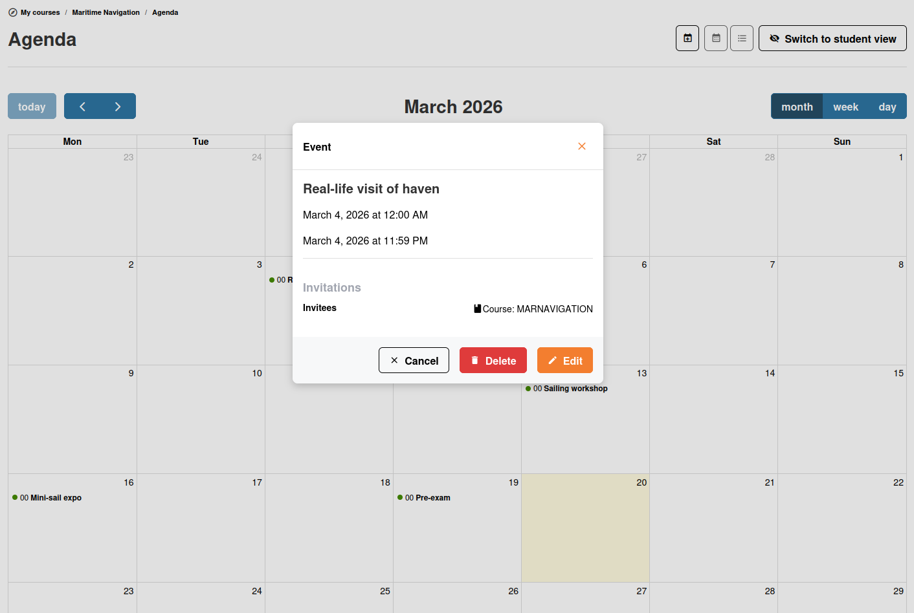
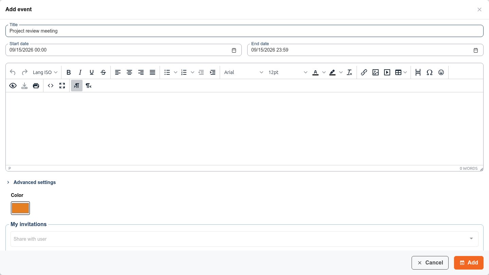
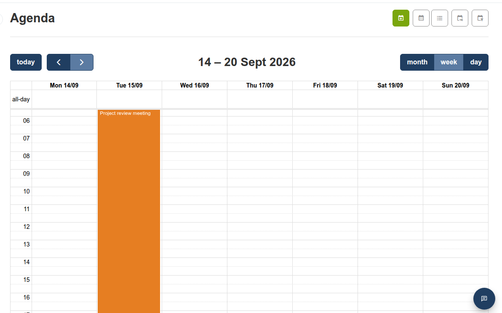

# Agenda

La herramienta de agenda le permite programar eventos y fechas límite dentro de su curso. Los eventos aparecen en un calendario que sus estudiantes pueden consultar.

## Visualización de la agenda

Abra la herramienta **Agenda**  desde la página de inicio del curso. Puede ver los eventos en tres modos:

* **Vista de calendario** — Un calendario visual mensual, semanal o diario
* **Vista de lista** — Los eventos se muestran como una lista cronológica
* **Eventos personales** — Filtre para ver solo los eventos que le conciernen

## Creación de un evento

1. Haga clic en **Añadir evento** 
2. Complete los datos del evento:
   * **Título** — Un nombre breve para el evento
   * **Fecha y hora de inicio**
   * **Fecha y hora de finalización**
   * **Descripción** — Detalles adicionales (admite texto enriquecido)
   * **Archivos adjuntos** — Haga clic en **Añadir archivo adjunto** para adjuntar uno o varios archivos y, si lo desea, descríbalos en **Comentario del archivo**. Los estudiantes ven los archivos en los detalles del evento y pueden descargarlos, si el evento se les ha enviado. Para eliminar un archivo, edite el evento y haga clic en el icono de eliminación situado junto al archivo. Los archivos adjuntos solo están disponibles para los eventos del curso
   * **Comentario** — Una nota breve en texto sin formato, por ejemplo lo que los estudiantes deben llevar. Solo está disponible para los eventos del curso, y los estudiantes lo ven debajo de la descripción, en los detalles del evento y en la vista de lista
3. Elija el **público** en el campo **Enviar a**:
   * Déjelo vacío para enviar el evento a **todos** los participantes del curso (o del curso de la sesión actual)
   * Seleccione uno o varios **usuarios** y/o **grupos** del curso para enviar el evento solo a ellos. Un estudiante ve entonces el evento solo si se le envió a él o a uno de sus grupos; los docentes siempre ven todos los eventos del curso.

   Puede cambiar los destinatarios más adelante editando el evento. El campo **Enviar a** solo se muestra a los docentes, en la agenda de un curso; dentro de la agenda de un grupo, los eventos nuevos pertenecen siempre a ese grupo.
4. Opcionalmente, configure un **recordatorio**  para enviar notificaciones por correo electrónico antes del evento (un administrador debe configurar el *cron* del portal)
5. Opcionalmente, marque **Añadir un anuncio (Enviar correo)** para publicar también el evento como anuncio del curso, enviado por correo electrónico a los mismos destinatarios. El anuncio toma el título y la descripción del evento. Esta opción solo se muestra a los docentes cuando crean un evento del curso
6. Elija un **color** para el evento haciendo clic en la muestra de color. Este color se utiliza para resaltar el evento en todo el calendario (vistas de mes, semana y día), de modo que resulte fácil distinguir los eventos de un vistazo; por ejemplo, para diferenciar las fechas límite de las sesiones habituales, o los eventos de distintos cursos en su agenda personal.

   
7. Guardar

El color elegido se refleja entonces en todos los lugares donde aparece el evento en el calendario:

De forma predeterminada, los eventos nuevos reciben un color según su contexto (curso, sesión, personal o global), pero puede sustituirlo por cualquier color que desee.

## Gestión de eventos

* **Editar**  — Haga clic en un evento para modificar sus datos
* **Eliminar**  — Quite un evento del calendario
* **Arrastrar y soltar** — En la vista de calendario, arrastre los eventos para reprogramarlos

## Repetición de un evento

Al crear un evento del curso, marque **Repetir evento** y, a continuación, elija:

* **Tipo de repetición** — **Diaria**, **Semanal**, **Mensual, por fecha** o **Anual**
* **Fecha de fin de la repetición** — El último día en el que puede comenzar una repetición

La agenda crea entonces una copia del evento en cada repetición, con los mismos datos y los mismos destinatarios. Cada copia es un evento independiente: puede editarla o eliminarla por separado. Para eliminar toda la serie de una vez, haga clic en cualquier evento de la serie y, a continuación, en **Eliminar todos los elementos**.

Las opciones de repetición solo están disponibles al crear un evento del curso; no es posible añadir una repetición a un evento existente.

## Filtrado por destinatario

Como docente, utilice el selector **Filtro** situado encima de la agenda del curso para mostrar solo los eventos enviados a un usuario o a un grupo. Elija **Todos** (o borre el selector) para volver a ver todos los eventos. El filtro se aplica tanto a la vista de calendario como a la vista de lista, y se conserva al cambiar de una a otra.

## Agenda personal

También dispone de una **agenda personal** accesible desde la barra lateral. La agenda personal agrupa los eventos de todos sus cursos en una única vista. Aquí es donde los estudiantes ven su horario combinado de todos los cursos en los que están inscritos.

## Consejos

* **Establecer fechas límite** — Cree eventos para las fechas de entrega de las tareas y los plazos de los ejercicios para que los estudiantes puedan verlos en su calendario
* **Usar recordatorios** — Active los recordatorios por correo electrónico para los eventos importantes a fin de ayudar a los estudiantes a mantenerse al día
* **Coordinar con las sesiones** — Si imparte clase en varias sesiones, cada sesión tiene sus propios eventos, visibles solo para los estudiantes de esa sesión. Los docentes disponen de una función para ver los eventos (tareas, excursiones, etc.) de otros cursos de sus sesiones y evitar así sobrecargar a los estudiantes.