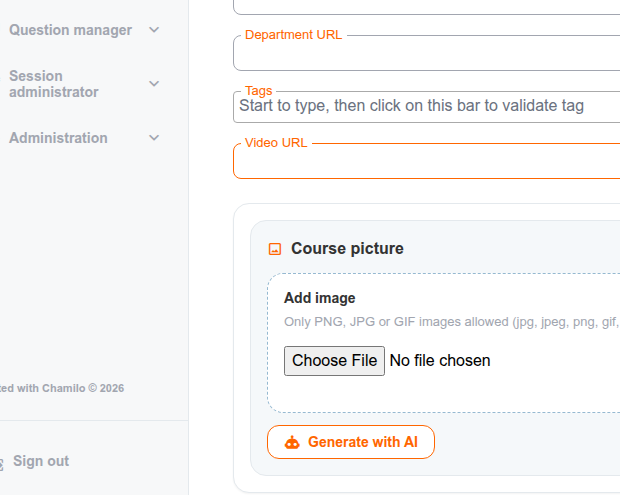
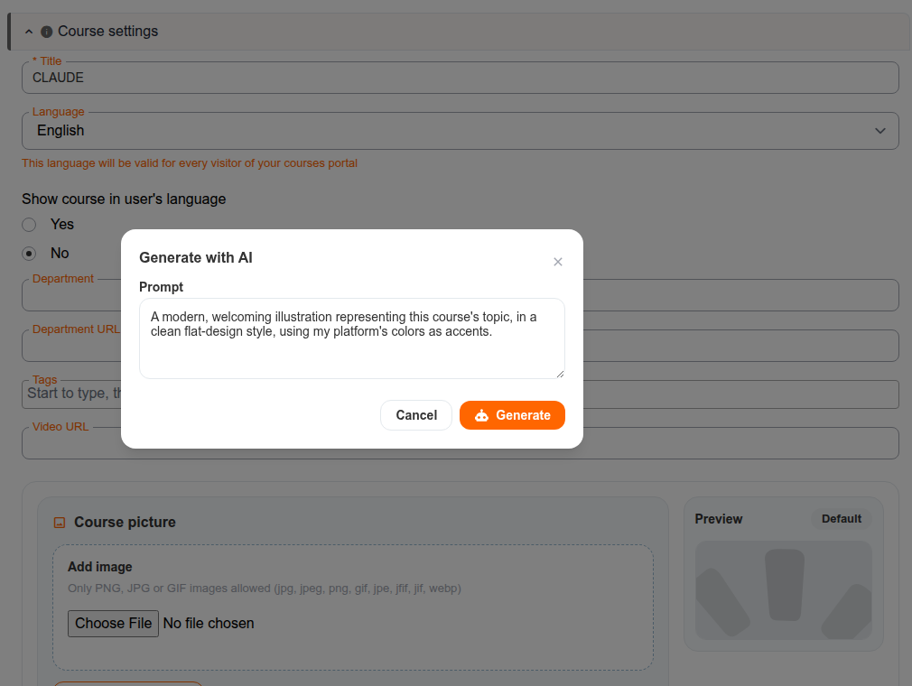

# Generador de imagen del curso

El generador de imágenes de curso con IA le permite crear una miniatura para su curso directamente desde la pantalla de configuración del curso, en lugar de buscar o diseñar una usted mismo. Esta es la imagen que se muestra para su curso en los listados y en el [catálogo de cursos](../assessing-learners/subscribing-users.md#self-enrollment-via-the-course-catalog).

## Acceso al generador

El botón **Generate with AI**  está disponible junto al campo **Course picture**, siempre que:

1. Los asistentes de IA estén habilitados a nivel de plataforma
2. Al menos un proveedor de IA configurado en su plataforma admita la generación de imágenes
3. La función esté permitida en su curso (véase **AI Helpers Settings** en [Configuración del curso](../creating-your-course/course-settings.md))

Abra **Settings**  de su curso y desplácese hasta el campo **Course picture**:

## Cómo generar una imagen

1. Haga clic en **Generate with AI**
2. Se abre un cuadro de diálogo con un campo **Prompt** rellenado previamente con una descripción predeterminada; edítelo para describir la ilustración que desea, o deje el valor predeterminado tal cual

3. Haga clic en **Generate** y espere: la generación de la imagen puede tardar unos segundos
4. La imagen generada se coloca automáticamente en el campo **Course picture**, sustituyendo cualquier elemento que hubiera seleccionado allí
5. Previsualícela en el panel **Preview** y, a continuación, haga clic en el botón **Save** del formulario para aplicarla realmente a su curso: generar la imagen no la guarda por sí sola

Si no le gusta el resultado, puede generar de nuevo con un prompt diferente tantas veces como desee antes de guardar.

## Qué se incluye en el prompt

Además de lo que usted escribe, Chamilo añade automáticamente contexto para ayudar a la IA a producir una imagen pertinente y coherente con la identidad visual:

* El título de su curso
* La primera sección de la [descripción del curso](../creating-your-course/course-description.md), si la ha completado, lo que da a la IA una idea del tema real
* El tema de color de su plataforma (primario, secundario y terciario), de modo que la ilustración utilice colores coherentes con su portal

La imagen se genera en estilo de ilustración plana y panorámica (16:9), sin texto legible, logotipos ni personas fotorrealistas, de acuerdo con el formato previsto para una miniatura de curso.

## Consejos

* **Complete primero una descripción del curso**: como alimenta el prompt, un curso con una descripción real suele obtener una ilustración más pertinente que uno sin ella
* **Sea específico sobre el estilo, no sobre el contenido**: el título y la descripción del curso ya fijan el tema; utilice su prompt para indicaciones de estilo (ambiente cromático, metáfora, composición) en lugar de volver a describir el tema
* **Regenere en lugar de conformarse**: cada clic produce un nuevo intento sin ningún paso adicional; pruebe un par de variaciones antes de elegir una
* **Recuerde guardar**: el botón solo rellena el campo de la imagen; si sale sin guardar, la imagen generada se pierde
* **Si la generación falla, consulte a su administrador**: una función deshabilitada, un proveedor de imágenes no configurado o una cuota mensual de uso de IA agotada producen aquí un mensaje de error; su administrador puede revisar la [configuración de IA](../../admin-guide/integrations/ai-configuration.md)