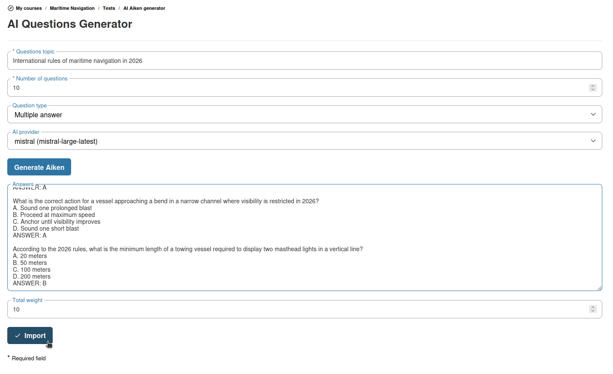
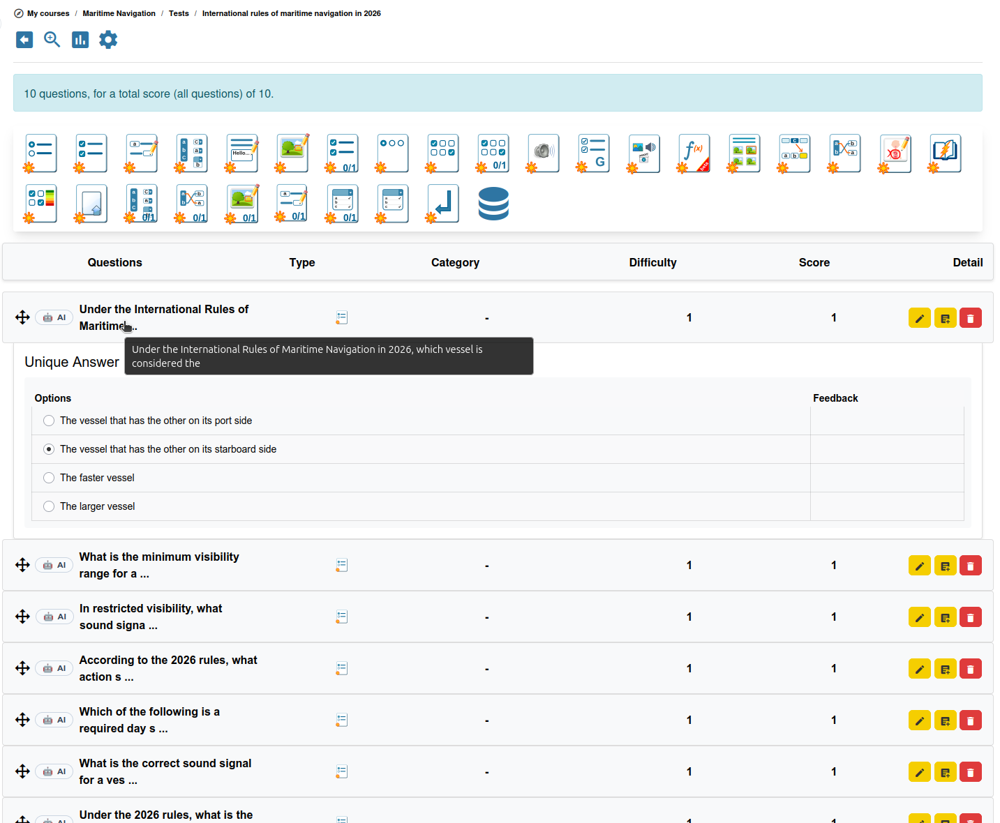

# Generador de ejercicios

El Generador de ejercicios con IA le ayuda a crear preguntas de cuestionario de forma automática mediante inteligencia artificial. Usted proporciona un tema o un contenido, y la IA genera preguntas que puede revisar, editar y añadir a sus ejercicios.

## Acceso al Generador de ejercicios

El Generador de ejercicios está disponible al crear o editar un ejercicio, siempre que:

1. Los asistentes de IA estén habilitados a nivel de plataforma
2. Haya al menos un proveedor de texto de IA configurado

Busque el botón o la sección **Generador de IA** dentro de la interfaz de creación de ejercicios.

## Cómo generar preguntas

El generador ofrece dos modos, disponibles como pestañas:

* **Prueba a partir de un tema** — Generar preguntas a partir de una descripción textual del tema
* **Prueba a partir de un documento** — Generar preguntas a partir de un documento del curso (solo disponible cuando hay configurado un proveedor compatible con documentos). Cuando se utiliza este modo, el campo del tema pasa a ser opcional y se trata como una indicación adicional.

1. Abra el formulario del Generador de IA dentro de un ejercicio y elija el modo
2. Configure los parámetros de generación:
   * **Título del cuestionario** — El título del ejercicio resultante
   * **Tema de las preguntas** — Describa de qué deben tratar las preguntas (o, en el modo documento, una indicación opcional)
   * **Número de preguntas** — Cuántas preguntas generar (con un máximo de 100)
   * **Tipo de pregunta** — Actualmente solo se ofrece **Respuesta múltiple**
   * **Proveedor de IA** — Seleccione qué proveedor de IA utilizar (solo se muestra cuando hay más de uno configurado)
3. Haga clic en **Generar**
4. La IA produce un conjunto de preguntas con opciones de respuesta y las respuestas correctas marcadas. Cuando la divulgación de IA está habilitada, las preguntas generadas llevan el prefijo **\[AI-assisted\]**.

## Revisión y edición

Las preguntas generadas se presentan como **sugerencias**. Debe:

* **Revisar cada pregunta** en cuanto a exactitud y pertinencia
* **Editar la redacción** si es necesario: ajuste las preguntas, las opciones de respuesta y la retroalimentación
* **Verificar las respuestas correctas**: asegúrese de que la IA haya identificado las respuestas adecuadas
* **Eliminar las preguntas inadecuadas**: borre las que no cumplan sus criterios
* **Ajustar la puntuación**: establezca los valores de puntos apropiados para cada pregunta

Cuando esté satisfecho, añada las preguntas a su ejercicio.

Tenga en cuenta que, a pesar de nuestras solicitudes de formato específicas, algunos modelos devolverán títulos de pregunta precedidos por un número. No recomendamos dejar ese número, ya que dificultará la mezcla de preguntas en pruebas con preguntas seleccionadas aleatoriamente. Además, a veces no se obtiene tantas preguntas como se ha solicitado, así que asegúrese de comprobarlo y, si es necesario, generar más preguntas o cambiar de modelo si tiene esa posibilidad.

## Divulgación del contenido generado por IA

El contenido generado por IA se etiqueta con un aviso de divulgación, que indica que se creó mediante inteligencia artificial. Esta transparencia ayuda a los estudiantes a comprender el origen del material.

## Consejos

* **Proporcione temas específicos**: cuanto más específica sea la descripción del tema, más pertinentes serán las preguntas generadas.
* **Revise siempre**: el contenido generado por IA puede contener errores. Nunca publique preguntas sin revisarlas antes.
* **Úselo como punto de partida**: las preguntas generadas ahorran tiempo, pero no son un producto terminado. Edítelas para adaptarlas a su estilo de enseñanza y al contenido del curso.
* **Combine con preguntas manuales**: combine las preguntas generadas por IA con las creadas manualmente para obtener los mejores resultados.
* **Pruebe distintos proveedores**: si hay varios proveedores de IA disponibles, pruebe diferentes para ver cuál produce las mejores preguntas para su área temática.