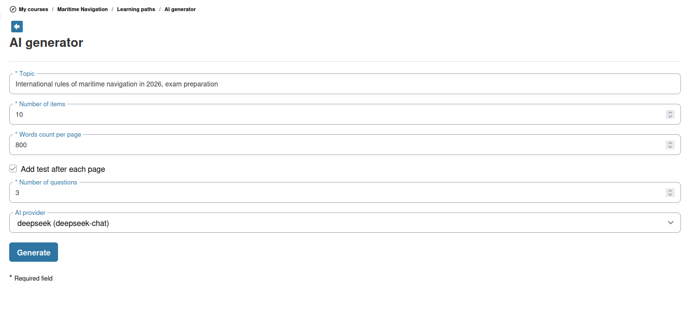

# Generador de itinerarios de aprendizaje

El Generador de itinerarios de aprendizaje con IA le ayuda a crear secuencias de aprendizaje estructuradas de forma automática. Usted proporciona un tema y unos objetivos, y la IA genera un esquema de itinerario de aprendizaje con secciones y elementos de contenido que puede revisar y personalizar.

## Acceso al Generador de itinerarios de aprendizaje

El Generador de itinerarios de aprendizaje está disponible al crear un nuevo itinerario de aprendizaje, siempre que:

1. Los asistentes de IA estén habilitados a nivel de plataforma
2. El generador de itinerarios de aprendizaje esté habilitado en la configuración del curso
3. Haya configurado al menos un proveedor de texto de IA

Busque la sección **Generador de IA** en la interfaz de creación del itinerario de aprendizaje.

## Cómo generar un itinerario de aprendizaje

1. Abra el formulario del Generador de IA
2. Configure los parámetros:
   * **Tema** — La materia del itinerario de aprendizaje
   * **Número de elementos** — Cuántas páginas de contenido debe contener el itinerario
   * **Recuento de palabras por página** — Aproximadamente cuánto debe ocupar cada página
   * **Añadir una prueba después de cada página** — Si se marca, la IA también crea un breve cuestionario de opción múltiple después de cada página (2 preguntas de forma predeterminada, con un máximo de 5)
3. Haga clic en **Generar**
4. La IA produce un itinerario de aprendizaje con un elemento de documento por página y, opcionalmente, un elemento de cuestionario después de cada una

## Revisión y personalización

El itinerario de aprendizaje generado es un **punto de partida**. Debe:

* **Revisar la estructura** — Compruebe que las secciones estén en un orden lógico
* **Editar el contenido** — Modifique el texto generado, añada sus propios materiales y elimine las secciones irrelevantes
* **Añadir recursos** — Inserte sus propios documentos, ejercicios, enlaces y otros contenidos
* **Establecer prerrequisitos** — Configure qué secciones deben completarse antes que otras
* **Añadir evaluaciones** — Incluya ejercicios en los puntos adecuados para comprobar la comprensión

## Aviso sobre el contenido generado por IA

El contenido generado por IA se etiqueta con un aviso de divulgación, que indica que se creó mediante inteligencia artificial. Esta transparencia ayuda a los estudiantes a comprender el origen del material.

## Consejos

* **Empiece de forma amplia y luego refine** — Genere primero una estructura de alto nivel y, a continuación, añada manualmente detalles y recursos específicos
* **Úselo para la planificación del curso** — Aunque no utilice el contenido generado de forma directa, la estructura sugerida por la IA puede ser una herramienta de planificación útil
* **Combínelo con la generación de ejercicios** — Después de generar un itinerario de aprendizaje, utilice el Generador de ejercicios para crear evaluaciones de cada sección