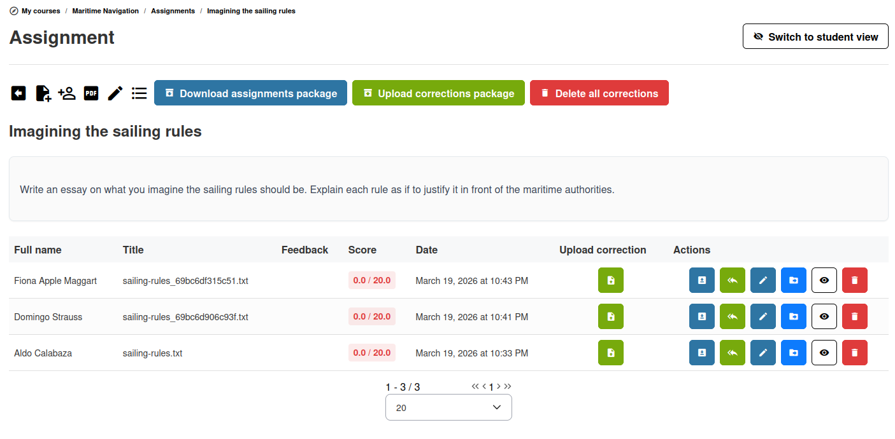
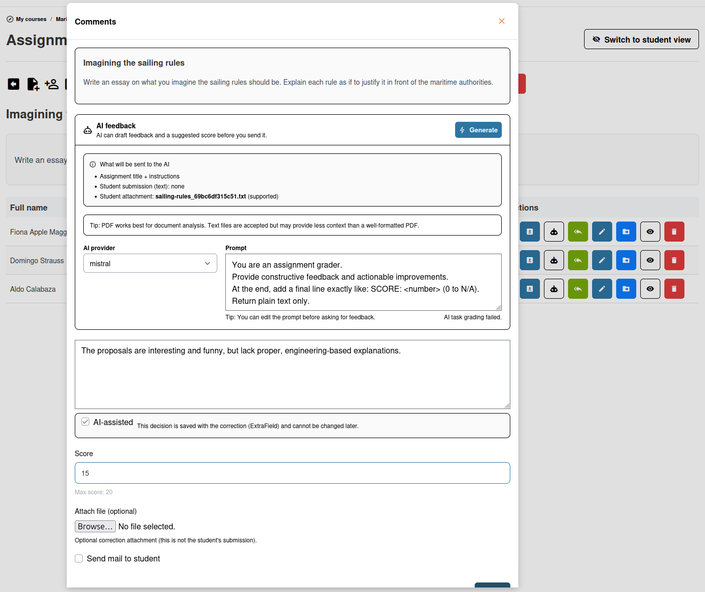

# Tareas

La herramienta de tareas (también denominada «publicaciones de los estudiantes») permite recoger el trabajo de los estudiantes —ensayos, proyectos, informes o cualquier entrega basada en archivos— y calificarlo.

## Crear una tarea

1. Abra la herramienta **Tareas**  desde la página de inicio del curso
2. Haga clic en **Crear una tarea**
3. Complete los datos:
   * **Nombre de la tarea** — El nombre de la tarea (p. ej., «Informe del proyecto final»)
   * **Descripción** — Instrucciones para los estudiantes, incluido qué deben entregar y cómo se evaluará (admite texto enriquecido)
   * **Puntuación máxima** — Sobre qué total se calificará la tarea
   * **Añadir al libro de calificaciones** — Añadir como elemento evaluado en la herramienta de evaluación (libro de calificaciones), de modo que pueda formar parte del logro de los objetivos del curso
   * **Fecha límite** — La fecha y hora oficiales (publicadas) a partir de las cuales las entregas se marcan como tardías (las cargas siguen aceptándose)
   * **Finaliza el (completamente cerrada)** — La fecha y hora de cierre definitivo a partir de las cuales no es posible ninguna carga
   * **Añadir al calendario** — Crear un evento para referenciar la fecha de entrega de esta tarea
   * **Tipo de entrega** — Elija entre **Permitir solo texto**, **Permitir solo archivos** o **Permitir archivos o texto en línea**
4. Guardar

Una vez creada una tarea, también puede:
* Cargar documentos de plantilla desde la página de detalle de la tarea
* Asignar la tarea a usuarios específicos (en lugar de a todos los usuarios del curso)

Y una vez que los estudiantes hayan entregado sus tareas, puede:
* Exportar una lista en PDF de las entregas
* Mostrar una lista solo de los estudiantes que no han entregado su tarea
* Descargar todas las tareas en un ZIP grande
* Cargar todas las correcciones en un ZIP grande
* Eliminar todas las correcciones que haya enviado (esto no elimina las entregas de los estudiantes)

## Tareas para grupos

Cuando el curso tiene grupos, el formulario de la tarea puede mostrar **Esta es una tarea por grupos**. Actívela para crear una tarea compartida entre los grupos de la **Categoría de grupos** seleccionada. Si las categorías de grupos están desactivadas, Chamilo puede aplicar la tarea a todos los grupos.

Configure la tarea compartida desde la herramienta Tareas habitual, no desde el interior de un grupo concreto. Los estudiantes acceden a la misma tarea desde el contexto de su propio grupo, por lo que no es necesario duplicar la tarea una vez por grupo.

Si existen varias categorías de grupos, seleccione la categoría cuyos grupos deben recibir la tarea. La opción no se ofrece mientras ya se encuentre dentro del contexto de un grupo específico.

## Cómo entregan los estudiantes

Los estudiantes abren la tarea y:

1. Hacen clic en **Cargar archivo** o en el botón de entrega
2. Seleccionan un archivo de su ordenador (o escriben texto directamente, según la configuración)
3. Añaden un comentario opcional
4. Envían

Los estudiantes pueden ver si ya han entregado y, si está permitido, actualizar su entrega.

### Entregas de texto enriquecido (HTML)

Cuando configure **Permitir solo texto** o **Permitir archivos o texto en línea**, los estudiantes pueden redactar una respuesta con formato en el editor en línea en lugar de cargar un documento aparte. Chamilo depura el HTML enviado y lo almacena como un archivo de entrega `.html`. Sigue sujeto a las reglas de acceso y de fecha límite existentes de la tarea.

En la lista de entregas del docente, use **Vista previa** para abrir una entrega HTML disponible, o **Corregir y calificar** para ver su contenido en el cuadro de diálogo de revisión antes de añadir comentarios y una puntuación. El HTML se presenta de forma segura en lugar de ejecutarse como un script proporcionado por el estudiante. Véase [PR #9410](https://github.com/chamilo/chamilo-lms/pull/9410).

## Revisar las entregas

Como docente, abra una tarea para ver la lista de todas las entregas:

* **Nombre del estudiante** — Quién entregó
* **Fecha de entrega** — Cuándo se entregó el trabajo
* **Archivo** — Descargar el archivo entregado
* **Estado** — Si la entrega ha sido calificada
* **Comentarios** — Cualquier comentario dejado por el estudiante o por usted

### Seguimiento de una tarea

Los docentes y los tutores de sesión habilitados pueden optar por seguir una tarea individual y recibir notificaciones cuando un estudiante comente una de sus entregas.

1. Abra la página de detalle de la tarea desde la herramienta **Tareas**.
2. Seleccione **Seguir** (icono de campana). El botón cambia a **Siguiendo**.
3. Seleccione **Siguiendo** de nuevo para dejar de seguir esa tarea.

El docente que crea una nueva tarea la sigue automáticamente y puede dejar de seguirla más adelante. El seguimiento es personal de cada docente o tutor; no suscribe a todo el curso. Los estudiantes no disponen de este control. Las notificaciones se envían únicamente a los seguidores activos que aún tienen el rol de curso o de sesión adecuado; el autor del comentario no recibe una notificación por su propio comentario.

**Importante:** Las notificaciones se envían solo cuando el ajuste del curso `email_to_teachers_on_new_work_feedback` está habilitado (valor `1`, **Sí**). Seguir una tarea por sí solo no anula un ajuste del curso deshabilitado. Esto se refiere a los comentarios de los estudiantes sobre las entregas, no a cada edición de la tarea ni a cada carga de archivos. La entrega también depende de la configuración de mensajería y correo electrónico del portal.

### Calificación de una entrega

1. Haga clic en una entrega para abrirla
2. Revise el archivo enviado
3. Introduzca una **puntuación**
4. Escriba **comentarios de retroalimentación** para el estudiante
5. Opcionalmente, cargue un **archivo corregido** como adjunto
6. Guarde

### Calificación asistida por IA

Si las herramientas de IA están configuradas en su plataforma, puede ver una opción de **calificación con IA** al revisar las entregas. Esta utiliza un modelo de IA para sugerir una puntuación y una retroalimentación para trabajos de respuesta abierta. Consulte [Calificación con IA](../ai-tools/ai-grading.md) para más detalles.

## Gestión de entregas

Acciones de grupo:
* **Descargar paquete de tareas** — Descargue todas las entregas como un único archivo ZIP para su revisión sin conexión
* **Cargar paquete de correcciones** — Si descargó todas las entregas en un único archivo ZIP, editó los archivos en su lugar en su equipo y los volvió a comprimir, puede enviar el ZIP como un paquete de correcciones. No cambie los nombres de archivo o no funcionará.
* **Entregas tardías** — Las entregas posteriores a la fecha límite se marcan, pero aún pueden aceptarse según su configuración

Acciones de entrega individual:
* **Cargar corrección** — Cargue una corrección para un estudiante 
* **Descargar** — Descargue la entrega de un estudiante
* **Corregir y calificar** — Añada una corrección y una calificación a la entrega del estudiante 
* **Editar** — Edite el título del documento o la retroalimentación anterior de la entrega
* **Mover** — Transfiera una entrega entre carpetas de tareas (p. ej., si el estudiante la envió en la tarea incorrecta)
* **Visibilidad** — Controle si los estudiantes pueden ver las entregas de los demás

## Vinculación con el libro de calificaciones

Las puntuaciones de las tareas pueden incluirse en el libro de calificaciones del curso (herramienta «Evaluaciones»). Esto permite que las calificaciones de las tareas contribuyan a la calificación global del curso del estudiante y a su elegibilidad para el certificado. Consulte [Libro de calificaciones](gradebook.md) para más detalles.

## Revisión de entregas agrupadas por estudiante

Para los docentes, el detalle de la tarea ahora agrupa las entregas por estudiante. La tabla inicial muestra a cada estudiante y el **Número enviado**; abra la fila de un estudiante para inspeccionar sus entregas y acceder a las acciones habituales de retroalimentación y calificación. Esto evita repetir la identidad de un estudiante en la lista de nivel superior cuando se permiten varias entregas.

La agrupación es un cambio de presentación, no un cambio en los permisos de entrega, las fechas límite o la calificación. Consulte [PR de entregas agrupadas #9424](https://github.com/chamilo/chamilo-lms/pull/9424).

## Envío de recordatorios solo a estudiantes seleccionados

Abra **Usuarios sin entrega** desde el detalle de la tarea para revisar a los estudiantes que aún no han enviado. Seleccione los usuarios concretos a los que desea contactar y elija **Recordar a todos los usuarios seleccionados**; confirme antes de enviar. **Enviar correo electrónico a todos** sigue disponible cuando todos los estudiantes sin entrega deben recibir un recordatorio.

Se requiere una selección para la acción selectiva. Compruebe la lista de destinatarios antes de confirmar; enviar un recordatorio es una operación real de correo electrónico, no solo una vista previa. Consulte [PR de recordatorios selectivos #9386](https://github.com/chamilo/chamilo-lms/pull/9386).

## Consejos

* **Sea específico en las instrucciones** — Describa con claridad qué deben enviar los estudiantes, el formato esperado y los criterios de evaluación
* **Establezca fechas límite realistas** — Utilice la herramienta Agenda para que las fechas límite sean visibles en el calendario del curso
* **Utilice la función de archivo corregido** — Cargue versiones anotadas del trabajo de los estudiantes para que puedan ver sus correcciones específicas
* **Habilite la visibilidad entre pares con cuidado** — Permitir que los estudiantes vean el trabajo de los demás puede favorecer el aprendizaje, pero puede no ser adecuado para todas las tareas