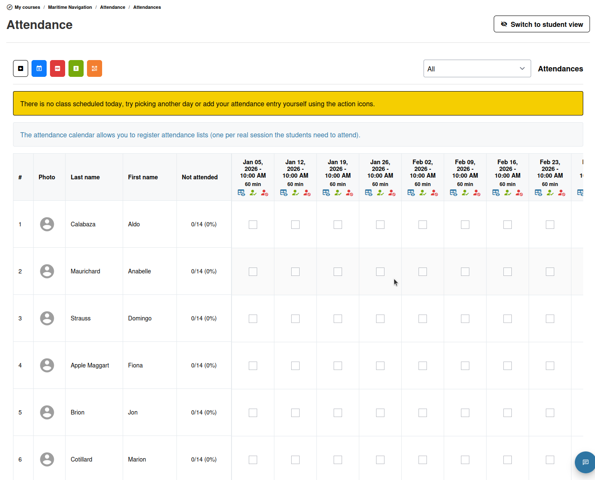

# Asistencia

La herramienta de asistencia le permite registrar la presencia de los estudiantes en las sesiones de clase programadas, ya sean presenciales o en línea.

## Crear una hoja de asistencia

1. Abra la herramienta **Asistencia** desde la página de inicio del curso
2. Haga clic en **Añadir asistencia** para crear una hoja de asistencia
3. Introduzca un **Título** para la hoja de asistencia (p. ej., «Semana 1 - Introducción»)
4. Introduzca una **Descripción** (esto es principalmente para su uso: los estudiantes no verán la descripción)
5. Guarde

### Configuración avanzada

1. **Exigir presencia única** le permite considerar a un estudiante como totalmente presente si participó aunque solo fuera en una fecha de la hoja de asistencia
2. **Opciones del libro de calificaciones** le permite decidir si calificar la hoja de asistencia en la herramienta de evaluación (libro de calificaciones).

## Añadir fechas

Cada hoja de asistencia contiene una o más fechas (sesiones) en las que registra la presencia:

1. Abra una hoja de asistencia o continúe con el proceso de creación
2. Haga clic en **Añadir una fecha** 
3. Seleccione la fecha y la hora
4. Opcionalmente, marque **Repetir fecha** para elegir una lógica de repetición
5. Indique una **Duración** en minutos para el evento (el valor predeterminado es 60 minutos)
6. Opcionalmente, seleccione un **Grupo** si esta fecha de asistencia solo se aplica a un grupo de estudiantes
7. Guarde

Puede añadir varias fechas a la misma hoja de asistencia (p. ej., todas las sesiones de un mes).

## Registrar la asistencia

Para cada fecha, marque a cada estudiante como:

* **Presente** — El estudiante asistió (valor predeterminado para todos los estudiantes)
* **Ausente** — El estudiante no asistió

Haga clic en la celda de estado junto al nombre de cada estudiante para alternar entre presente y ausente.

De forma predeterminada, todos los estudiantes se marcan como presentes, ya que consideramos que es más probable que haya más personas presentes que ausentes.

Nota: Los administradores pueden modificar la configuración del portal para permitirle elegir tipos de asistencia más amplios (retraso, ausencia justificada, etc.), que pueden reflejar mejor sus procedimientos. En este caso, al hacer clic en el campo de presencia se alternará entre todos los tipos de presencia.

## Ver los informes de asistencia

La herramienta de asistencia muestra:

* Una tabla resumen con todos los estudiantes y todas las fechas
* El porcentaje de asistencia de cada estudiante (sesiones presentes / sesiones totales)
* Indicadores codificados por colores para facilitar la revisión

## Extra

Las asistencias tienen algunas funciones ampliadas que no son visibles de inmediato:
* Las **Firmas** se pueden habilitar para que los estudiantes puedan firmar su asistencia en clase a través de una tableta gestionada por el docente
* El docente puede añadir **Comentarios** sobre la asistencia de cada estudiante
* Se pueden extraer **Informes PDF** para cumplir con la normativa

## Consejos

* **Vincular con el progreso del curso** — Utilice los datos de asistencia junto con la herramienta Progreso del curso para correlacionar la presencia con la cobertura de los temas
* **Exportar datos** — Exporte la hoja de asistencia para los registros administrativos
* **Establecer expectativas** — Si la asistencia es obligatoria, comunique la política con claridad en la introducción del curso o en los anuncios