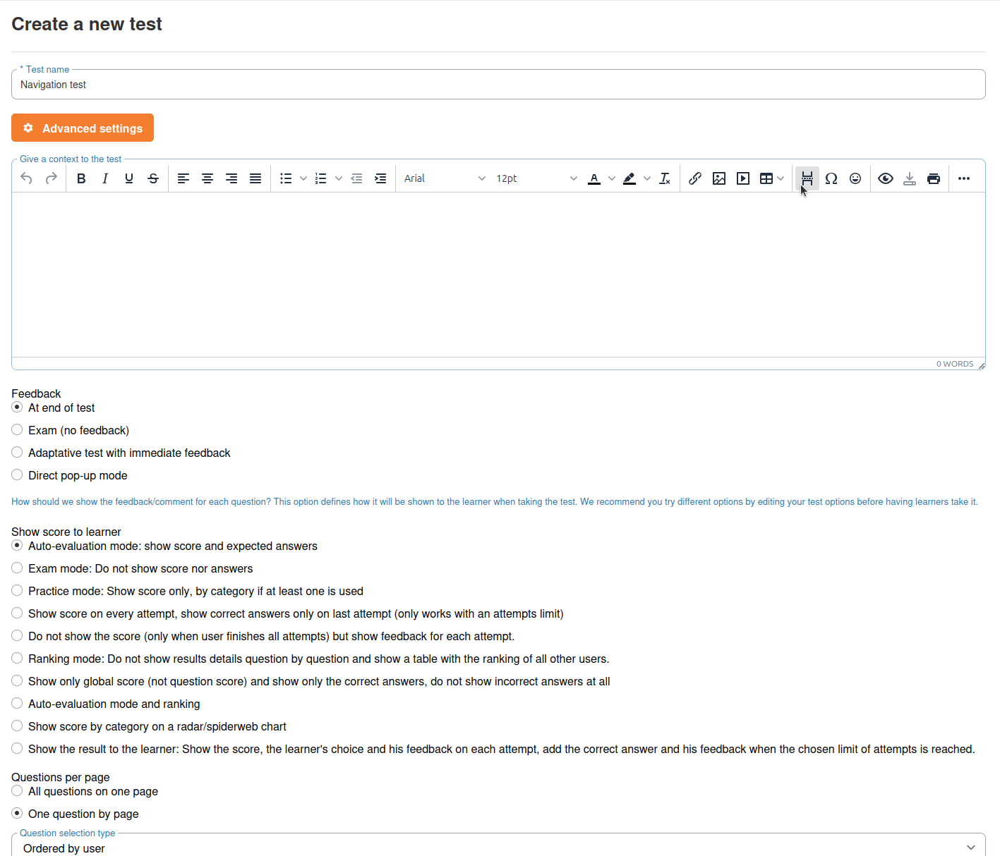
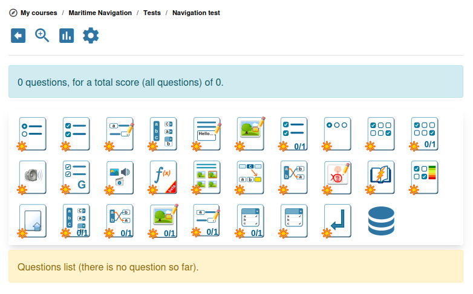

# Ejercicios

La herramienta de ejercicios (también llamada «pruebas») permite crear cuestionarios y exámenes con calificación automática. Chamilo admite una amplia variedad de tipos de preguntas, desde la opción múltiple simple hasta las preguntas interactivas de zona activa (hotspot).

## Crear un ejercicio

1. Abra la herramienta **Ejercicios**  desde la página de inicio del curso
2. Haga clic en **Nuevo ejercicio**
3. Introduzca un **título** y una **descripción** opcional
4. Configure los ajustes del ejercicio (véase más abajo)
5. Guarde y, a continuación, añada preguntas

## Configuración del ejercicio

### Visualización y navegación

| Configuración | Opciones | Descripción |
|---------|---------|-------------|
| **Disposición de las preguntas** | Todas en una página / Una por página | Mostrar todas las preguntas a la vez o de una en una |
| **Ocultar los títulos de las preguntas** | Sí / No | Si se muestran los títulos de las preguntas a los estudiantes |
| **Mostrar el botón anterior** | Sí / No | Permitir que los estudiantes vuelvan a las preguntas anteriores |
| **Impedir la navegación hacia atrás** | Sí / No | Obligar a los estudiantes a responder en orden, sin poder retroceder |

### Tiempo y disponibilidad

| Configuración | Descripción |
|---------|-------------|
| **Límite de tiempo** | Tiempo máximo (en minutos) para completar el ejercicio. Se muestra al estudiante un temporizador de cuenta atrás |
| **Fecha de inicio** | Momento en que el ejercicio pasa a estar disponible para los estudiantes |
| **Fecha de finalización** | Momento en que el ejercicio deja de estar disponible |

### Condiciones de acceso

Cuando el administrador activa **Condiciones de acceso antes de una prueba** (`allow_final_exam_access_rule`), la parte **Intentos y temporización** de la configuración avanzada muestra un bloque de **Condiciones de acceso**. Utilícelo para mantener cerrada una prueba, normalmente un examen final, hasta que el estudiante esté preparado:

| Configuración | Descripción |
|---------|-------------|
| **Tiempo mínimo en el curso antes de iniciar la prueba (en minutos)** | El estudiante solo puede iniciar la prueba una vez que haya dedicado este tiempo al curso, tal como lo contabilizan los informes del curso (el mismo tiempo que el reloj del tiempo dedicado al curso). 0 no establece ningún mínimo |
| **Campo del perfil obligatorio antes de iniciar la prueba** | Un campo del perfil del estudiante, como un identificador de estudiante, que debe rellenarse primero. Solo se ofrecen los campos de texto que los estudiantes pueden modificar en su propio perfil |
| **El estudiante puede optar por no rellenar este campo** | Formula primero una pregunta al estudiante (**Pregunta formulada antes de rellenar el campo**). Si responde No, el campo se marca como rechazado y la prueba puede iniciarse |

Hasta que se cumplan las condiciones, la página de inicio de la prueba oculta el botón **Iniciar prueba** e indica al estudiante cuánto tiempo le queda por dedicar al curso y qué campo del perfil debe rellenar. El estudiante rellena el campo directamente en esa página: solo acepta dígitos (al menos 3). Los docentes no están sujetos a las condiciones.

Debajo de los campos, **Condiciones de acceso en JSON** muestra, en solo lectura, la regla tal como se guardará. Marque **Editar el JSON** para escribirlo usted mismo: los campos anteriores quedan entonces bloqueados y el JSON se guarda tal como se ha escrito, incluidas las claves que los campos no editan (como el `source` de las reglas importadas desde una plataforma anterior). El JSON debe ser un objeto con al menos `minimum_minutes_before_exam` (un número entero de minutos) y `user_identifier_field_variable` (el campo del perfil, o una cadena vacía); `allow_user_identifier_opt_out` (verdadero o falso) y `user_identifier_opt_out_prompt` son opcionales. Un JSON vacío elimina las condiciones. Al desmarcar **Editar el JSON**, los campos se rellenan a partir de un JSON válido.

### Intentos y puntuación

| Configuración | Descripción |
|---------|-------------|
| **Intentos máximos** | Cuántas veces puede realizar el ejercicio un estudiante (0 = ilimitado) |
| **Porcentaje de aprobación** | La puntuación mínima para aprobar (p. ej., 70 %). Los estudiantes que no alcancen este umbral ven un mensaje de suspenso |
| **Propagar la puntuación negativa** | Si los puntos negativos de preguntas individuales reducen la puntuación total por debajo de cero |

### Retroalimentación

| Configuración | Opciones |
|---------|---------|
| **Al final** | Mostrar los resultados y las respuestas correctas después de que el estudiante envíe el ejercicio |
| **Inmediata** | Mostrar la retroalimentación después de cada pregunta (útil para ejercicios de aprendizaje) |
| **Modo examen** | No mostrar ninguna retroalimentación ni resultados |

### Informes de incidencias en preguntas por parte del estudiante

Active **Permitir que los estudiantes informen de incidencias en las preguntas** cuando desee que los estudiantes señalen preguntas poco claras, incorrectas o defectuosas durante un intento activo. La opción de informe se muestra solo a los estudiantes y solo para los elementos de pregunta normales.

El estudiante introduce un comentario en **Informar de un problema con esta pregunta**. El informe queda asociado a esa pregunta y a ese intento; no modifica la respuesta ni la puntuación del estudiante.

### Visualización de resultados

Controle lo que los estudiantes ven después de completar el ejercicio:

* Mostrar la puntuación y las respuestas esperadas
* Mostrar solo la puntuación
* Mostrar la puntuación con desglose por categoría
* Mostrar la clasificación entre los demás estudiantes
* Mostrar solo en el último intento
* Mostrar la visualización en gráfico de radar

### Mensajes de finalización

* **Mensaje de éxito** — Texto personalizado que se muestra cuando el estudiante aprueba
* **Mensaje de fracaso** — Texto personalizado que se muestra cuando el estudiante no alcanza el porcentaje de aprobación

### Aleatorización de preguntas

| Configuración | Descripción |
|---------|-------------|
| **Orden aleatorio de las preguntas** | Mezcla el orden de las preguntas en cada intento |
| **Respuestas aleatorias** | Mezcla las opciones de respuesta dentro de cada pregunta |
| **Aleatorio por categoría** | Selecciona preguntas aleatorias de cada categoría de preguntas |

También puede configurar estrategias de selección avanzadas que combinan categorías y aleatorización.

## Tipos de preguntas

Chamilo ofrece un amplio conjunto de tipos de preguntas organizados en varias categorías:

### Opción única

* **Opción múltiple (respuesta única)** — El estudiante selecciona una respuesta correcta de una lista de opciones
* **Respuesta única con imágenes** — Igual que la anterior, pero las opciones de respuesta se muestran como imágenes

### Opción múltiple

* **Respuesta múltiple** — El estudiante selecciona una o más respuestas correctas
* **Respuesta múltiple (desplegable)** — Las opciones de respuesta se presentan como menús desplegables
* **Verdadero/Falso** — Una serie de afirmaciones que el estudiante marca como verdaderas o falsas
* **Verdadero/Falso con grado de certeza** — Verdadero/falso con un nivel de confianza adicional, que permite una puntuación más matizada

### Completar los espacios en blanco

* **Completar los espacios en blanco** — El estudiante completa las palabras que faltan en un texto. Usted define los espacios en blanco y las respuestas aceptadas al crear la pregunta.

### Emparejamiento

* **Emparejamiento** — El estudiante conecta elementos de dos columnas
* **Emparejamiento (arrastrable)** — El mismo concepto, pero con una interfaz de arrastrar y soltar
* **Arrastrable** — Arrastre elementos hasta las posiciones correctas

### Respuesta abierta

* **Respuesta libre (ensayo)** — El estudiante escribe una respuesta de texto. Requiere calificación manual (o calificación asistida por IA si está configurada)
* **Expresión oral** — El estudiante graba una respuesta de audio con su micrófono
* **Subir respuesta** — El estudiante sube un archivo como respuesta

### Zona activa

* **Zona activa** — El estudiante hace clic en áreas específicas de una imagen para responder
* **Delimitación de zona activa** — El estudiante traza los límites de áreas sobre una imagen

### Calculada

* **Respuesta calculada** — Preguntas numéricas con una fórmula y un rango de tolerancia. Útil para cursos de matemáticas y ciencias.

### Especial

* **Comprensión lectora** — Pruebas basadas en la lectura de un pasaje
* **Anotación** — El docente sube una imagen y el estudiante la anota
* **Respuesta en documento de Office** — Cuando el complemento OnlyOffice está habilitado, el estudiante responde a la pregunta editando un documento de Office incrustado (Word, Excel, PowerPoint). Su respuesta se guarda como un archivo independiente dentro del ejercicio para que pueda revisarse junto con el resto de su intento.

## Añadir preguntas a un ejercicio

1. Abra el ejercicio y haga clic en **Añadir una pregunta**
2. Seleccione el tipo de pregunta
3. Introduzca el **texto de la pregunta** (admite texto enriquecido con imágenes y formato)
4. Defina las **respuestas** y su puntuación:
   * Para cada opción de respuesta, especifique si es correcta y cuántos puntos vale
   * Puede asignar puntos negativos a las respuestas incorrectas para desalentar las adivinanzas
5. Opcionalmente, añada **retroalimentación** — explicaciones que se muestran al estudiante después de responder
6. Establezca el **nivel de dificultad** y la **categoría** (útiles para la selección aleatoria y los informes)
7. Guarde

## Corrección de preguntas abiertas

Las preguntas de respuesta abierta (pregunta abierta, expresión oral, carga de archivos, anotación y respuestas en documentos de Office) se corrigen manualmente. Abra el intento del estudiante desde los resultados del ejercicio en modo de corrección: debajo de cada una de estas respuestas, el cuadro **Corrección del docente** establece la puntuación y un **Comentario del docente**.

Cuando **Retroalimentación de audio a las respuestas enviadas** (`exercise.allow_teacher_comment_audio`) está habilitada en la configuración de la plataforma, el cuadro también ofrece un **Comentario de audio**: haga clic en **Iniciar grabación**, hable y, a continuación, en **Detener grabación**, y escuche el resultado antes de guardar. La grabación se guarda con la corrección, mediante **Guardar como borrador** o **Guardar corrección**. Una nueva grabación sustituye a la anterior. El estudiante la escucha junto al comentario escrito cuando el ejercicio muestra la retroalimentación.

## Revisión de los informes de los estudiantes

Abra una pregunta en el editor de preguntas y expanda **Informes de los estudiantes**. Cada informe muestra al estudiante, la hora, el ejercicio cuando está disponible y el comentario enviado. Cuando Chamilo puede vincular el informe con el intento, utilice **Ver intento** para inspeccionar las respuestas circundantes antes de corregir la pregunta.

## Historial de cambios de respuestas (técnico)

Chamilo 3.1 puede registrar los cambios realizados en las respuestas durante un intento de ejercicio, incluidos el reproductor moderno de Vue y los flujos heredados aplicables de guardado de respuestas. El registro se almacena por separado en `track_e_attempt_log`, conservando los estados anteriores de las respuestas sin modificar las respuestas finales ni las puntuaciones.

Se trata de un registro interno de auditoría, **no** de una puntuación adicional de la pregunta ni de un visor de historial de respuestas de uso general en la interfaz del docente. La implementación de esta función requiere la migración de base de datos de Chamilo asociada. Consulte [Historial de respuestas de ejercicios #9277](https://github.com/chamilo/chamilo-lms/pull/9277).

## Categorías de preguntas

Puede organizar las preguntas en categorías (p. ej., «Módulo 1», «Vocabulario», «Avanzado»). Las categorías son útiles para:

* Organizar bancos de preguntas extensos
* Permitir la selección aleatoria por categoría (p. ej., «5 preguntas del Módulo 1, 3 del Módulo 2»)
* Consultar las puntuaciones desglosadas por categoría en los informes

## Reutilización de preguntas

Las preguntas pueden reutilizarse en distintos ejercicios del mismo curso. Al añadir una pregunta, puede optar por crear una nueva o seleccionar una pregunta existente del banco de preguntas.

## Importación de ejercicios

Chamilo permite importar ejercicios desde formatos externos:

* **IMS QTI / Common Cartridge** — El formato estándar de cuestionarios de e-learning
* **Formato Moodle** — Importar cuestionarios a partir de exportaciones de Moodle

Para importar, busque la opción **Importar** en la herramienta de ejercicios y cargue su archivo.

### Interoperabilidad IMS QTI 2

Chamilo 3.1 admite un subconjunto definido de tipos de pregunta IMS QTI 2. Las mejoras recientes abarcan **Emparejamiento** (`matchInteraction`), incluidas las asociaciones correctas, y **Rellenar los espacios en blanco**, incluidos los espacios de texto (`textEntryInteraction`), los espacios de lista desplegable (`inlineChoiceInteraction`) y su puntuación por espacio cuando está representada en el paquete importado.

El exportador QTI 2 admite preguntas de respuesta única, respuesta múltiple, combinación exacta, respuesta libre, emparejamiento (incluido el emparejamiento arrastrable), ordenación de secuencias y rellenar los espacios en blanco. Las preguntas de respuesta múltiple utilizan QTI `choiceInteraction` con `maxChoices="0"`, lo que permite a los estudiantes seleccionar más de una opción. Las preguntas de combinación exacta otorgan la puntuación completa solo cuando se seleccionan exactamente las opciones correctas, y se importan de nuevo como preguntas de combinación exacta.

**Respuesta única con desconocido (tipo 10)** utiliza un `choiceInteraction` de QTI 2.1 con una única respuesta. Chamilo incluye la opción fija **No lo sé** con cero puntos y una etiqueta opcional de `assessmentItem` `chamilo:unique-answer-unknown`. Cuando un paquete generado por Chamilo se importa de nuevo en Chamilo, esta etiqueta restaura el tipo 10 y su respuesta fija. Las preguntas de respuesta única sin marcar se importan como Respuesta única ordinaria (tipo 1), incluso cuando una opción dice «No lo sé». Otras herramientas QTI pueden ignorar o eliminar la etiqueta, por lo que conviene verificar el tipo de pregunta y la puntuación después de las transferencias.

El emparejamiento y el emparejamiento arrastrable utilizan ambos QTI `matchInteraction`. Para el emparejamiento arrastrable, Chamilo añade la etiqueta opcional de `assessmentItem` `chamilo:matching-draggable`. **Los viajes de ida y vuelta de QTI 2.1 de Chamilo a Chamilo conservan el emparejamiento arrastrable (tipo 19)** cuando esta etiqueta está presente; los elementos de emparejamiento ordinarios o sin marcar se importan como Emparejamiento estándar (tipo 4). Otras herramientas QTI pueden ignorar o eliminar la etiqueta opcional, por lo que la presentación arrastrable no está garantizada al transferir a través de otra herramienta.

**Ordenación de secuencias (tipo 18)** se exporta e importa mediante `orderInteraction` de QTI 2.1 con una respuesta ordenada. Un viaje de ida y vuelta de Chamilo a Chamilo conserva el orden correcto, la orientación horizontal o vertical y los puntos de crédito parcial por posición. Las herramientas QTI pueden utilizar reglas de puntuación distintas u omitir esta puntuación posicional, por lo que conviene verificar las ponderaciones importadas y la puntuación total antes de utilizar una evaluación.

Los tipos de pregunta no admitidos pueden omitirse durante la exportación o la importación, por lo que conviene comparar el número de preguntas y la puntuación después de cada transferencia.

Para evaluaciones críticas, pruebe el archivo exportado importándolo en un curso que no sea de producción y comprobando las preguntas y las respuestas antes de utilizarlo con los estudiantes. Esto **no** constituye una garantía de cobertura completa de QTI 2 para todos los tipos de pregunta o paquetes.

## Mostrar u ocultar la puntuación máxima de cada pregunta

Abra la configuración de un ejercicio y localice **Mostrar la puntuación máxima por pregunta durante la prueba**. Actívela cuando los estudiantes deban ver el número máximo de puntos disponibles para cada pregunta mientras realizan un ejercicio; desactívela cuando esta información deba permanecer oculta durante el intento.

Esto controla la presentación en el reproductor de ejercicios, no la forma en que se califican las preguntas. El valor configurado se conserva cuando se duplica el ejercicio y se aplica tanto al reproductor moderno como al flujo de ejercicios heredado compatible. Consulte [PR de puntuación máxima de la pregunta #9362](https://github.com/chamilo/chamilo-lms/pull/9362).

---
## Crear una copia vinculada de un ejercicio

En la lista de ejercicios, utilice **Crear ejercicio vinculado** en un ejercicio en el que esa acción esté disponible y, a continuación, confirme. Esto crea otro ejercicio vinculado al conjunto de preguntas original, en lugar de una copia totalmente independiente. Utilice una copia independiente normal cuando las preguntas deban editarse sin afectar a los ejercicios relacionados.

Antes de editar las preguntas vinculadas, compruebe qué otros ejercicios las reutilizan, de modo que un cambio compartido no altere involuntariamente otra evaluación. La acción de copia vinculada solo se muestra para los ejercicios elegibles. Consulte [copia de ejercicio vinculado PR #9350](https://github.com/chamilo/chamilo-lms/pull/9350).

## Consejos

* **Combine tipos de preguntas** — Combine preguntas de opción múltiple, de completar espacios en blanco y de respuesta abierta para una evaluación integral
* **Utilice categorías** — Organice las preguntas por tema para permitir una selección aleatoria específica
* **Establezca un porcentaje de aprobación** — Ofrezca a los estudiantes un objetivo claro y vincúlelo a la generación de certificados a través del Libro de calificaciones
* **Utilice retroalimentación inmediata para la práctica** — Cree ejercicios de práctica no calificados con retroalimentación inmediata para ayudar a los estudiantes a aprender de sus errores
* **Aleatorice para preservar la integridad** — Active el orden aleatorio de las preguntas y las respuestas aleatorias para reducir la posibilidad de copia