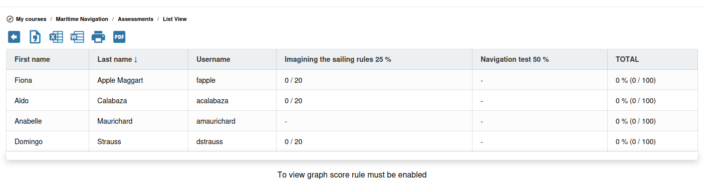
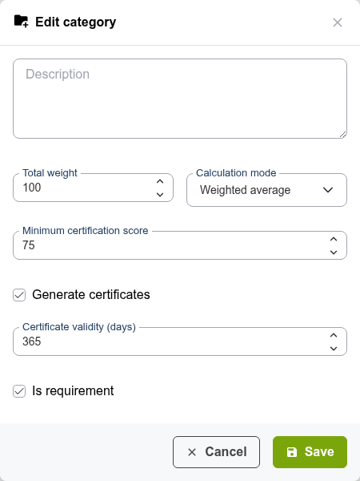

# Evaluaciones

Las evaluaciones (anteriormente *gradebook*) agregan las puntuaciones de ejercicios, tareas y otras actividades calificadas en una vista unificada del rendimiento de cada estudiante. También controlan la generación de certificados.

## Cómo funcionan las evaluaciones

Las evaluaciones son sistemas de puntuación ponderada. Usted define:

1. **Qué actividades** contribuyen a la calificación (ejercicios, tareas, asistencia, etc.)
2. **El peso** de cada actividad (cuánto cuenta para la calificación final)
3. **La puntuación mínima de certificación** (el umbral para obtener un certificado)
4. **Una puntuación mínima por actividad** — Cada actividad del libro de calificaciones puede tener su propia **Puntuación mínima**. Los estudiantes que obtengan una puntuación inferior a ese mínimo en una actividad clave pueden verse impedidos de alcanzar los objetivos y obtener el certificado, aunque su total ponderado general sea por lo demás suficiente.

Las actividades pueden ser de 2 tipos:
* **Actividad de aula** (o actividad presencial), en la que las calificaciones deben importarse desde otra fuente
* **Actividad en línea** seleccionada del curso, en la que las calificaciones se obtienen al completar la actividad en el curso

Chamilo calcula la calificación global de cada estudiante a partir de estos pesos.

## Configuración de la evaluación

1. Abra la herramienta **Evaluaciones**  desde la página de inicio del curso
2. Verá el resumen de las evaluaciones, inicialmente vacío

### Añadir actividades

1. Haga clic en **Añadir actividad en línea**
2. Elija el tipo:
   * **Test** — Vincular un ejercicio específico del curso
   * **Tarea** — Vincular una carpeta de trabajos de los estudiantes
   * **Itinerario de aprendizaje** — Vincular la finalización del itinerario de aprendizaje
   * **Asistencia** — Vincular una hoja de asistencia
   * **Hilo del foro** — Vincular un hilo del foro (que debe calificarse manualmente)
   * **Encuesta** — Vincular una encuesta
3. Seleccione la actividad específica dentro del tipo elegido
4. Establezca el **Peso** de esta actividad (p. ej., 30 % para el examen parcial, 40 % para el proyecto final)
5. Establezca la **Puntuación mínima** si corresponde
6. Guardar

El peso total de todas las actividades debe sumar el 100 %.

### Subcategorías

Para esquemas de calificación complejos, puede crear **subcategorías** para agrupar actividades relacionadas:

* **Ejemplo**: Una subcategoría «Deberes» (peso: 30 %) que contiene cinco tareas individuales, cada una con un valor del 20 % de la subcategoría
* Las subcategorías permiten organizar la evaluación de forma jerárquica manteniendo sencillo el cálculo global

## Visualización de las calificaciones

La evaluación muestra una tabla con:

* El nombre de cada estudiante
* Las puntuaciones de cada actividad
* El total ponderado
* Si el estudiante cumple los requisitos para un certificado

Puede ordenar por cualquier columna para identificar rápidamente a los estudiantes con mejor rendimiento o a quienes tienen dificultades.

### Gráficos de distribución de puntuaciones

Debajo de la tabla, y en la página **Vista gráfica**, la evaluación dibuja un gráfico de barras
por actividad más uno para el total. Cada gráfico es un gráfico de columnas: el
eje horizontal enumera sus rangos de puntuación del más bajo al más alto, y la
altura de cada barra es el número de estudiantes en ese rango.

El gráfico **Total** también marca la media de la clase. Un punto rojo se sitúa en el rango
que contiene la media, y la leyenda indica el porcentaje exacto.

Estos gráficos aparecen solo cuando están definidas las reglas de visualización de puntuaciones. Si ve el
mensaje *Para ver el gráfico, debe habilitarse la regla de puntuación*, defina primero sus rangos
en la configuración de puntuación de la evaluación.

## Certificados

Para habilitar la generación de certificados:

1. En la configuración de la evaluación, establezca una **puntuación mínima de certificación** (p. ej., 70 %)
2. Cuando el total ponderado de un estudiante alcance o supere este umbral (y no haya suspendido ninguna puntuación mínima por actividad), podrá descargar su certificado
3. El certificado se genera a partir de una plantilla configurada por el administrador de la plataforma

Una vez habilitada la opción **Generar certificados** en la categoría raíz, aparece el campo **Validez del certificado (días)**. Déjelo en `0` para certificados que no caduquen nunca, o establezca un número de días tras el cual el certificado caduca — Chamilo puede entonces recordar a los estudiantes a medida que se acerca esa fecha de caducidad, ya sea de forma automática (cron, configurado por el administrador) o manualmente desde la lista de certificados.

Consulte [Certificados y competencias](../tracking-and-reporting/certificates-and-skills.md#certificate-validity-and-expiry) para obtener más detalles.

## Vinculación con competencias

Puede asociar **competencias** a la evaluación. Cuando un estudiante alcanza los objetivos establecidos para completar la evaluación, puede obtener un certificado, una competencia o ambos. Las competencias son visibles en su perfil en el espacio de la red social. Esto construye un registro de competencias a lo largo del tiempo.

## Exportación de calificaciones

Haga clic en el botón **Exportar**  para descargar las calificaciones como una hoja de cálculo. Esto resulta útil para:

* Compartir las calificaciones con los sistemas administrativos
* Realizar análisis adicionales fuera de Chamilo
* Conservar registros sin conexión

### Exportación de la lista a Excel: resultados numéricos

En la **vista de lista**, la exportación a Excel (`.xls`) escribe cada actividad evaluada y el total en tres columnas independientes: **Porcentaje**, **Puntuación** y **Puntuación máxima**. Los valores son números, no un texto combinado como `18 / 20 (90%)`, de modo que puede calcular totales, promedios y gráficos en una hoja de cálculo.

Por ejemplo, un resultado de actividad de 18 sobre 20 se exporta como una celda numérica con formato de porcentaje (mostrada como **90.00%**), **18** en la columna de puntuación y **20** en la columna de puntuación máxima. Un estudiante sin resultado registrado tiene celdas de puntuación en blanco, no ceros. Esto se aplica específicamente a la exportación a Excel de la lista de evaluaciones; no implica la misma estructura de columnas para CSV, PDF u otros formatos de exportación.

## Token de seguridad en los enlaces de acción

Algunos enlaces que antes modificaban datos mediante una petición GET simple ahora incluyen un token de seguridad por sesión, de modo que un enlace copiado de una página antigua, un marcador o un enlace abierto desde otro sitio ya no ejecuta la acción: al usuario se le muestra la página «no permitido» (o, en el caso de los certificados, el mensaje «El token de seguridad ha caducado, vuelva a cargar la página»). Vuelva a cargar la página y utilice el botón de nuevo. Los usuarios que hacen clic en los botones de la forma habitual no notan ningún cambio.

* Libro de calificaciones (páginas del curso y de «mi libro de calificaciones»): eliminar o mostrar/ocultar una categoría, una evaluación o un enlace; mover una categoría o una evaluación; crear las categorías que faltan; eliminar el resultado de un estudiante o uno de sus intentos.
* Lista de certificados del libro de calificaciones: **Generar certificados**.
* Sesión > Anuncios programados: **Enviar manualmente los anuncios pendientes**. El envío programado realizado por cron (`app:send-scheduled-announcements` / `main/cron/scheduled_announcement.php`) no se ve afectado.

## Mantener visibles los nombres de los estudiantes en la vista plana

En la **vista plana** de Evaluaciones, las columnas del nombre y los apellidos del estudiante permanecen fijas mientras las columnas de evaluación se desplazan horizontalmente. Esto facilita la revisión de tablas de puntuaciones amplias sin perder de vista al estudiante asociado a cada fila. El cambio es únicamente visual; no altera las calificaciones, las ponderaciones, los cálculos ni las exportaciones. Véase [columnas de estudiantes fijas PR #9429](https://github.com/chamilo/chamilo-lms/pull/9429).

## Consejos

* **Planifique las ponderaciones con antelación** — Defina el esquema de calificación al inicio del curso para que los estudiantes sepan qué esperar
* **Utilice subcategorías en los cursos complejos** — Agrupe las tareas, los cuestionarios y la participación en categorías claras
* **Establezca umbrales de aprobación significativos** — La puntuación de certificación debe reflejar la competencia real, no solo la participación
* **Revise con regularidad** — Revise el libro de calificaciones periódicamente para asegurarse de que todas las actividades estén correctamente vinculadas y de que las puntuaciones se estén registrando