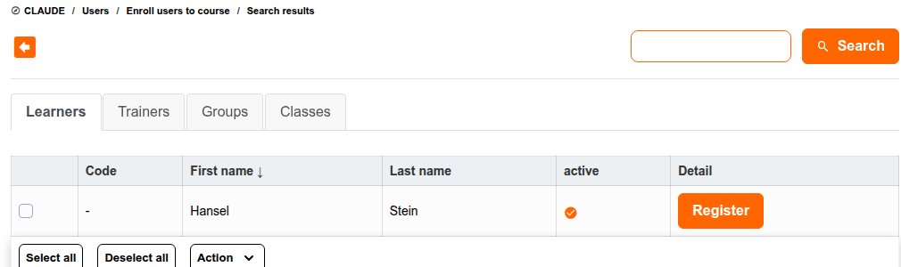
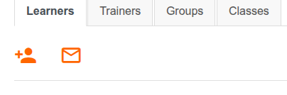
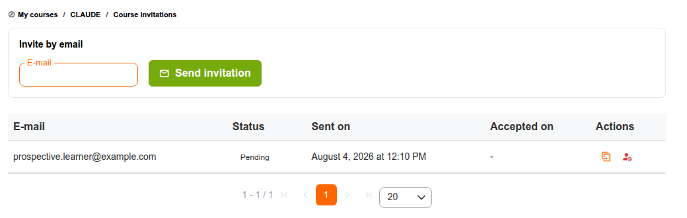

# Inscripción de usuarios

Antes de poder evaluar a un estudiante, este debe estar inscrito en su curso. Chamilo ofrece cuatro formas de incorporar a alguien, según quién realice la inscripción y si la persona ya tiene una cuenta en la plataforma.

| Método | Quién lo hace | ¿Necesita una cuenta existente? |
|--------|-------------|------------------------------|
| [Inscripción por el administrador](#administrator-enrollment) | Administrador de la plataforma | Sí |
| [Autoinscripción a través del catálogo de cursos](#self-enrollment-via-the-course-catalog) | El propio estudiante | Sí |
| [Inscripción manual mediante la herramienta Usuarios](#manual-enrollment-via-the-users-tool) | Docente (o administrador del curso) | Sí |
| [Invitación de usuarios por correo electrónico](#inviting-users-by-email) | Docente (o administrador del curso) | **No** |

## Inscripción por el administrador

Un administrador de la plataforma puede inscribir a cualquier usuario existente en cualquier curso directamente desde el panel de administración; resulta útil para la incorporación masiva (p. ej., importar una lista de clase) o cuando un docente no tiene permisos para gestionar la inscripción por sí mismo. Consulte la sección [Cursos](../../admin-guide/courses/README.md) de la Guía de administración.

## Autoinscripción a través del catálogo de cursos

Si la [visibilidad](../creating-your-course/course-settings.md#course-visibility) de su curso lo permite, los estudiantes con una cuenta en la plataforma pueden inscribirse por sí mismos buscando su curso en **Explorar más cursos** y haciendo clic para unirse; no se requiere ninguna acción por su parte. La disponibilidad de esta opción y si requiere una contraseña se controlan mediante los **Ajustes de inscripción** en [Ajustes del curso](../creating-your-course/course-settings.md#enrollment-settings).

## Inscripción manual mediante la herramienta Usuarios

Para inscribir a alguien que ya tiene una cuenta en la plataforma pero no se ha unido por su cuenta, abra la herramienta **Usuarios** de su curso y haga clic en el icono **Añadir usuarios** .

1. Busque a la persona por nombre, nombre de usuario, correo electrónico o código oficial
2. Haga clic en **Registrar** en su fila, o seleccione varios con las casillas de verificación y use el menú **Acción** para inscribirlos a todos a la vez

Solo aparecen en los resultados los usuarios que aún no están inscritos en el curso.

> Este icono está disponible para los docentes de forma predeterminada. Un administrador de la plataforma puede restringirlo solo a administradores mediante el ajuste **Allow User Course Subscription By Course Administrator** (`allow_user_course_subscription_by_course_admin`); si no ve el icono **Añadir usuarios**, consulte a su administrador.

## Invitación de usuarios por correo electrónico

Los tres métodos anteriores presuponen que la persona ya tiene una cuenta en la plataforma. Las **invitaciones al curso** cubren el caso en que no la tiene: usted envía una invitación a una dirección de correo electrónico y Chamilo envía a esa persona un enlace de un solo uso. Al abrir el enlace, puede crear una cuenta y, en cuanto termina de registrarse, queda inscrita automáticamente en su curso; no se necesita un paso de inscripción aparte.

### Acceso a la herramienta

Abra la herramienta **Usuarios** de su curso y, a continuación, haga clic en el icono **Invitar por correo electrónico**  de la barra de herramientas, junto a **Añadir usuarios**:

Se abre la página **Invitaciones al curso**.

### Quién puede enviar invitaciones

* Los administradores de la plataforma, siempre.
* En un curso ordinario (no abierto en una sesión): los docentes y otros usuarios con derechos de edición sobre el curso.
* En una sesión: el coach general de la sesión o un administrador de sesión; no el conjunto más amplio de coaches del curso, ya que enviar una invitación aquí inscribe en la *sesión completa*, no solo en este curso.

### Envío de una invitación

1. Introduzca la dirección de correo electrónico del destinatario en el formulario **Invitar por correo electrónico**
2. Haga clic en **Enviar invitación**

Todas las invitaciones que haya enviado para este curso aparecen debajo del formulario, con su estado:

| Estado | Significado |
|--------|---------|
| **Pendiente** | Enviada, aún no utilizada. Sigue dentro de su período de validez. |
| **Aceptada** | El destinatario se registró y fue inscrito. |
| **Revocada** | Usted la canceló antes de que se utilizara. |

En el caso de una invitación aún pendiente, la columna **Acciones** ofrece:

* **Copiar**  — copia el enlace de la invitación, por si prefiere compartirlo usted mismo (chat, en persona) en lugar de depender del correo electrónico.
* **Revocar**  — cancela la invitación de inmediato; el enlace deja de funcionar. Una invitación ya aceptada no se puede revocar.

> **La dirección de correo electrónico invitada no debe tener ya una cuenta en esta plataforma.** Si la tiene, el envío de la invitación falla con un mensaje que le pide que inscriba a ese usuario existente directamente, a través de [Inscripción manual mediante la herramienta Usuarios](#manual-enrollment-via-the-users-tool) más arriba.

### Invitaciones en una sesión

Si abre la herramienta Usuarios desde un curso que se está impartiendo dentro de una sesión, la página muestra un recordatorio de que la invitación se aplica a toda la sesión, no solo a este curso:

> *Este curso está abierto en una sesión. Enviar una invitación aquí inscribirá al destinatario en toda la sesión, no solo en este curso.*

Esto refleja cómo funciona la inscripción en el resto de Chamilo: se inscribe a alguien en una sesión en su conjunto, o en un curso independiente, pero nunca en «este curso concreto dentro de esta sesión» como una acción aparte.

### Qué ve la persona invitada

El correo electrónico contiene un enlace a la página de registro. Al abrirlo:

* Rellena previamente y bloquea el campo de correo electrónico con la dirección que invitó: no pueden registrarse con una dirección distinta mediante ese enlace.
* Les permite completar el registro **incluso si el autorregistro está desactivado en toda la plataforma**, siempre que el administrador haya activado el ajuste **Permitir el registro mediante enlaces de invitación al curso** (véase más abajo). Sin él, un enlace de invitación solo resulta útil cuando el autorregistro está abierto por otros medios.
* Los inscribe de inmediato en su curso (o en la sesión) en cuanto envían el formulario, y los conecta.

El enlace es de un solo uso y caduca a los 7 días. Si caduca o se revoca la invitación de destino, al abrirlo se comporta como si el enlace nunca hubiera existido.

> El ajuste de toda la plataforma **Permitir el registro mediante enlaces de invitación al curso** (`registration.allow_invitation_registration`) determina si el enlace de invitación puede abrir el registro cuando el autorregistro general está desactivado. Consulte a su administrador si las invitaciones no parecen funcionar en una plataforma que, por lo demás, está cerrada.

## Consejos

* **Adapte el método a la situación** — inscripción por el administrador o autoinscripción para quienes ya utilizan la plataforma, inscripción manual para un usuario existente conocido, e invitaciones para invitados externos, revisores o cualquier persona que aún no tenga una cuenta.
* **Revoque las invitaciones que ya no necesite** — una invitación pendiente antigua sigue siendo un enlace válido y sin usar; revóquela si el destinatario previsto ya no necesita acceso, o si no está seguro de que le haya llegado.
* **Consulte a su administrador si algún método parece no estar disponible** — varios de estos flujos (inscripción manual, invitaciones, autoinscripción) pueden restringirse o desactivarse en toda la plataforma.