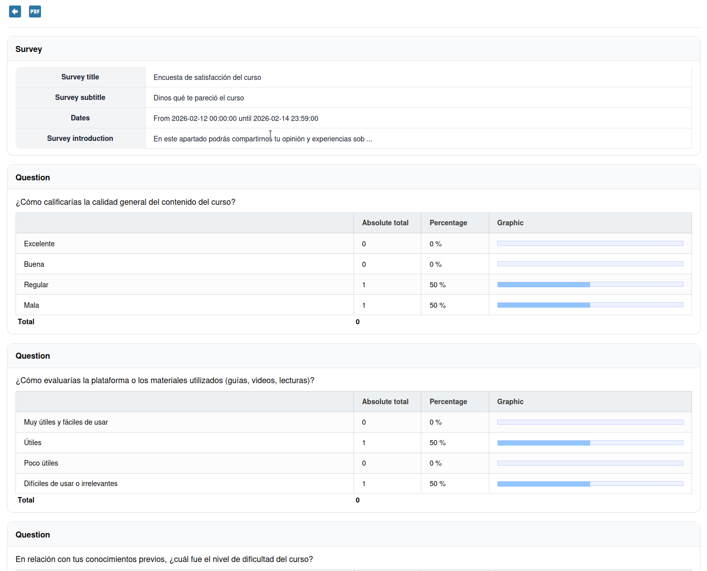

# Encuestas

La herramienta de encuestas le permite crear cuestionarios para recoger la opinión de sus estudiantes. Las encuestas son útiles para evaluaciones de cursos, diagnósticos de necesidades y sondeos de opinión.

## Crear una encuesta

1. Abra la herramienta **Encuestas**  desde la página de inicio del curso
2. Haga clic en **Crear encuesta**
3. Complete los datos de la encuesta:
   * **Código** — Es un código único de la encuesta. Se utilizará en los correos y en los enlaces.
   * **Título** — El nombre de la encuesta
   * **Subtítulo** — Un encabezado secundario opcional
   * **Fecha de inicio** — A partir de cuándo esta encuesta estará abierta a la participación
   * **Fecha de fin** — Hasta cuándo esta encuesta estará abierta a la participación
   * **Anónima** — Si las respuestas son anónimas o están vinculadas a estudiantes individuales
   * **Visibilidad de los resultados** — Quién puede ver los resultados (solo el tutor, el tutor y los estudiantes, todo el mundo)
   * **Introducción** — Un mensaje que se muestra a los estudiantes antes de que comiencen la encuesta
   * **Mensaje de agradecimiento** — Un mensaje que se muestra después del envío
4. Guardar

### Configuración avanzada

* **Calificación en la herramienta de evaluación** — Si se incluye el estado de respuesta de esta encuesta en la herramienta de evaluación (libro de calificaciones). Quien haya completado la encuesta obtiene el 100 %; los demás obtienen el 0 %
* **Encuesta principal** — No se utiliza realmente en este momento (función heredada)
* **Una pregunta por página** — Estilo de presentación de las preguntas
* **Activar el modo aleatorio** — Si se deben mezclar las preguntas
* **Mostrar el número de pregunta** — Si se muestran los números de pregunta (generados automáticamente)

### Plantillas creadas por un administrador

Los administradores de la plataforma pueden crear **plantillas de encuesta** reutilizables con sus propias preguntas. Cuando el administrador marca una plantilla como **Visible como plantilla**, un docente puede elegirla al crear una encuesta en un curso o una sesión autorizados. La encuesta copiada puede revisarse y publicarse mediante el flujo habitual de invitaciones. Los docentes no pueden asignar plantillas a otros cursos o sesiones fuera de su contexto docente.

Los administradores también pueden asignar una plantilla directamente a un curso elegido o a una sesión que contenga ese curso. Consulte [Plantillas de encuesta](../../admin-guide/survey-templates.md) para el flujo de trabajo del administrador (PR #9208, issue #8760).

### Resultados ocultos para docentes y tutores

En las encuestas cuyos datos de respuesta deben permanecer confidenciales para el personal docente, un administrador de la plataforma puede activar **Resultados ocultos para el docente/tutor** en la configuración de la encuesta. Los docentes y los tutores pueden seguir viendo el número de respuestas y enviar recordatorios, pero **no pueden abrir ni exportar los resultados**. Esta restricción también se aplica a las descargas de informes; solo un administrador de la plataforma puede acceder a los resultados restringidos. Es independiente de la selección normal de **Visibilidad de los resultados** y de la configuración global del botón de informes.

### Plantilla de satisfacción de la formación

Si desea un cuestionario estándar de fin de formación, utilice la acción **Crear encuesta de satisfacción** en la barra de herramientas de Encuestas. Chamilo crea una **encuesta de satisfacción de la formación** anónima a partir de la plantilla integrada de siete preguntas y abre de inmediato su editor de preguntas.

La encuesta se crea en el contexto del curso o de la sesión de curso actual y no se publica automáticamente. Revise o edite primero las preguntas generadas y, a continuación, publíquela y elija los destinatarios de la forma habitual. Esta acción solo está disponible para los usuarios que pueden crear encuestas y se oculta cuando la creación de encuestas está desactivada por la configuración de la plataforma.

## Añadir preguntas

Una vez creada la encuesta, añada preguntas:

1. Elija el tipo de pregunta:
   * **Sí/No** — Una elección binaria sencilla
   * **Opción múltiple** — Seleccionar una respuesta entre varias opciones
   * **Respuesta múltiple** — Seleccionar una o más respuestas entre varias opciones
   * **Respuesta abierta** — Respuesta de texto libre
   * **Lista desplegable** — Seleccionar de una lista desplegable
   * **Porcentaje** — Elegir un valor porcentual
   * **Puntuación** — Valorar en una escala numérica
   * **Comentario** — Un bloque de texto (no es una pregunta) para añadir instrucciones entre preguntas
   * **Opción múltiple con opción «otra»** — Seleccionar una respuesta entre varias opciones, con una alternativa
   * **Visualización selectiva** — Tipo especial que permite adaptar el flujo de preguntas en función de las respuestas anteriores
   * **Salto de página** — Añadir saltos de página en el flujo de preguntas. Solo es útil si **no** se seleccionó «Una pregunta por página» en el paso anterior
2. Configure el texto de la pregunta y las opciones de respuesta
3. Guardar

Cada pregunta puede marcarse como obligatoria. Si no lo hace, omitir cualquier pregunta será un comportamiento aceptable.

---
## Publicar una encuesta

Después de añadir todas las preguntas:

1. Haga clic en **Publicar**
2. Elija los destinatarios — Seleccione estudiantes o grupos específicos (usted los selecciona). El botón **Añadir estudiantes** añade a todos los estudiantes de una sola vez y deja fuera a los docentes
3. Añadir usuarios adicionales — Le permite invitar a usuarios externos a Chamilo a participar en la encuesta. Recibirán un correo electrónico con un enlace y aparecerán por su dirección de correo electrónico en los detalles de la encuesta
4. Asunto del correo
5. Texto del correo — Explique de qué trata la encuesta y cuándo y cómo responder
6. Hay distintas opciones disponibles para las invitaciones repetidas
7. Confirmar

Los estudiantes reciben una invitación (por correo electrónico) para completar la encuesta.

En la parte inferior de la página de publicación hay un enlace para invitar a aún más usuarios externos a participar. Los participantes que utilicen este enlace no serán identificados y aparecerán como anónimos en los resultados de la encuesta.

## Ver los resultados

Después de que los estudiantes hayan respondido:

1. Abra la encuesta
2. Haga clic en **Resultados** o **Informe**
3. Consulte los resúmenes de las respuestas:
   * Gráficos y porcentajes de las preguntas cerradas
   * Respuestas de texto individuales de las preguntas abiertas
   * Tasa de finalización (cuántos invitados respondieron)

Puede exportar los resultados a una hoja de cálculo para un análisis más detallado.

## Consejos

* **Sea breve** — Es más probable que los estudiantes completen las encuestas más cortas
* **Utilice el modo anónimo** — Para obtener comentarios sinceros, active las respuestas anónimas
* **Elija el momento adecuado** — Envíe encuestas a mitad del curso para realizar ajustes, no solo evaluaciones al final del curso