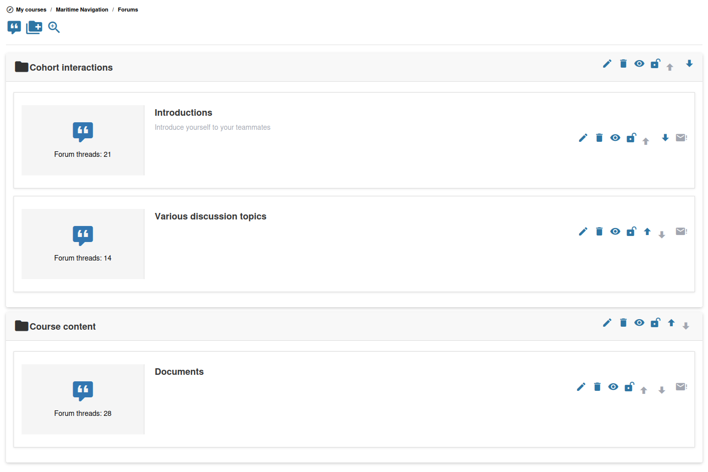

# Foros

La herramienta de foros le permite organizar debates estructurados dentro de su curso. Los estudiantes pueden publicar mensajes, responderse entre sí y participar en conversaciones en hilos.

## Estructura del foro

Los foros en Chamilo se organizan en tres niveles:

1. **Categorías de foro** — Agrupaciones de nivel superior (p. ej., «Debates generales», «Preguntas del módulo 1»)
2. **Foros** — Tableros de debate individuales dentro de una categoría
3. **Temas (hilos)** — Temas de debate individuales dentro de un foro, cada uno con una cadena de respuestas

## Crear una categoría de foro

1. Abra la herramienta **Foros**  desde la página de inicio de su curso
2. Haga clic en **Añadir una categoría de foro**
3. Introduzca un **Nombre de la categoría** y una descripción opcional
4. Guarde

## Crear un foro

Solo puede añadir un foro cuando exista al menos una categoría.

1. Dentro de una categoría, haga clic en **Añadir un foro**
2. Complete los datos básicos:
   * **Título** — El nombre de este tablero de debate
   * **Descripción** — Una descripción opcional de la finalidad del foro
   * **Crear en la categoría** — La categoría a la que pertenece este foro
3. Abra **Configuración avanzada** para configurar:
   * **Fecha de publicación** / **Fecha de cierre** — Intervalo de tiempo opcional durante el cual el foro está abierto
   * **Foro moderado** — Exigir que las nuevas publicaciones sean aprobadas por un docente antes de hacerse visibles
   * **¿Pueden los estudiantes editar sus propias publicaciones?** — Permitir o impedir que los estudiantes editen las publicaciones después de enviarlas
   * **Permitir a los usuarios iniciar nuevos hilos** — Si se establece en No, los estudiantes solo pueden responder a hilos existentes
   * **Tipo de vista predeterminado** — Elija cómo se muestran las publicaciones: **Plano**, **En hilos** o **Anidado**
   * **Para el grupo** — Asociar este foro a un grupo del curso
   * **Acceso público / Acceso privado** — En los foros de grupo, decidir si cualquier miembro del curso puede leerlo o solo los miembros del grupo
4. Guarde

Si la visibilidad del curso está establecida en «Abierto al mundo», el formulario también muestra la opción **¿Permitir publicaciones anónimas?**. Esta opción está oculta en los cursos con visibilidad restringida.

## Gestión de temas

Los estudiantes (y usted) pueden crear nuevos temas dentro de un foro. Como docente, puede:

* **Fijar un tema (mensaje fijo)** — Marcar un hilo como fijo al crearlo o editarlo para que aparezca siempre en la parte superior
* **Bloquear un tema** — Impedir nuevas respuestas
* **Editar o eliminar publicaciones** — Moderar el debate
* **Mover un tema** — Transferir un tema a otro foro
* **Listar las publicaciones desde la más reciente** — Un hilo lista sus publicaciones desde la más antigua. El botón de flechas de la barra de herramientas del hilo (**Más recientes primero**) las lista desde la más reciente, para seguir la actividad más reciente de un hilo largo; haga clic de nuevo (**Más antiguas primero**) para volver. En las vistas en hilos y anidada, las respuestas de cada publicación se listan desde la más reciente. Los estudiantes siempre leen el hilo desde la publicación más antigua y, dentro de una secuencia de aprendizaje, todos ven primero las publicaciones más recientes.

En hilos muy largos, su plataforma puede mostrar solo parte de las publicaciones de cada hilo a todos excepto a los administradores de la plataforma —usted incluido— cuando el administrador establece **Número máximo de publicaciones mostradas en un hilo de foro** (`thread_max_posts_for_non_admins`, consulte [Configuración de foros](../../admin-guide/platform-settings/forum-settings.md)). En las vistas en hilos y anidada, el límite se aplica a las respuestas de cada publicación: usted ve las primeras respuestas en la herramienta Foros y las más recientes dentro de una secuencia de aprendizaje, donde el límite también se aplica a los administradores. Listar las publicaciones desde la más reciente le muestra en su lugar las últimas. Consulte a un administrador si necesita leer las demás publicaciones de un hilo de este tipo.

## Calificación del foro

Al crear un nuevo hilo como docente, puede activar **Calificar este hilo** en Configuración avanzada. A continuación establece una puntuación máxima, un encabezado de columna para el libro de calificaciones y un peso en el informe. También puede activar **Hilo calificado por pares**, que exige que cada estudiante califique al menos a otros dos estudiantes antes de que cuente su propia puntuación.

Para calificar, haga clic en **Calificar hilo** en el hilo, dentro de la lista de hilos del foro. La ventana lista a los estudiantes que publicaron en el hilo, con un campo de puntuación para cada uno. Haga clic en el nombre de un estudiante para abrir su participación antes de calificarla: el número de usuarios del curso, el número de publicaciones del hilo, cuántas de ellas son del estudiante y su proporción del hilo, y después cada publicación que escribió el estudiante, con sus archivos adjuntos. También puede guardar la puntuación del estudiante desde esta ventana. Una papelera roja junto a cada publicación la elimina tras la confirmación, por ejemplo para quitar un mensaje fuera de tema o duplicado antes de calificar; los recuentos se actualizan y un estudiante que se queda sin ninguna publicación desaparece de la lista. La papelera no se muestra una vez que el libro de calificaciones ha bloqueado la puntuación del hilo.

## Requisitos de participación e información de la categoría

Los administradores pueden activar opcionalmente tres comportamientos aplicables a todos los foros en **Administración > Parámetros de configuración > Foros**:

* **Mostrar las respuestas del hilo solo después de participar** (`show_thread_replies_after_participation`) — El estudiante ve el mensaje de apertura del hilo, pero no las respuestas de otras personas hasta que haya publicado una contribución. Los profesores, los administradores, los tutores de sesión y los tutores de grupo no están sujetos a esta restricción. Una publicación del estudiante en espera de moderación cuenta igualmente como participación, aunque siguen aplicándose las reglas habituales de moderación.
* **Mostrar la descripción de la categoría del foro en los hilos** (`show_category_description_in_thread`) — El título de la categoría y un extracto de su descripción aparecen encima del debate. **Leer más** despliega las descripciones largas.
* **Publicaciones necesarias para completar un hilo del foro** (`thread_participation_progress_posts`) — Cuando el valor es mayor que `0`, una barra de progreso muestra el número de publicaciones del estudiante frente al objetivo configurado. Las publicaciones en espera de moderación cuentan. Si se establece en `0`, la barra se oculta.

El objetivo de progreso es un indicador informativo, **no** el umbral para desbloquear las respuestas: si las respuestas condicionadas a la participación están activadas, publicar una vez basta para levantar esa restricción. Estos parámetros están desactivados de forma predeterminada. Consulte [Parámetros de los foros](../../admin-guide/platform-settings/forum-settings.md).

Estos tres parámetros se aplican a todos los cursos de la plataforma, salvo que el administrador active también **Los parámetros de participación del foro pueden modificarse por curso** (`forum_participation_can_be_modified_in_course`). Cada curso elige entonces sus propios valores en la sección **Parámetros del foro** de sus [parámetros del curso](../creating-your-course/course-settings.md#forum-settings); por ejemplo, para ocultar las respuestas hasta que los estudiantes publiquen solo en algunos cursos, mientras los parámetros de la plataforma permanecen desactivados. Un curso que mantiene **Usar el parámetro de la plataforma** sigue el valor de la plataforma.

## Debates del foro dentro de una secuencia de aprendizaje

Cuando los estudiantes abren un debate del foro **desde un paso de una secuencia de aprendizaje**, sus respuestas se muestran **primero las más recientes**. En las vistas en hilo y anidada, la publicación de apertura permanece en la parte superior y las respuestas más recientes aparecen justo debajo, cada respuesta seguida de sus propias respuestas, también con las más recientes primero, de modo que los estudiantes ven su respuesta justo después de publicarla. Una publicación sin elemento superior en el hilo se muestra como respuesta a la publicación de apertura. La navegación ordinaria del foro fuera de la secuencia de aprendizaje conserva su orden habitual. La página del foro oculta las acciones redundantes **Volver a los hilos** y **Volver a la secuencia de aprendizaje** en este contexto incrustado; los estudiantes deben usar la navegación del reproductor de la secuencia de aprendizaje para pasar a otro paso.

Si los estudiantes abren el mismo debate desde la herramienta habitual **Foros**, utilizan la navegación normal del foro y el orden cronológico de las publicaciones. Este comportamiento contextual se corrigió en [PR #9163](https://github.com/chamilo/chamilo-lms/pull/9163).

## Notificaciones

Cada foro y cada hilo dispone de un interruptor **Notificarme** que usted y sus estudiantes pueden usar para suscribirse a notificaciones por correo electrónico sobre nuevas publicaciones. Las notificaciones son una suscripción por usuario y no se configuran al crear el foro.