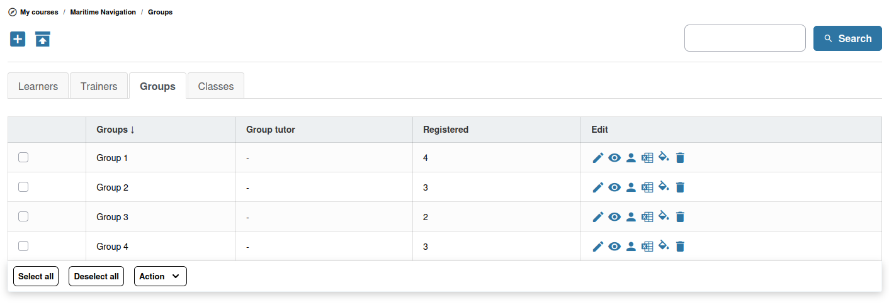

# Grupos

Los grupos le permiten dividir a sus estudiantes en equipos más pequeños para el trabajo colaborativo. Cada grupo puede disponer de sus propias herramientas compartidas, como documentos, foros y una wiki.

## Creación de grupos

1. Abra la herramienta **Grupos** desde la página de inicio del curso
2. Haga clic en **Crear grupos**
3. Configure los ajustes del grupo:
   * **Número de grupos** — Cuántos grupos crear
   * **Máximo de miembros por grupo** — El límite de tamaño de cada grupo (0 para ilimitado)
   * **Autoinscripción** — Si los estudiantes pueden unirse a los grupos por su cuenta
   * **Autodesinscripción** — Si los estudiantes pueden abandonar un grupo por su cuenta

## Herramientas de grupo

Cada grupo puede tener acceso a un subconjunto de herramientas del curso que se comparten únicamente entre los miembros del grupo:

* **Documentos** — Un espacio de archivos compartido para el grupo
* **Foro** — Un foro de debate específico del grupo
* **Wiki** — Una wiki colaborativa para el grupo
* **Chat** — Un espacio de chat para el grupo
* **Agenda** — Eventos de calendario limitados al grupo
* **Anuncios** — Enviar anuncios únicamente a los miembros del grupo
* **Tareas** — Recoger el trabajo del grupo

Para cada herramienta puede elegir su nivel de acceso: **No disponible**, **Público** (cualquier miembro del curso) o **Privado** (solo los miembros del grupo). Estos ajustes pueden aplicarse a nivel de categoría de grupo, de modo que varios grupos de la misma categoría compartan la misma configuración de herramientas.

## Gestión de los miembros del grupo

Puede gestionar la pertenencia a los grupos de varias maneras:

* **Asignación manual** — Añadir estudiantes concretos a cada grupo
* **Rellenar los grupos seleccionados** — Distribuir automáticamente a los estudiantes no inscritos entre los grupos seleccionados, respetando la capacidad de cada grupo y el límite de grupos por usuario
* **Autoinscripción** — Permitir que los estudiantes elijan su propio grupo
* **Importar desde clases** — Crear grupos automáticamente a partir de las clases ya inscritas en el curso

Para gestionar los miembros manualmente, haga clic en el nombre de un grupo y, a continuación, utilice la sección **Miembros** para añadir o eliminar estudiantes.

## Tutores de grupo

Puede asignar **tutores** a los grupos. Un tutor suele ser un estudiante o un asistente que ayuda a gestionar el trabajo del grupo. Los tutores pueden disponer de permisos adicionales dentro del grupo, como moderar el foro del grupo.

## Seguimiento del trabajo en grupo

Como docente del curso, puede acceder a todos los grupos y a sus herramientas compartidas con independencia de su pertenencia. Esto le permite:

* Revisar los documentos cargados por cada grupo
* Leer los debates del foro del grupo
* Comprobar las contribuciones a la wiki
* Evaluar la colaboración del grupo