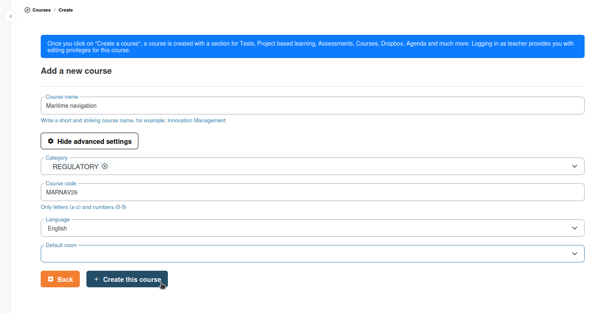

# Creación de su curso

Esta sección explica cómo crear un curso nuevo en Chamilo y configurarlo según sus necesidades.

## Creación de un curso nuevo

Para crear un curso:

1. Haga clic en **Mis cursos** en la barra lateral
2. Haga clic en el botón **Crear curso** (normalmente un icono de libro verde  con un signo +)
3. Complete el formulario de creación del curso:

| Campo | Obligatorio | Descripción |
|-------|----------|-------------|
| **Nombre del curso** | Sí | Un título breve y descriptivo para su curso (p. ej., «Gestión de la innovación») |
| **Categoría del curso** | No | Seleccione una categoría para ayudar a organizar los cursos en la plataforma |
| **Código del curso** | No | Un código breve que utilice solo letras y números (máximo 40 caracteres). Si se deja en blanco, se genera automáticamente a partir del nombre del curso |
| **Idioma** | No | El idioma principal del curso. De forma predeterminada, coincide con su idioma actual |

Si está habilitada, también puede encontrar la opción **Sala predeterminada** y la posibilidad de utilizar una **Plantilla de curso** para evitar crear el curso completamente desde cero.

4. Haga clic en **Crear este curso**

Se le redirigirá a la página de inicio de su nuevo curso. Aparecerá un mensaje de confirmación: «Curso creado correctamente.»

## La página de inicio del curso

Una vez creado el curso, accederá a su página de inicio. Este es el centro neurálgico del curso, donde usted y sus estudiantes acceden a todas las herramientas y contenidos.

La página de inicio muestra:

* **Título del curso** — El nombre de su curso, mostrado en la parte superior.
* **Introducción del curso** — Una descripción opcional o mensaje de bienvenida. Haga clic en el botón **+ Introducción del curso** para añadir una, o en el botón **Editar introducción**  de la parte superior para modificarla. Admite texto enriquecido con imágenes, enlaces y formato.
* **Cuadrícula de herramientas** — Una cuadrícula de todas las herramientas del curso disponibles, cada una mostrada como una tarjeta con un icono y un nombre.

### Gestión de la visibilidad de las herramientas

Como docente, puede controlar qué herramientas pueden ver sus estudiantes:

* Haga clic en el **icono del ojo**  junto a cualquier herramienta para ocultarla a los estudiantes. Las herramientas ocultas muestran un **ojo tachado**  y siguen siendo accesibles para usted.
* Utilice los botones **Mostrar todo** y **Ocultar todo** para cambiar todas las herramientas a la vez
* Haga clic en **Ordenar** para habilitar la reordenación de la cuadrícula de herramientas mediante arrastrar y soltar

### Vista de estudiante

Haga clic en el botón **Vista de estudiante** para ver la página de inicio del curso exactamente como la vería un estudiante. Esto resulta útil para comprobar que las herramientas ocultas y el contenido no publicado no son visibles. Haga clic de nuevo en el botón para volver a la vista de docente.

## Próximos pasos

* [Configuración del curso](course-settings.md) — Configure el acceso, la inscripción y otras opciones a nivel de curso
* [Página de inicio del curso](course-homepage.md) — Guía detallada para personalizar la página de inicio de su curso
* [Descripción del curso](course-description.md) — Redacte una descripción estructurada de su curso para el catálogo de cursos