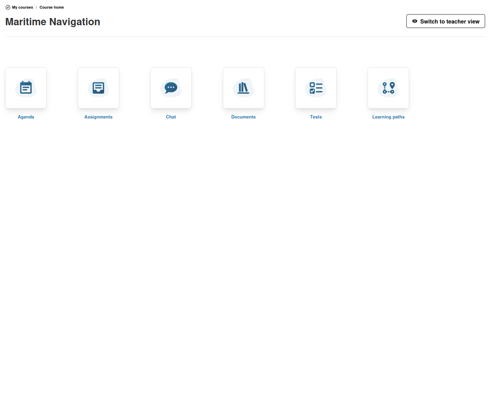

# Página de inicio del curso

La página de inicio del curso es la primera página que ven sus estudiantes al entrar en un curso. Esta página describe cómo personalizarla para crear un punto de entrada atractivo.

## Introducción del curso

La introducción del curso es un área de texto enriquecido que se muestra en la parte superior de la página de inicio, encima de la cuadrícula de herramientas. Úsela para:

* Dar la bienvenida a sus estudiantes
* Describir los objetivos del curso
* Proporcionar instrucciones para comenzar
* Insertar imágenes, vídeos o enlaces

Para editar la introducción:

1. Haga clic en el botón **Editar introducción** 
2. Utilice el editor de texto enriquecido para redactar su contenido
3. Guarde los cambios

Si aún no se ha creado ninguna introducción, verá un botón para **Crear una introducción**.

## Cuadrícula de herramientas

Debajo de la introducción, las herramientas del curso se muestran en una disposición de cuadrícula. Cada herramienta aparece como una tarjeta con:

* Un icono que representa la herramienta
* El nombre de la herramienta

Las herramientas disponibles en su curso pueden incluir:

| Herramienta | Icono | Finalidad |
|------|------|---------|
| Agenda |  | Programar eventos y fechas límite |
| Anuncios |  | Enviar mensajes a los estudiantes inscritos |
| Tareas |  | Recoger y calificar el trabajo de los estudiantes |
| Documentos |  | Cargar y organizar archivos y contenidos |
| Tests |  | Crear cuestionarios y tests |
| Foro |  | Alojar debates |
| Glosario |  | Definir términos clave |
| Evaluaciones |  | Gestionar calificaciones y certificados |
| Rutas de aprendizaje |  | Crear secuencias de aprendizaje estructuradas |
| Enlaces |  | Compartir URL útiles |
| Usuarios |  | Ver y gestionar los usuarios inscritos |
| Encuestas |  | Crear y distribuir encuestas |

> Es posible que algunas herramientas no aparezcan si el administrador las ha desactivado a nivel de plataforma o si usted las ha ocultado.

Un cambio notable respecto a Chamilo 1.* es que ya no se dividen las herramientas en 3 secciones diferentes. Esto otorga a los docentes pleno control sobre qué herramientas mostrar y en qué orden.

Además, las herramientas **Seguimiento** y **Mantenimiento** se han trasladado a la parte superior de la página, bajo los iconos de estadísticas y de engranaje, para retirar de la lista las herramientas que nunca se muestran a los estudiantes.

## Organización de las herramientas

### Reordenación

1. Haga clic en el botón **Ordenar** en la parte superior de la cuadrícula de herramientas
2. Arrastre y suelte las herramientas para reorganizar su orden
3. El nuevo orden se guarda automáticamente

### Ocultar y mostrar

* Haga clic en el **icono de visibilidad** de cualquier herramienta para alternar entre visible y oculta para los estudiantes
* Utilice **Mostrar todo** u **Ocultar todo** para cambios masivos
* Las herramientas ocultas siguen siendo accesibles para usted como docente: solo están ocultas para los estudiantes

## Funciones de inicio automático

Puede configurar determinadas herramientas para que se inicien automáticamente cuando un estudiante entra en el curso. Si está activado, aparece una notificación en la parte superior de la página de inicio del curso que indica qué inicio automático está activo:

* Inicio automático de documento — Abre un documento específico de forma automática
* Inicio automático de ejercicio — Inicia un test de inmediato
* Inicio automático de ruta de aprendizaje — Inicia una ruta de aprendizaje al entrar en el curso
* Inicio automático de foro — Abre el foro directamente