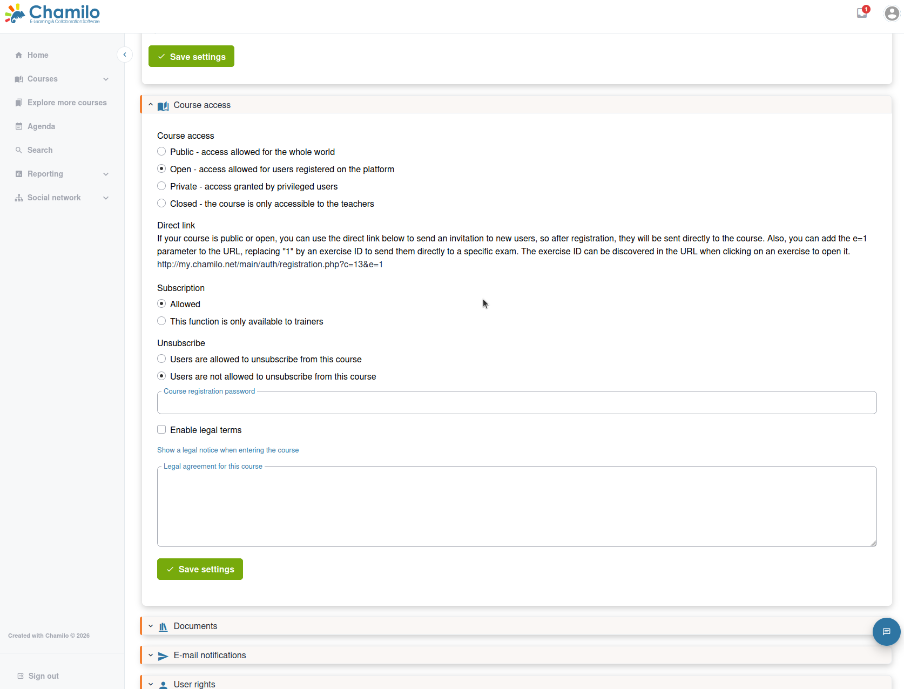

# Configuración del curso

La configuración del curso le permite controlar cómo se comporta su curso: quién puede acceder a él, cómo se muestra y qué funciones están habilitadas.

Para acceder a la configuración del curso, entre en su curso y haga clic en el icono **Configuración**  situado junto al botón **Cambiar a la vista de estudiante**.

## Configuración general

### Información del curso

* **Título del curso** — El nombre visible de su curso
* **Idioma del curso** — El idioma principal de la interfaz del curso
* **Categoría del curso** — La categoría bajo la cual aparece el curso en el catálogo
* **Imagen del curso** — Cargue una miniatura que represente su curso en los listados de cursos (se redimensionará según el contexto)

El código del curso (el identificador único corto) se establece al crear el curso y no se puede editar desde esta página.

De forma predeterminada, todos los usuarios que entren en su curso verán toda la interfaz de Chamilo en el idioma de su curso. Se trata de una función de inmersión. Los administradores pueden cambiar este comportamiento, pero usted también puede modificarlo con una de las primeras opciones: **Mostrar el curso en el idioma del usuario** (establecida en No de forma predeterminada) si considera que esto resulta demasiado difícil para sus usuarios.

El departamento y la URL del departamento son campos obsoletos. Solo se mantienen por motivos de compatibilidad con versiones anteriores.

Si está habilitada, puede cambiar el estilo dentro de su curso con la opción **Hojas de estilo**, utilizando las hojas de estilo existentes en su portal. Esta opción suele estar deshabilitada por los administradores, para lograr un diseño global más integrado.

### Cuota de disco

Cada curso tiene un límite de almacenamiento (cuota de disco) para los archivos cargados. La cuota la establece el administrador de la plataforma. Puede ver su límite actual en la configuración del curso y el uso actual en la herramienta **Documentos**.

> Si se está quedando sin espacio, contacte al administrador de la plataforma para solicitar un aumento de la cuota, o elimine los archivos no utilizados de la herramienta Documentos.

### Visibilidad del curso

Controle quién puede acceder a su curso:

| Configuración | Descripción |
|---------|-------------|
| **Público** | Cualquier persona, incluidos los visitantes anónimos, puede acceder al curso |
| **Abierto a la plataforma** | Todos los usuarios registrados en la plataforma pueden acceder al curso |
| **Privado — acceso concedido por usuarios con privilegios** | Solo los usuarios inscritos explícitamente en el curso pueden acceder a él |
| **Cerrado** | El curso está bloqueado; nadie puede acceder a él excepto el docente |

#### Configuración de inscripción

Según la configuración de su plataforma, es posible que pueda controlar:

* **Permitir la autoinscripción** — Si los estudiantes pueden inscribirse por sí mismos a través del catálogo de cursos
* **Permitir la baja voluntaria** — Si los estudiantes pueden abandonar el curso por su cuenta
* **Contraseña de inscripción** — Exigir una contraseña para la autoinscripción (útil para restringir el acceso a un grupo específico), pero el nivel de seguridad es bajo, ya que la misma contraseña de acceso al curso se comparte entre todos los usuarios.

Estos ajustes solo cubren la autoinscripción. Para obtener el panorama completo —incluida la inscripción de un usuario existente por su parte, o la invitación de alguien que aún no tiene una cuenta en la plataforma— consulte [Inscripción de usuarios](../assessing-learners/subscribing-users.md).

### Configuración de documentos

Elija si desea mostrar u ocultar las carpetas del sistema en la herramienta **Documentos** (ocultas de forma predeterminada; en la mayoría de los casos no las necesita realmente y mostrarlas podría causar problemas con el contenido oculto y los estudiantes).

* **Visibilidad predeterminada de los documentos nuevos** — Decida si los documentos, carpetas y archivos que cree o cargue son visibles para los estudiantes de inmediato, o invisibles hasta que los publique. Esta opción solo aparece cuando el administrador de la plataforma permite que cada curso elija; de lo contrario, se aplica el valor predeterminado de la plataforma (visible, salvo que se haya cambiado).

### Configuración de notificaciones por correo electrónico

Configure cómo la actividad del curso genera notificaciones:

* **Notificaciones por correo electrónico de contenido nuevo** — Notificar a los usuarios inscritos cuando añada documentos, anuncios u otro contenido nuevo

### Configuración del chat

Controle cómo se mostrará la herramienta **Chat**.

### Configuración de las lecciones

* **Habilitar temas del curso** — Permitir que las lecciones cambien de apariencia (no recomendado para una experiencia de usuario integrada)
* **Enlace de retorno de la lección** — Decida dónde llegan los usuarios cuando hacen clic en el icono **Inicio** de una lección: la lista de lecciones, la página de inicio del curso, *Mis cursos*, *Mis sesiones* o la página de inicio del portal
* **Visibilidad predeterminada de las lecciones nuevas** — Decida si una lección que cree (o importe desde un paquete SCORM) es visible para los estudiantes de inmediato, o invisible hasta que la publique. Esta opción solo aparece cuando el administrador de la plataforma permite que cada curso elija; de lo contrario, se aplica el valor predeterminado de la plataforma (invisible, salvo que se haya cambiado).

### Configuración de los tests

* **Visibilidad predeterminada de los tests nuevos** — Decida si un test que cree (o importe) es visible para los estudiantes de inmediato, o invisible hasta que lo publique. Esta sección solo aparece cuando el administrador de la plataforma permite que cada curso elija; de lo contrario, se aplica el valor predeterminado de la plataforma (visible, salvo que se haya modificado).

### Configuración del avance temático

Configure cómo aparecerán los mensajes de avance temático en la página de inicio del curso.

### Configuración del foro

Controle el comportamiento de la herramienta de foro de este curso.

Cuando el administrador de la plataforma permite que cada curso los elija (`forum_participation_can_be_modified_in_course`), esta sección también muestra las opciones de participación en el foro. De lo contrario, la configuración de la plataforma se aplica a todos los cursos, como se describe en [Foros](../collaboration-and-communication/forums.md#participation-requirements-and-category-information).

* **Mostrar las respuestas del hilo solo después de participar** — **Sí** para mostrar a los estudiantes solo el mensaje inicial de un hilo hasta que hayan publicado en él, **No** para mostrar siempre todas las respuestas, o **Usar la configuración de la plataforma**
* **Mostrar la descripción de la categoría del foro en los hilos** — **Sí** para mostrar el título y una descripción abreviada de la categoría del foro en la parte superior de cada hilo, **No** para ocultarlos, o **Usar la configuración de la plataforma**
* **Publicaciones necesarias para completar un hilo del foro** — El número de publicaciones que un estudiante debe escribir en un hilo para que su barra de progreso de participación alcance el 100 %. Establezca `0` para ocultar la barra, o déjelo vacío para usar la configuración de la plataforma

### Configuración de las tareas

* **Configuración predeterminada de la visibilidad de los archivos recién publicados** — Decida si los documentos nuevos subidos por los estudiantes en la herramienta **Tareas** se comparten con todos los demás estudiantes (No de forma predeterminada)
* **Permitir a los estudiantes eliminar sus propias publicaciones** — Permita a los estudiantes eliminar las tareas que ya han subido (en caso de que deseen subir una corrección).

### Tiempo dedicado al curso

Cuando el administrador de la plataforma permite que cada curso lo elija (`show_clock_time_spent_can_be_modified_in_course`), esta sección le permite decidir si los estudiantes ven, en cada página del curso, incluidas las lecciones, un reloj con el tiempo total que han dedicado al curso. De lo contrario, la configuración de la plataforma (`show_clock_time_spent_on_all_course_page_for_learner`) se aplica a todos los cursos.

* **Mostrar a los estudiantes el tiempo dedicado al curso** — **Sí** para mostrar el reloj a los estudiantes de este curso, **No** para ocultarlo, o **Usar la configuración de la plataforma**

El reloj aparece en la parte inferior izquierda de la página. Muestra el tiempo registrado por el seguimiento del curso, el mismo que en los informes del curso, y deja de contar cuando el estudiante ha estado inactivo durante más tiempo del que permite la plataforma. Los docentes nunca lo ven, ni siquiera en la vista de estudiante.

### Configuración de inicio automático

Un curso puede configurarse con un comportamiento de inicio automático, que acortará el recorrido de los estudiantes para llegar a las partes importantes de su curso. Si está activado, los estudiantes que entren en su curso serán enviados directamente a la herramienta seleccionada y no verán la página de inicio del curso como paso intermedio. Incluso puede seleccionar lecciones o ejercicios específicos para que se inicien al llegar al curso. En este caso, debe seleccionar la opción aquí y, a continuación, ir a la lista de lecciones o ejercicios y hacer clic en el icono del cohete  del elemento seleccionado.

### Configuración de los asistentes de IA

Esta sección solo aparece si su administrador ha activado las herramientas de IA en la plataforma. Le permite precisar la selección de servicios de asistencia de IA disponibles a través de las distintas herramientas de su plataforma Chamilo. Desactívelos si no desea utilizarlos, aunque probablemente sería una mala idea, ya que son muy potentes.

Estas funciones se explican en la sección **Herramientas de IA** de esta guía.

### Herramientas externas (LTI)

Si está activado en su plataforma, Learning Tools Integration le permite integrar actividades externas compatibles en este curso, como iconos individuales en la página de inicio del curso. El análisis de LTI queda fuera del alcance de esta guía, pero se trata de un potente sistema de integración para los docentes.

### Otros

Pueden aparecer secciones u opciones adicionales en esta página según las opciones y las versiones de Chamilo.