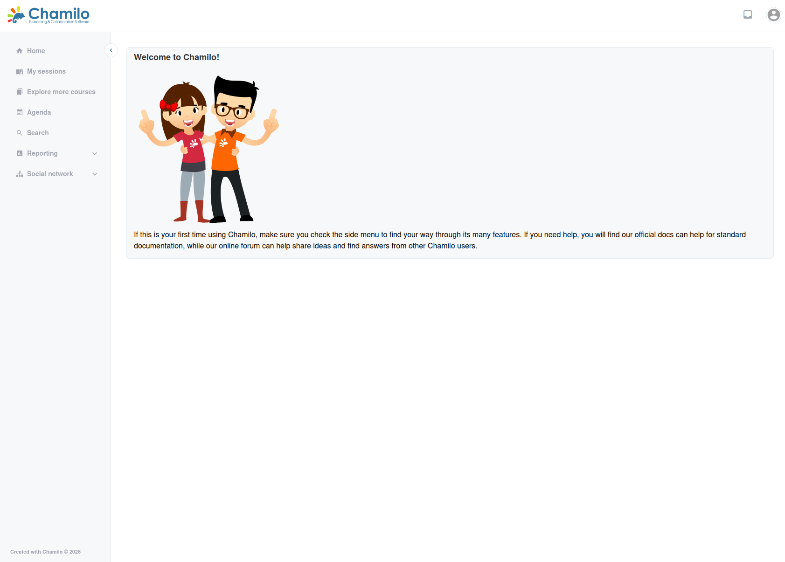
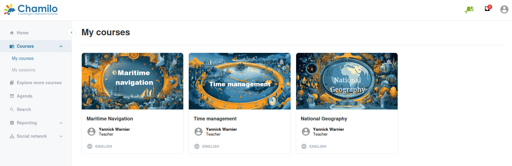

# Primeros pasos

Esta sección le ayuda a familiarizarse con Chamilo 3.0. Aprenderá a iniciar sesión, a navegar por la interfaz principal y a configurar su perfil.

## Inicio de sesión

Para acceder a Chamilo, abra su navegador y vaya a la URL proporcionada por su institución (por ejemplo, `https://chamilo.yourschool.edu`). Introduzca su nombre de usuario y su contraseña en la página de inicio de sesión y haga clic en **Iniciar sesión**.

Si su institución utiliza autenticación externa (como Azure, Keycloak o un sistema de inicio de sesión único universitario), es posible que vea botones de inicio de sesión adicionales debajo del formulario de inicio de sesión estándar. Haga clic en el botón correspondiente para autenticarse a través del proveedor de identidad de su institución.

> Si ha olvidado su contraseña, haga clic en el enlace **¿Ha olvidado su contraseña?** de la página de inicio de sesión. Recibirá un correo electrónico con instrucciones para restablecerla.

## Un primer vistazo

Tras iniciar sesión, verá la página de inicio de Chamilo. La interfaz se organiza en tres áreas principales:

* **Barra superior** — Muestra el logotipo de la plataforma, su bandeja de entrada de mensajes (con una insignia que indica los mensajes no leídos) y su avatar de usuario. Haga clic en su avatar para acceder a su perfil y a la configuración de la cuenta.
* **Barra lateral** — El panel de navegación izquierdo le ofrece acceso rápido a sus cursos, sesiones, agenda, red social y más. Puede contraerla haciendo clic en el conmutador de su borde.
* **Área de contenido principal** — Aquí se muestra el contenido de la página actual. En la página de inicio verá los anuncios del sistema y sus cursos destacados.

## Sus cursos

Desde la barra lateral, haga clic en **Mis cursos** para ver todos los cursos en los que está inscrito como docente o estudiante. Cada curso aparece como una tarjeta que muestra:

* La imagen o miniatura del curso
* El título del curso
* Acciones de acceso rápido

Si su institución utiliza **sesiones** (periodos de formación delimitados en el tiempo), también verá un enlace **Mis sesiones** en la barra lateral, organizado en sesiones actuales, pasadas y próximas.

Las sesiones en Chamilo son una forma de impartir el mismo curso a distintos grupos de estudiantes en momentos diferentes, sin duplicar el contenido del curso. Piense en una sesión como una edición programada o una cohorte de un curso. Más adelante se tratará este tema con mayor detalle.

## Próximos pasos

* [Comprender la interfaz](understanding-the-interface.md) — Un examen detallado de cada parte de la interfaz de Chamilo
* [Su perfil](your-profile.md) — Cómo gestionar su información personal y sus preferencias
* [Cursos de demostración](demo-courses.md) — Los dos cursos listos para usar (AI Act y Using Chamilo) incluidos en cada nueva instalación