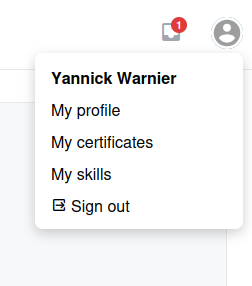

# Su perfil

Su perfil en Chamilo contiene su información personal y sus preferencias. Otros usuarios de la plataforma pueden ver partes de su perfil según su configuración de visibilidad.

## Acceder a su perfil

Haga clic en su **avatar** en la esquina superior derecha de la barra superior y, a continuación, seleccione **Perfil** en el menú desplegable. También puede acceder desde la sección **Red social** de la barra lateral.

## Información del perfil

Su página de perfil puede mostrar (según la configuración):

* **Avatar** — Su foto de perfil. Haga clic en **Editar perfil** para cambiarla.
* **Nombre completo** — Su nombre y apellidos tal como están registrados en la plataforma.
* **Correo electrónico** — Su dirección de correo electrónico. Otros usuarios pueden hacer clic en ella para enviarle un mensaje dentro de Chamilo.
* **Idioma** — Su idioma preferido.
* **Campos adicionales** — Según la configuración de su plataforma, puede ver campos como el número de teléfono, el identificador de Skype, el enlace al perfil de LinkedIn o campos personalizados definidos por su administrador.

## Editar su perfil

Para actualizar la información de su perfil, haga clic en **Editar perfil**. Aquí puede:

* Cambiar su nombre, correo electrónico y contraseña
* Cargar o cambiar su avatar o foto
* Actualizar su idioma preferido
* Completar campos adicionales del perfil (Skype, LinkedIn, etc.)
* Configurar las preferencias de notificación

Para cambiar su contraseña, haga clic en **Cambiar contraseña**. Por motivos de seguridad, deberá indicar su contraseña actual y su nueva contraseña dos veces.

Si su administrador ha habilitado la opción de **autenticación de dos factores** (`2fa_enable`) para la plataforma, su perfil le permitirá activar la 2FA para su propia cuenta mediante una aplicación de autenticación TOTP (Google Authenticator, Authy, 1Password, etc.). Una vez activada, el flujo de inicio de sesión solicitará el código de 6 dígitos basado en el tiempo, además de su contraseña.

## Datos personales

En **Red social** > **Datos personales**, puede revisar toda la información que Chamilo almacena sobre usted. Esta sección incluye:

* Un resumen de todos los datos recopilados, organizados por categoría
* Si su organización lo ha habilitado, su estado de aceptación de los **Términos y condiciones** de la plataforma
* Si su organización lo ha habilitado, una opción para **retirar su consentimiento** o **eliminar cuenta**, lo que generará una solicitud de eliminación de cuenta que procesará su administrador

> Esta función se ofrece para cumplir con las normativas de protección de datos. Póngase en contacto con su administrador si tiene preguntas sobre cómo se tratan sus datos.