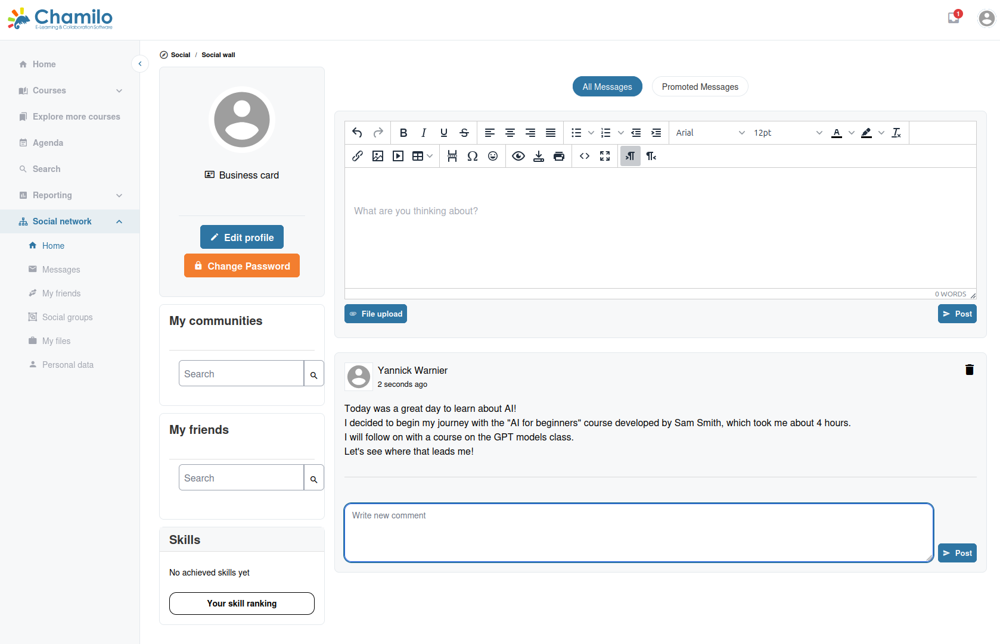

# Red social

Chamilo incluye una red social integrada que le permite conectar con otros usuarios de la plataforma. Esta función puede ser activada o desactivada por el administrador de la plataforma.

## Acceso a la red social

Haga clic en **Red social** en la barra lateral para acceder a las funciones sociales. Si no ve esta opción, es posible que el administrador la haya desactivado.

## Su muro social

El muro social muestra un feed de actividad suya y de sus conexiones. Puede:

* **Publicar actualizaciones** — Compartir texto y enlaces con sus conexiones
* **Dar me gusta y comentar** — Interactuar con las publicaciones de otros usuarios
* **Ver la actividad** — Consultar las publicaciones recientes de las personas con las que está conectado

## Conexiones

Puede conectar con otros usuarios de la plataforma:

* **Buscar usuarios** — Encontrar colegas y estudiantes por nombre
* **Enviar solicitudes de conexión** — Invitar a otros usuarios a conectar
* **Gestionar conexiones** — Aceptar, rechazar o eliminar conexiones

> **Nota:** Los estudiantes solo pueden buscar y añadir a otros estudiantes como amigos; no pueden enviar solicitudes de amistad a los docentes. Como docente, sin embargo, usted puede buscar estudiantes y solicitar añadirlos como amigos.

## Mensajería

La red social se integra con el sistema de mensajería de la plataforma:

* **Enviar mensajes**  — Escribir mensajes directos a otros usuarios
* **Bandeja de entrada**  — Leer y responder a los mensajes recibidos
* **Mensajes enviados**  — Revisar los mensajes que ha enviado

### Redacción y respuesta

Al redactar un mensaje nuevo, puede dirigirlo a varios destinatarios a la vez. Del mismo modo, al responder a un mensaje, puede incluir a varios usuarios en su respuesta, lo que resulta útil para la coordinación de un grupo sin un grupo social formal.

### Respuestas por correo electrónico y estado de apertura

Si el administrador ha habilitado las respuestas de correo electrónico entrante, los destinatarios de las notificaciones de mensajes directos pueden responder desde su cliente de correo electrónico y la respuesta se añade de nuevo a la conversación de Chamilo. La respuesta debe proceder de la dirección de correo electrónico registrada en la cuenta de Chamilo del destinatario.

Si el seguimiento de apertura del correo electrónico está habilitado, sus **Mensajes enviados** también pueden mostrar una marca de tiempo de **Notificaciones por correo electrónico**. Solo indica que se solicitó la imagen de seguimiento de la notificación y no demuestra que el mensaje haya sido leído.

### Chat flotante y videollamadas individuales

El panel de chat flotante es independiente tanto de la bandeja de entrada como de la herramienta **Chat** del curso. Seleccione un contacto en línea para intercambiar mensajes directos en tiempo real. Si el administrador ha habilitado el chat de vídeo y su navegador admite WebRTC, un contacto en línea también muestra **Iniciar videollamada**.

Las llamadas son individuales. El destinatario puede **Aceptar** o **Rechazar** una llamada entrante. Durante una llamada conectada, cualquiera de los participantes puede silenciar o activar el micrófono, encender o apagar la cámara y colgar. El navegador puede solicitar permiso para la cámara y el micrófono la primera vez.

### Etiquetas de mensajes

Si la configuración de su plataforma utiliza etiquetas de mensajes (normalmente gestionadas a nivel de plataforma), su bandeja de entrada muestra una lista de etiquetas en las que puede hacer clic para filtrar los mensajes por esa etiqueta, lo que agiliza la localización de hilos relacionados a medida que crece su bandeja de entrada.

## Grupos sociales

Los grupos sociales permiten a los usuarios reunirse en torno a intereses o proyectos comunes:

* **Unirse a grupos** — Explorar y unirse a grupos existentes
* **Crear grupos** — Iniciar un nuevo grupo social (si está permitido)
* **Debates de grupo** — Compartir publicaciones en el contexto de un grupo

> Los grupos sociales son distintos de los **grupos de curso** (tratados en la sección [Grupos](collaboration-and-communication/groups.md)). Los grupos de curso están vinculados a un curso específico, mientras que los grupos sociales son de ámbito de plataforma.