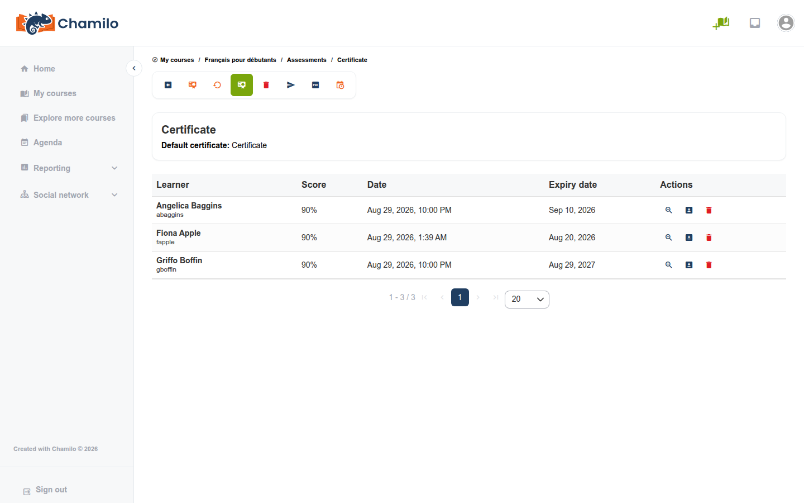
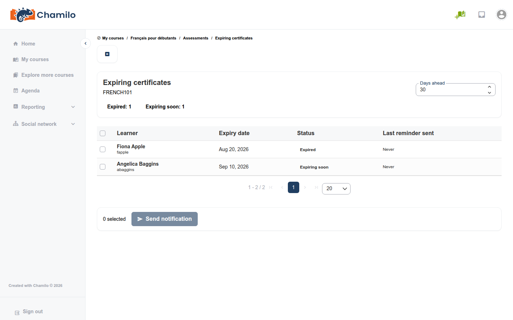
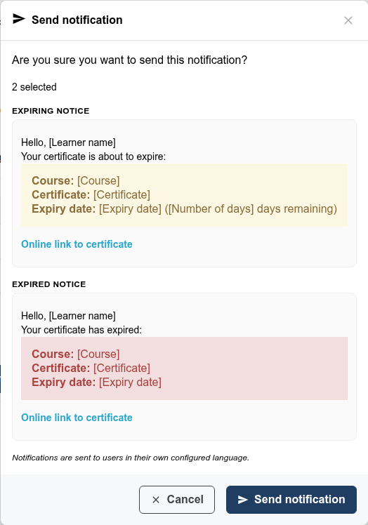

# Certificados y competencias

Chamilo le permite otorgar certificados a los estudiantes que cumplen criterios de logro específicos y validar las competencias asociadas a esos logros.

## Cómo funcionan los certificados

Los certificados están vinculados a las **Evaluaciones** (también denominadas libro de calificaciones). Cuando la calificación de un estudiante alcanza o supera el umbral mínimo que usted define, el certificado queda disponible para su descarga.

El flujo de trabajo es el siguiente:

1. Configure las [Evaluaciones](../assessing-learners/gradebook.md) con sus ejercicios, tareas y demás actividades calificadas
2. Defina una **puntuación mínima de certificación** (p. ej., 70 %)
3. Cuando un estudiante alcanza esa puntuación, puede descargar su certificado (ya sea dentro de la propia herramienta Evaluaciones o desde un itinerario de aprendizaje, si ha configurado el paso final para ello). Como docente, también puede utilizar la acción **Generar certificados** en el libro de calificaciones para crear los PDF por lotes para todos los estudiantes que cumplan los requisitos.

## Plantillas de certificados

Los certificados utilizan plantillas definidas por el administrador de la plataforma. La plantilla suele incluir:

* El nombre del estudiante
* El nombre del curso
* La fecha de finalización
* La puntuación obtenida
* Un código QR o una URL para la verificación en línea

La primera vez que abre el gestor de plantillas de certificados de las Evaluaciones de un curso (el icono **Adjuntar certificado** en el libro de calificaciones), Chamilo duplica automáticamente la plantilla de certificado predeterminada de la plataforma en el curso, de modo que nunca llega a una página vacía: la copia es suya para personalizarla libremente a partir de ese momento. Si más adelante la desvincula (**Usar el certificado predeterminado del sistema en su lugar**), volver a abrir el gestor no la recrea una segunda vez; solo un curso que realmente nunca haya tenido un documento de certificado adjunto recibe uno generado automáticamente.

### Marcadores de seguimiento del curso en las plantillas

Las plantillas de certificados pueden incluir marcadores de seguimiento además de los campos del estudiante, del curso y de la calificación. Los siguientes marcadores se rellenan cuando Chamilo genera un certificado:

| Marcador | Valor |
|-------------|-------|
| `((time_in_course))` | Tiempo que el estudiante dedicó al curso en el contexto actual de curso/sesión, con formato de tiempo transcurrido. |
| `((time_in_course_in_all_sessions))` | Suma del tiempo registrado del estudiante en este curso **en todas sus sesiones**. Es un agregado por sesión, no necesariamente el mismo que el tiempo del contexto actual. |
| `((start_date_and_end_date))` | Fechas de la primera y la última conexión al curso en el contexto actual. Si ambas corresponden al mismo día, la etiqueta es el equivalente localizado de **El [fecha]**; en caso contrario, es **Del [primera fecha] al [última fecha]**. |

Estos valores proceden del seguimiento del estudiante y representan la **actividad registrada**, no la duración prevista del curso ni las horas de crédito académico. Las etiquetas de tiempo transcurrido utilizan ahora el formato de tiempo habitual de Chamilo, sin el formato abreviado anterior. Previsualice el certificado generado con datos de seguimiento representativos, especialmente cuando un curso se reutiliza en varias sesiones.

## Validez y caducidad de los certificados

Los certificados pueden configurarse para que caduquen transcurrido un número determinado de días. En la configuración de las [Evaluaciones](../assessing-learners/gradebook.md) de la categoría raíz, una vez activada la opción **Generar certificados**, aparece el campo **Validez del certificado (días)**. Déjelo en `0` (el valor predeterminado) para los certificados que nunca caducan, o indique un número de días para que el certificado caduque ese número de días después de su emisión.

La fecha de caducidad de cada certificado se calcula automáticamente a partir de esa configuración cuando se genera (o se regenera): no se define certificado por certificado. La lista de **Certificados** muestra una columna **Fecha de caducidad** para cada estudiante, que indica **Nunca caduca** cuando no se aplica ningún periodo de validez.

Si la categoría no tiene configurado un periodo de validez, aún puede establecer (o modificar) manualmente la fecha de caducidad de un estudiante concreto: haga clic en el botón del lápiz **Editar fecha de caducidad** junto a su entrada y seleccione una fecha. Este botón solo está disponible cuando la propia categoría no tiene periodo de validez: una vez establecido un periodo de validez, las fechas de caducidad se gestionan automáticamente y ya no pueden editarse certificado por certificado.

### Recordar a los estudiantes una caducidad próxima o pasada

Abra la lista de **Certificates** de su evaluación y haga clic en el botón **Expiring certificates**  para ver qué certificados de los estudiantes han caducado o están a punto de hacerlo. La página muestra, por estudiante: la **Expiry date** del certificado, su **Status** (**Expired** o **Expiring soon**) y cuándo se envió un recordatorio al respecto en **Last reminder sent** (o **Never**). Utilice **Days ahead** para ampliar o reducir hasta qué punto en el futuro se considera «a punto de caducar».

Para notificar usted mismo a los estudiantes:

1. Seleccione los estudiantes a los que desea recordar (o selecciónelos todos)
2. Haga clic en **Send notification**
3. Revise la vista previa del correo electrónico que se enviará: se muestran vistas previas distintas para la redacción de «a punto de caducar» y de «caducado», según en qué caso se encuentre cada uno de los estudiantes seleccionados
4. Confirme haciendo clic de nuevo en **Send notification** en el cuadro de diálogo

Cada estudiante recibe la notificación en el idioma que tiene configurado, tanto por correo electrónico como mediante un mensaje interno de Chamilo. Volver a enviar el recordatorio para el mismo certificado y la misma fecha de caducidad es seguro: Chamilo registra lo que ya se ha enviado por certificado y no saturará al estudiante con recordatorios duplicados, a menos que usted los reenvíe de forma explícita.

Los administradores también pueden programar estos mismos recordatorios de forma automática y recurrente, sin que un docente tenga que activarlos manualmente. Consulte [Configuración de tareas cron](../../admin-guide/platform-settings/crons-settings.md#certificate-expiry-reminders).

## Credenciales de certificado firmadas (opcional)

Cuando el administrador habilita la verificación de certificados firmados, los estudiantes pueden aprobar o retirar la publicación de una credencial verificable desde **My Certificates**. Tras la aprobación, un administrador puede emitir la credencial firmada y, de forma opcional, anclar su huella digital en la red de pruebas Sepolia. Un enlace público de verificación comprueba la firma de la credencial, el consentimiento vigente, la revocación y el estado del certificado subyacente; el anclaje en Sepolia es opcional y utiliza una red de pruebas.

Consulte [Verificación de certificados firmados](../../admin-guide/maintenance/signed-certificate-verification.md) para conocer el flujo de trabajo del administrador y los límites importantes del consentimiento.

## Importación de plantillas de certificado desde archivos ZIP

Puede cargar un paquete ZIP que contenga una plantilla de certificado en HTML y sus imágenes al asociar un certificado a una evaluación del curso. En la vista de carga de la plantilla de certificado, elija un archivo `.html` o un archivo `.zip`. Chamilo importa la plantilla HTML e incrusta los recursos de imagen admitidos, de modo que el certificado pueda previsualizarse y generarse sin exponer las imágenes extraídas como archivos públicos.

El ZIP debe contener al menos un archivo `.html` o `.htm`. Las plantillas HTML pueden estar dentro de subdirectorios; los formatos de imagen admitidos son PNG, JPEG, GIF y WebP. Se rechazan otros tipos de archivo, rutas de archivo no seguras, enlaces simbólicos y archivos de tamaño excesivo. Si un paquete contiene varias plantillas, revise los documentos importados y seleccione la plantilla de certificado prevista antes de generar certificados para los estudiantes.

Previsualice un certificado con un estudiante de prueba antes de la generación masiva, especialmente cuando el diseño haga referencia a rutas de imagen relativas o a marcadores de seguimiento del curso. Consulte [PR de importación de certificados ZIP n.º 9371](https://github.com/chamilo/chamilo-lms/pull/9371).

## Informe de la plataforma sobre certificados caducados

Los administradores del portal disponen de un informe de **Expired certificates** en Global Reporting. Admite el filtrado por palabra clave, sesión, curso, mes y año, y muestra la fecha de caducidad de cada certificado coincidente. Este informe es distinto de la vista de recordatorios **Expiring certificates** del docente descrita anteriormente. Consulte [PR del informe global de certificados caducados n.º 9372](https://github.com/chamilo/chamilo-lms/pull/9372) y la [guía de estadísticas globales](../../admin-guide/analytics/global-statistics.md).

## Competencias

Las competencias representan las capacidades que adquieren los estudiantes. En Chamilo:

* Las competencias pueden vincularse a los logros del libro de calificaciones
* Cuando un estudiante obtiene un certificado, las competencias asociadas se validan automáticamente
* Las competencias se acumulan en el perfil del estudiante y crean un registro de competencias
* Las competencias pueden organizarse de forma jerárquica (por ejemplo, «Análisis de datos» dentro de «Métodos de investigación»)
* Las competencias pueden evaluarse además por pares (evaluación de 360°)

## Visualización del estado de certificados y competencias

Como docente, puede ver:

* Qué estudiantes han obtenido certificados en su curso
* Qué competencias se han validado
* El progreso de los estudiantes hacia el umbral de certificación
* Qué certificados han caducado o están a punto de caducar, y si ya se les envió un recordatorio

Los estudiantes pueden ver sus propios certificados y competencias validadas desde su perfil, y pueden acceder a la Rueda de competencias para comprobar qué competencias se demandan en su organización.

Si su plataforma utiliza expedientes académicos, cada certificado que obtiene un estudiante también se convierte en una fila de su expediente, con la puntuación y la letra de la escala de calificación — consulte [Expedientes académicos](../../admin-guide/users/academic-transcripts.md).

## Consejos

* **Establezca expectativas claras** — Indique a los estudiantes al inicio del curso qué deben lograr para obtener un certificado
* **Utilice nombres de competencias significativos** — Las competencias deben describir lo que el estudiante es capaz de hacer, no solo el nombre del curso
* **Combine con portafolios** — Anime a los estudiantes a añadir sus certificados a su portafolio
* **Amplíe los certificados** — Pida a su administrador que active el complemento [Custom Certificate](../plugins/custom-certificate.md) para aprovechar aún más la potencia de las plantillas de certificados
* **Establezca un periodo de validez para las certificaciones exigidas por cumplimiento normativo** — Si una certificación requiere renovación periódica (p. ej., formación en seguridad), configure **Validez del certificado (días)** para que los estudiantes reciban un recordatorio antes de que caduque