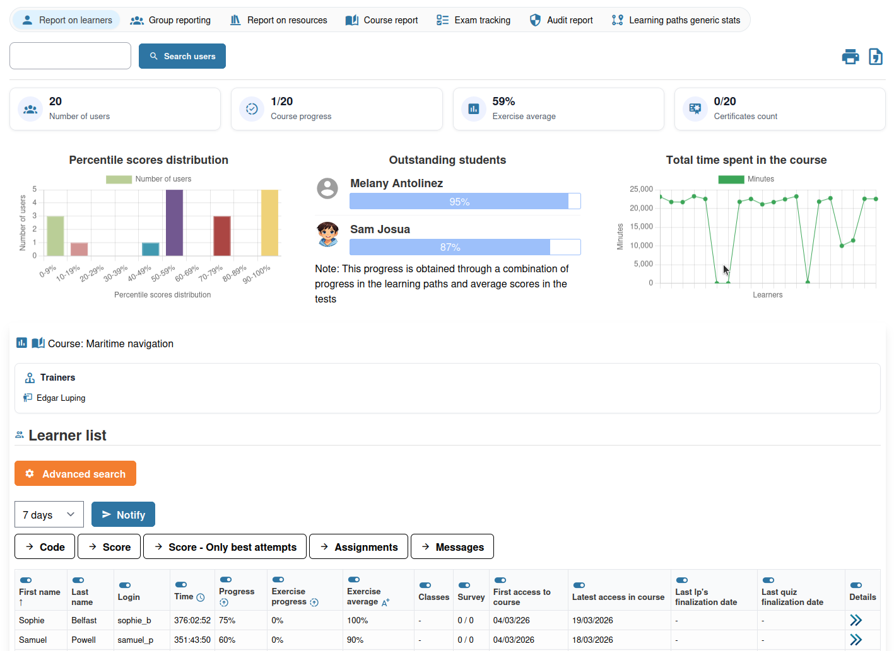

# Informes del curso

Los informes del curso ofrecen una visión agregada de la actividad y el rendimiento de todos los estudiantes de su curso.

## Acceso a los informes del curso

Abra la herramienta **Seguimiento**  desde la página de inicio del curso y seleccione la vista de informes a nivel de curso.

## Informes disponibles

### Resumen de actividad

Un resumen de la participación general en el curso, que incluye los estudiantes inscritos, el tiempo dedicado al curso, el progreso del curso, el progreso de los ejercicios y la puntuación media, y la actividad de las tareas.

Desde la sección de seguimiento hay vistas de detalle independientes para los **recursos** (recuentos de acceso por recurso), las **herramientas** (uso por herramienta) y los **eventos** (registro de eventos en bruto).

### Informes de ejercicios

Para cada ejercicio del curso:

* Número de estudiantes que lo intentaron
* Puntuación media
* Distribución de puntuaciones
* Número de estudiantes que aprobaron (según el umbral de aprobación que haya establecido)

### Informes de itinerarios de aprendizaje

Para cada itinerario de aprendizaje:

* Tasas de finalización de todos los estudiantes
* Porcentaje medio de progreso
* Tiempo dedicado por elemento
* Estudiantes que han completado el itinerario frente a los que aún están en curso

### Informes de tareas

Para cada tarea:

* Número de entregas recibidas
* Número de revisiones pendientes

## Exportación de datos

Puede exportar los datos de seguimiento y de informes para un análisis posterior. Busque la opción **Exportar**  para descargar los datos en un formato compatible con hojas de cálculo.

## Informes de sesión

Si imparte clase dentro de una sesión, los informes se limitan a los estudiantes de esa sesión. Los tutores de sesión tienen acceso a los informes de todos los cursos de su sesión. Un ajuste de configuración global también puede permitir que los docentes vean las tareas de todas las sesiones que utilizan su curso (consulte a su administrador).