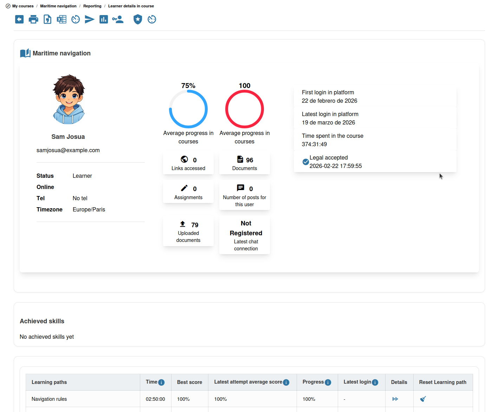

# Seguimiento del alumnado

Chamilo registra la actividad del alumnado en toda la plataforma y le ofrece información detallada sobre cómo cada estudiante interactúa con su curso.

## Acceder al seguimiento del alumnado

Abra la herramienta **Seguimiento**  desde la página de inicio del curso, o haga clic en **Informes** en la barra lateral.

## Qué se registra

Para cada estudiante, Chamilo registra (en la vista principal de seguimiento por estudiante):

* **Actividad de inicio de sesión** — Cuándo inició sesión por última vez y su tiempo total de conexión
* **Tiempo dedicado al curso** — Tiempo total que el estudiante ha pasado en su curso
* **Primer y último acceso** — Cuándo entró por primera vez y cuándo visitó el curso por última vez
* **Progreso del curso** — Porcentaje de progreso agregado en todo el curso
* **Resultados de los ejercicios** — Puntuaciones e intentos de cada ejercicio
* **Progreso de las rutas de aprendizaje** — Porcentaje de finalización y tiempo dedicado a cada ruta de aprendizaje
* **Entregas de tareas** — Qué tareas se han entregado y calificado

Los detalles de acceso por recurso (qué documentos o páginas concretos abrió un estudiante) y la actividad a nivel de herramienta están disponibles en las vistas específicas **Recursos**, **Herramientas** y **Eventos** de la sección de seguimiento, y no en la fila principal del estudiante.

## Ver los datos de un estudiante

Haga clic en el nombre de un estudiante para ver su informe de actividad detallado. Este muestra:

* Un resumen de su participación general
* El progreso en cada ruta de aprendizaje
* Las puntuaciones de los ejercicios y el historial de intentos
* El estado de entrega de las tareas

## Informe del estudiante en todos los cursos

**Informes** > **Estudiantes** y, a continuación, los detalles de un estudiante abren el informe del estudiante (`/reporting/learners/{id}`), que abarca todos los cursos que sigue. Debajo del perfil del estudiante y de las competencias adquiridas, se muestra:

* **Clases** — Las clases a las que pertenece el estudiante, cuando las hay
* **Cursos** — Los cursos a los que el estudiante está inscrito directamente
* **Una tabla por sesión** — El título y las fechas de acceso de la sesión y, a continuación, los cursos del estudiante en esa sesión

Los administradores, los responsables de recursos humanos, los jefes de estudiantes y los administradores de sesión ven todas las inscripciones del estudiante. Los profesores, los tutores y los coaches solo ven los cursos que imparten o tutorizan, las sesiones que dirigen como coach general y los cursos que tutorizan en una sesión; el profesor de un curso también ve ese curso en las sesiones del estudiante.

Las fechas se muestran en la zona horaria del usuario cuando este puede elegir una; en caso contrario, en la zona horaria de la plataforma.

Cada tabla de curso indica el tiempo dedicado, el progreso, la puntuación, las ausencias (hojas de asistencia no cumplimentadas respecto del total) y la puntuación del cuaderno de calificaciones de cada curso, seguida de una fila **Total**. El título del curso abre el curso, y el botón de detalles abre el informe del estudiante en ese curso. Un curso seguido tanto de forma directa como en una sesión aparece en ambas tablas, con las cifras de cada inscripción.

Cada tabla puede exportarse por separado a CSV o Excel. Las tablas de sesión también ofrecen una exportación en PDF de la asistencia de la sesión y un **Certificado de aprovechamiento**. Los botones de exportación de la parte superior de la página exportan todas las tablas a la vez.

### Competencias adquiridas

El bloque **Competencias adquiridas** muestra las competencias que ha adquirido el estudiante. Al hacer clic en una competencia se abre su insignia. La disposición de las competencias depende de dos ajustes de la categoría **Competencias** en la configuración de la plataforma:

* Cuando **Nombres de los niveles de competencia** (`skill.skill_levels_names`) está vacío, las competencias adquiridas se enumeran una tras otra.
* En caso contrario, las competencias se sitúan en el árbol de competencias: cada competencia adquirida aparece bajo sus competencias superiores, hasta la cima del árbol. Las competencias superiores que el estudiante no ha adquirido aparecen atenuadas, y solo se dibujan las ramas que contienen al menos una competencia adquirida.
  * Con **Mostrar las competencias como una tabla jerárquica** (`skill.skills_hierarchical_view_in_user_tracking`) activado, cada rama de nivel superior es una columna, con sus competencias anidadas debajo.
  * Con esta opción desactivada, cada rama de nivel superior es un encabezado, seguido de sus competencias una al lado de la otra: el primer nivel bajo el encabezado tiene insignias más grandes, y los niveles más profundos muestran su insignia sin título.

Una competencia muestra su código corto en lugar de su título cuando lo tiene. Una competencia no vinculada a ninguna competencia superior aparece en la parte superior del árbol.

El informe del estudiante en un curso dispone las competencias adquiridas en ese curso del mismo modo.

### Mensajes sobre el estudiante

Cuando **Permitir mensajes privados entre docentes sobre un estudiante** (`message.private_messages_about_user`) está activado en la configuración de la plataforma, un bloque **Mensajes** en la parte inferior del informe enumera los mensajes de seguimiento escritos sobre el estudiante. Haga clic en un mensaje para leerlo. **Nuevo mensaje** redacta uno nuevo, con un asunto y un texto. Cuando se envía un mensaje, los superiores del estudiante reciben una notificación con un enlace al informe. Solo puede eliminar los mensajes que usted escribió; cada eliminación queda registrada en el registro de eventos de la plataforma.

El informe del estudiante en un curso, abierto con el botón de detalles, también muestra las clases del estudiante y el mismo bloque **Mensajes**.

## Puntuaciones de las lecciones: cuenta el mejor intento

> **Cambio de comportamiento.** Las estadísticas de las lecciones utilizan ahora el **mejor intento** de cada estudiante por elemento, en lugar de la media de todos los intentos.

Cuando un estudiante abre un elemento de una lección (elemento SCORM o test) varias veces, la puntuación mostrada en las estadísticas de la lección es la puntuación del mejor intento de ese estudiante en ese elemento. Antes, cada intento se sumaba al total y se contaba como un elemento adicional, de modo que la puntuación mostrada era la media de todos los intentos: a un estudiante que obtenía 9/10 y después 4/10 en el mismo elemento se le mostraba un 65 %; ahora se le muestra un 90 %.

* Hay un valor por elemento y por estudiante: el intento con la relación puntuación/máximo más alta. Cuando dos intentos tienen la misma relación, se utiliza el más reciente. Un intento de test se compara con su propio máximo (las preguntas aleatorias pueden modificarlo), de modo que 8/10 supera a 9/20.
* Las columnas de «último intento» de la página de seguimiento del estudiante no cambian (siguen mostrando el último intento); las columnas de «mejor puntuación» coinciden ahora con la puntuación predeterminada.
* Se aplica allí donde se muestra o se exporta la puntuación de la lección: informes de curso y de sesión, la página de seguimiento del estudiante («Mis estudiantes»), el informe de la lección, el portal del usuario, la vista general del panel de Reporting y sus exportaciones CSV/Excel.
* Los datos de seguimiento existentes no se modifican; solo cambia la forma en que se resumen, de modo que las cifras de intentos anteriores se recalculan al mostrarse.

## Vistas de seguimiento

Puede consultar los datos de seguimiento desde distintas perspectivas:

* **Por estudiante** — Seleccione un estudiante para ver toda su actividad
* **Por recurso** — Seleccione un documento, un ejercicio o una lección para ver cómo interactuaron con él todos los estudiantes
* **Por herramienta** — Consulte el uso agregado de cada herramienta del curso

## Consejos

* **Identifique a los estudiantes con dificultades** — Busque estudiantes con baja participación, varios intentos fallidos en ejercicios o lecciones incompletas
* **Supervise el progreso con regularidad** — Revise los datos de seguimiento cada semana para detectar problemas a tiempo
* **Utilice los datos para la retroalimentación** — Comparta con los estudiantes los datos de seguimiento pertinentes para ayudarles a comprender su propio progreso