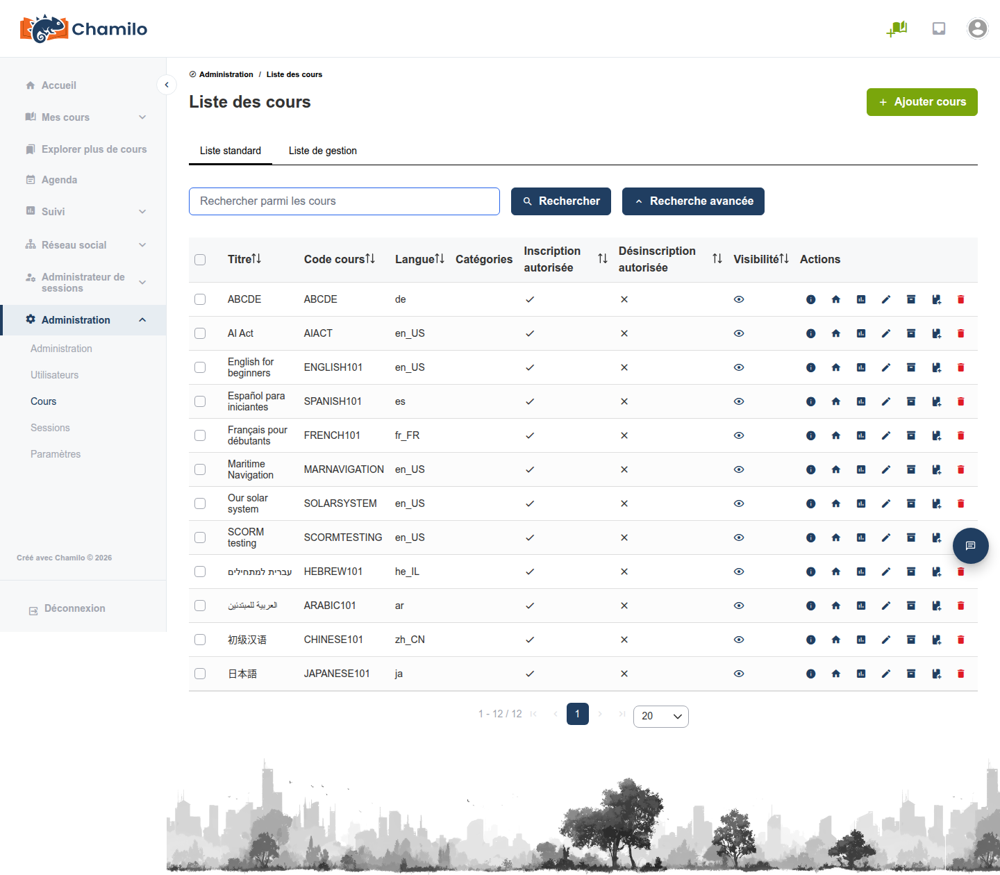

# Gestion des cours

En tant qu'administrateur, vous pouvez gérer tous les cours de la plateforme, quel que soit leur créateur.

## Liste des cours

Depuis le panneau d'administration, cliquez sur **Liste des cours** pour voir tous les cours. La liste affiche :

* Titre et code du cours
* Langue
* Catégories
* Statut de visibilité

Utilisez l'outil **Recherche avancée** pour trouver des cours spécifiques.

## Création d'un cours

En tant qu'administrateur, vous pouvez créer des cours et les attribuer à n'importe quel enseignant :

1. Cliquez sur **Ajouter un cours** depuis le panneau d'administration
2. Renseignez les informations du cours (titre, code, catégorie, langue)
3. Attribuez un enseignant au cours
4. Enregistrez

Remarque : dans Chamilo 1.11.x, le code du cours apparaissait dans l'URL du cours et ne pouvait plus être modifié après la création du cours. Ce comportement a changé à partir de la version 2.x. Le code du cours n'est plus visible dans l'URL, et les versions futures pourraient permettre aux enseignants de le modifier par la suite, celui-ci devenant moins essentiel pour la plateforme.

## Gestion d'un cours existant

Recherchez un cours dans la liste pour accéder aux options de gestion dans la colonne *Actions* :

* **Informations** — Afficher les informations relatives au cours
* **Accueil du cours** — Vous conduit directement à la page d'accueil du cours
* **Rapports** — Consulter les données d'engagement et de performance
* **Modifier** — Modifier le titre du cours, la catégorie, la visibilité et d'autres paramètres
* **Créer une sauvegarde** — Accéder à la section de maintenance du cours, où vous pouvez créer des copies et effectuer d'autres opérations
* **Ajouter au catalogue** — Ajouter ce cours au catalogue de cours
* **Supprimer** — Supprimer définitivement le cours et l'ensemble de son contenu

> La suppression d'un cours retire définitivement l'ensemble du contenu, les données des apprenants, les notes et les informations de suivi. Envisagez d'exporter d'abord le cours à titre de sauvegarde.

## Intégrations administrateur

Les administrateurs peuvent également synchroniser certaines métadonnées de cours à l'aide de `PATCH /api/courses/{id}`, ou demander la suppression d'un cours avec `DELETE /api/courses/{id}`. Ces opérations d'API exigent un administrateur de la plateforme ; un enseignant ne peut pas les utiliser pour contourner l'interface des paramètres du cours. La suppression d'un cours via l'API peut se comporter différemment dans les installations multi-URL et n'utilise pas la suppression facultative des documents exclusifs proposée par l'écran de maintenance. Consultez [API d'administration des cours](../../developer-guide/api/course-administration.md) avant d'automatiser des opérations destructives.

## Opérations groupées

Sélectionnez plusieurs cours dans la liste pour effectuer des actions par lot, telles que leur suppression. Pour exporter un cours, ouvrez le cours et utilisez l'outil **Maintenance** — il n'existe aucune action d'exportation groupée dans la liste des cours de l'administration.

## Paramètres de visibilité des cours

Les administrateurs peuvent remplacer la visibilité définie par les enseignants :

| Visibilité | Effet |
|-----------|--------|
| **Public** | Accessible à tous, y compris aux visiteurs anonymes |
| **Ouvert** | Accessible à tous les utilisateurs connectés |
| **Privé** | Seuls les utilisateurs inscrits peuvent accéder au cours |
| **Fermé** | Personne ne peut accéder au cours (sauf l'enseignant et les administrateurs) |
| **Caché** | Personne ne peut voir ni accéder au cours (sauf les administrateurs) |