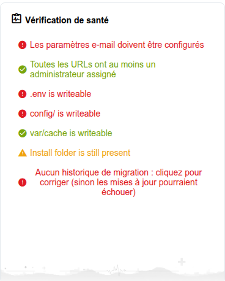

# Contrôle de santé

Le contrôle de santé est un petit bloc du tableau de bord d'administration qui exécute quelques vérifications en direct sur votre installation et signale tout élément nécessitant une attention — sans avoir à parcourir les fichiers de configuration pour repérer les erreurs de configuration courantes.

## Accéder au contrôle de santé

Depuis le panneau d'administration, le bloc **Contrôle de santé** apparaît aux côtés des autres blocs du tableau de bord — aucun clic n'est nécessaire, les résultats s'affichent directement.

## Les vérifications

* **Paramètres de messagerie** — Vérifie qu'une chaîne de connexion du mailer et un e-mail/nom d'expéditeur (« from ») sont configurés. Dans le cas contraire, un lien vers les paramètres de messagerie permet de corriger le problème.
* **Toutes les URL ont au moins un administrateur attribué** — Sur une installation multi-URL, vérifie que chaque URL d'accès dispose d'au moins un administrateur capable de la gérer. Si ce n'est pas le cas, un lien mène vers la page d'attribution des URL d'accès et des utilisateurs.
* **`.env` n'est pas accessible en écriture** — `.env` contient des secrets et ne doit pas être accessible en écriture par le serveur web après l'installation. Signalé comme une erreur s'il l'est ; lien vers le Guide de sécurité.
* **`config/` n'est pas accessible en écriture** — Même raisonnement que pour `.env` : ce répertoire ne doit pas être accessible en écriture via le web en fonctionnement normal. Ce dossier ayant historiquement été la cible d'attaques, supprimez-le avec `rm -rf public/main/install`. Lien vers le [Guide de sécurité](appendix/security-guide.md#remove-the-install-folder).
* **`var/cache` est accessible en écriture** — Vérification inverse : Symfony doit pouvoir écrire dans son répertoire de cache ; celle-ci est donc signalée comme une erreur s'il *n'est pas* accessible en écriture. Lien vers le guide de réglage des performances / d'optimisation.
* **Le dossier d'installation est absent** — Le dossier `public/main/install` n'est nécessaire que pendant l'installation et doit être supprimé ensuite. Il est signalé comme un avertissement (et non comme une erreur bloquante) s'il existe encore, car le risque est moins grave que celui des deux vérifications d'accessibilité en écriture ci-dessus. Ce dossier ayant historiquement été la cible d'attaques, supprimez-le avec `rm -rf public/main/install`. Lien vers le [Guide de sécurité](appendix/security-guide.md#remove-the-install-folder).

## Que faire

Chaque vérification renvoie directement vers l'endroit où corriger le problème sous-jacent — une page de paramètres ou le guide correspondant. Parcourez cette liste juste après l'installation, puis périodiquement par la suite (par exemple après un transfert manuel de fichiers ou une modification des permissions), car une vérification réussie aujourd'hui ne garantit pas qu'elle le restera. Pour une liste de contrôle plus large de durcissement en production, au-delà de ces six vérifications, consultez le [Guide de sécurité](appendix/security-guide.md).