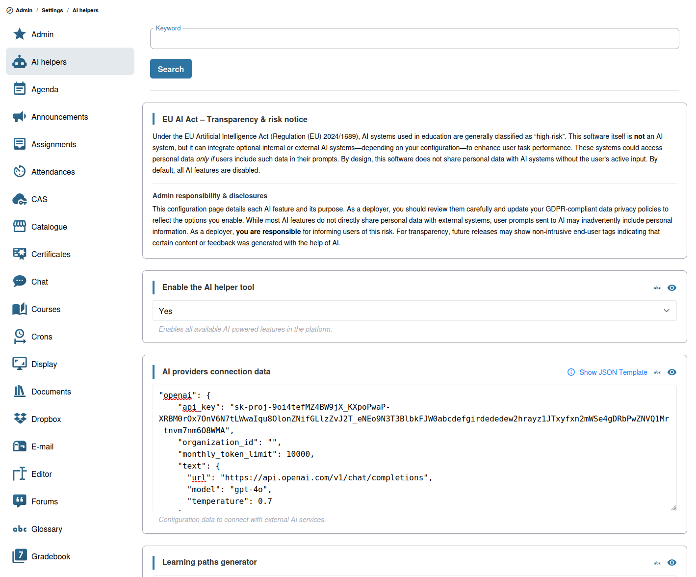

# Configuration de l'IA

Chamilo 3.0 inclut des fonctionnalités basées sur l'IA qui nécessitent une configuration avant d'être disponibles pour les enseignants et les apprenants.

## Fournisseurs d'IA pris en charge

Chamilo prend en charge plusieurs fournisseurs d'IA :

| Fournisseur | Capacités |
|----------|-------------|
| **Claude (Anthropic)** | Génération de texte, analyse de documents |
| **DeepSeek** | Génération de texte |
| **Google Gemini** | Génération de texte, d'images et de vidéos |
| **Grok** | Génération de texte, d'images et de vidéos |
| **Mistral** | Génération de texte |
| **OpenAI** | Génération de texte, d'images et de vidéos |

Chaque fournisseur peut être configuré pour différents types de tâches d'IA :

* **Texte** — Utilisé pour la génération d'exercices, la génération de parcours d'apprentissage, la notation par IA et le tuteur IA
* **Image** — Utilisé pour la génération d'images par IA
* **Vidéo** — Utilisé pour la génération de vidéos par IA (lorsque cette fonctionnalité est prise en charge)
* **Document** — Utilisé pour l'analyse de documents par IA

## Étapes de configuration

### 1. Obtenir des clés API

Inscrivez-vous auprès du fournisseur d'IA de votre choix et obtenez une clé API :

* **Claude (Anthropic)** : [console.anthropic.com](https://console.anthropic.com/)
* **DeepSeek** : [platform.deepseek.com](https://platform.deepseek.com/)
* **Google Gemini** : Google AI Studio ou Google Cloud
* **Grok** : [console.x.ai](https://console.x.ai/)
* **Mistral** : [console.mistral.ai](https://console.mistral.ai/)
* **OpenAI** : [platform.openai.com](https://platform.openai.com/)

### 2. Configurer les fournisseurs dans Chamilo



Dans les paramètres de la plateforme, accédez à la section **Assistants IA** :

1. **Activer les assistants IA** — Activez les fonctionnalités d'IA de manière globale
2. **Configurer les fournisseurs d'IA** — Ajoutez un ou plusieurs fournisseurs avec :
   * **Nom du fournisseur** (`claude`, `deepseek`, `gemini`, `grok`, `mistral`, `openai`). `anthropic` est accepté comme alias de `claude`
   * **Clé API** — Votre clé API pour le fournisseur
   * **Modèle** — Le modèle spécifique à utiliser (par exemple, `gpt-4o`, `claude-sonnet-4-6`, `gemini-pro`, `mistral-large`)
   * **URL de l'API** — L'URL du point de terminaison (préconfigurée pour les fournisseurs standard)

Vous pouvez configurer plusieurs fournisseurs. Le premier fournisseur de la configuration devient le fournisseur par défaut.

### 3. Activer les fonctionnalités par cours

Les fonctionnalités d'IA peuvent être activées ou désactivées au niveau du cours. Les enseignants peuvent activer ou désactiver :

* **Chatbot tuteur IA** — L'assistant IA destiné aux apprenants
* **Correcteur de devoirs** — Recommandation de notation générée par l'IA
* **Générateur d'exercices** — Questions de quiz générées par l'IA
* **Générateur de parcours d'apprentissage** — Séquences d'apprentissage générées par l'IA
* **Générateur d'images/vidéos** — Images et vidéos générées par l'IA dans les documents

Cela permet à différents cours d'utiliser des configurations d'IA distinctes selon leurs besoins.

## Utiliser n'importe quel modèle ou point de terminaison compatible

**Vous n'êtes pas limité aux fournisseurs listés ci-dessus.** Chamilo communique avec chaque fournisseur via une *interface* d'API standard, et l'URL du point de terminaison est configurable. Tout modèle ou service compatible avec l'une de ces interfaces peut être utilisé simplement en choisissant le fournisseur correspondant et en modifiant l'**URL de l'API** (point de terminaison), la **clé API** et le nom du **modèle**.

| Si votre modèle/service est compatible avec... | Utilisez ce fournisseur | Chemin de point de terminaison typique |
|---|---|---|
| L'**API OpenAI** (Chat Completions) | `openai` | `.../chat/completions` |
| L'**API Messages d'Anthropic (Claude)** | `claude` | `.../v1/messages` |
| L'**API Gemini** | `gemini` | spécifique au fournisseur |
| Les API **Mistral**, **DeepSeek** ou **Grok** | `mistral`, `deepseek`, `grok` | spécifique au fournisseur |

L'interface compatible OpenAI est de loin la plus largement implémentée. Elle est utilisée, entre autres, par GLM (Z.ai / Zhipu), Qwen, Kimi, Together AI, Groq, OpenRouter, Perplexity, ainsi que par des serveurs auto-hébergés tels qu'Ollama, vLLM, LM Studio ou LiteLLM. Tous peuvent être connectés à Chamilo via le fournisseur `openai`.

### Exemple : utiliser GLM (Z.ai) via le fournisseur OpenAI

Les modèles GLM de Z.ai exposent un point de terminaison compatible OpenAI, donc aucun fournisseur GLM dédié n'est nécessaire :

1. Obtenez une clé API depuis votre compte Z.ai.
2. Dans les paramètres **Assistants IA**, ajoutez (ou modifiez) le fournisseur `openai`.
3. Définissez l'**URL de l'API** du service texte sur le point de terminaison GLM, définissez le **modèle** sur un modèle GLM, et collez la clé Z.ai comme **clé API**.

```json
{
  "openai": {
    "api_key": "YOUR_ZAI_API_KEY",
    "text": {
      "url": "https://api.z.ai/api/paas/v4/chat/completions",
      "model": "glm-4.6",
      "temperature": 0.7,
      "max_tokens": 1000
    }
  }
}
```

La même approche fonctionne pour un modèle local servi par Ollama (`"url": "http://localhost:11434/v1/chat/completions"`, `"model": "llama3.1"`), ou pour tout autre service : consultez la documentation du fournisseur pour son URL de base compatible OpenAI et les noms exacts des modèles.


Le point de terminaison doit implémenter le format complet de requête/réponse de l'interface choisie, et le modèle doit prendre en charge la capacité utilisée (par exemple, la génération d'images ne fonctionnera que si le point de terminaison implémente également l'API d'images OpenAI). Les noms de modèles, les URL des points de terminaison et leur disponibilité sont définis par le fournisseur et peuvent changer : consultez toujours leur documentation. Si une fonctionnalité ne fonctionne pas, testez d'abord avec une configuration texte uniquement.


Le même principe s'applique au fournisseur Claude : toute passerelle ou tout proxy compatible Anthropic peut être utilisé en modifiant l'URL de l'API.

## Délais d'expiration de génération de la boîte à outils IA

Pour la génération de texte de la **boîte à outils IA**, le paramètre `text.timeout` d'un fournisseur contrôle la durée pendant laquelle la requête de ce fournisseur peut s'exécuter. Le fournisseur de texte Grok utilise une **valeur par défaut de 180 secondes** lorsqu'aucun délai numérique n'est configuré (voir [PR #9198](https://github.com/chamilo/chamilo-lms/pull/9198)). Cela ne garantit pas que la requête du navigateur puisse durer 180 secondes : les proxys inverses, le serveur web ou une autre passerelle peuvent imposer une limite plus courte.

Si le formulaire de la boîte à outils affiche **HTTP 504**, vérifiez le délai d'expiration des requêtes du proxy inverse/de la passerelle ainsi que les journaux PHP et de l'application ; augmenter uniquement `text.timeout` peut ne pas résoudre le problème. Lorsque l'erreur mentionne le fournisseur d'IA, examinez le `text.timeout` de ce fournisseur, les identifiants, la disponibilité du modèle et les limites de requêtes. Évitez d'augmenter les délais d'expiration sans tenir compte de la capacité du serveur et des requêtes simultanées.

## Considérations relatives aux coûts

Les appels à l'API d'IA ont un coût. Tenez compte des points suivants :

* **Définir des limites d'utilisation** — Surveillez et limitez l'utilisation de l'API d'IA pour maîtriser les coûts
* **Choisir les modèles avec discernement** — Des modèles plus petits et moins coûteux peuvent suffire pour de nombreuses tâches pédagogiques
* **Suivre l'utilisation** — Chamilo journalise les requêtes d'IA pour vous aider à surveiller la consommation

## Conseils

* **Commencer avec un seul fournisseur** — Configurez et testez un fournisseur avant d'en ajouter d'autres
* **Tester avec un cours** — Activez d'abord les fonctionnalités d'IA dans un cours de test pour vérifier qu'elles fonctionnent comme prévu
* **Communiquer avec les enseignants** — Informez les enseignants des fonctionnalités d'IA disponibles et de leur utilisation
* **Surveiller la qualité** — Examinez régulièrement le contenu généré par l'IA pour vous assurer qu'il répond à vos standards pédagogiques