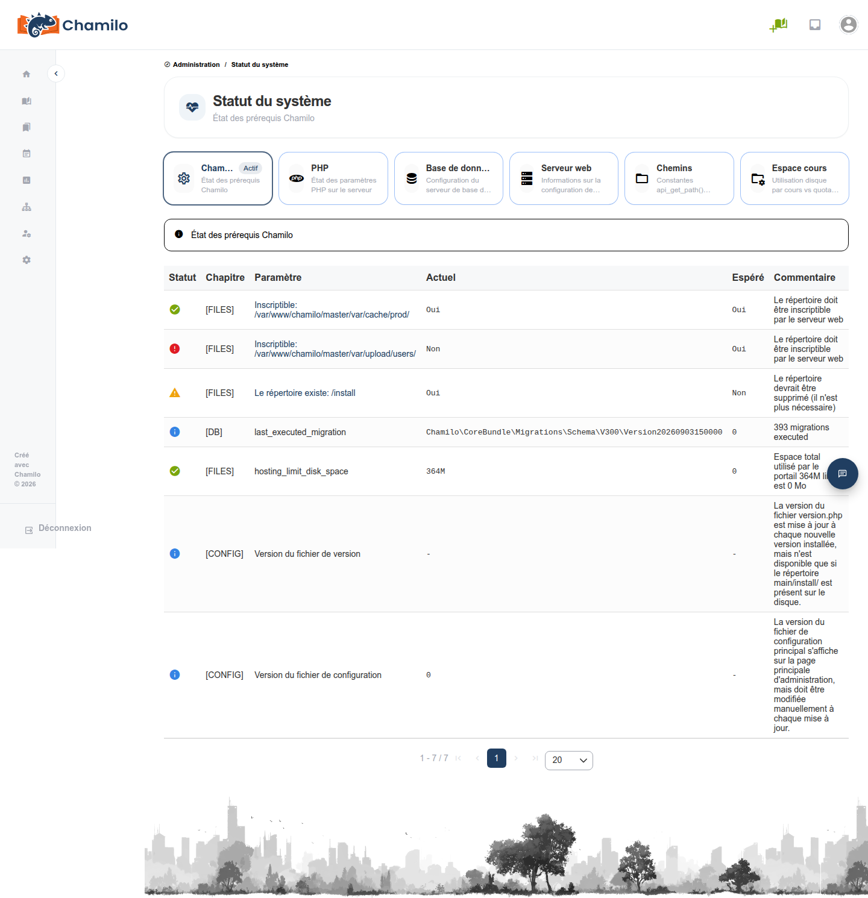

# État du système

La page d'état du système vous aide à vérifier que votre serveur Chamilo est correctement configuré et à identifier les problèmes potentiels.

## Accéder à l'état du système

Depuis le panneau d'administration, cliquez sur **État du système** (ou **Informations système**).

## Ce qu'elle affiche

### Configuration PHP

* **Version de PHP** — Chamilo 3.0 prend en charge PHP 8.3, 8.4 et 8.5
* **Extensions requises** — Vérifie que toutes les extensions PHP nécessaires sont installées
* **Paramètres PHP** — Vérifie les paramètres PHP importants tels que la limite de mémoire, les limites de téléversement et le temps d'exécution

### État de la base de données

* **Connexion à la base de données** — Confirme que la base de données est accessible
* **Version de la base de données** — Affiche la version du serveur de base de données

### Permissions des fichiers

* **Répertoires accessibles en écriture** — Vérifie que Chamilo peut écrire dans les répertoires requis (cache, uploads, logs)

### Informations du serveur

* **Système d'exploitation** — Détails du système d'exploitation du serveur
* **Serveur web** — Apache, Nginx ou autre
* **Espace disque** — Stockage disponible

## Vérifications recommandées

Effectuez ces vérifications régulièrement :

* **Après l'installation** — Vérifiez que toutes les exigences sont satisfaites
* **Après les mises à niveau** — Assurez-vous que la version de PHP et les extensions restent compatibles
* **En cas de problème** — Consultez d'abord l'état du système lors du dépannage