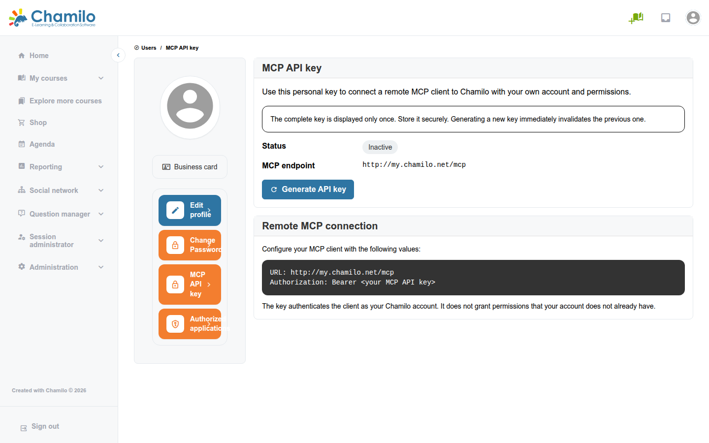

# MCP (Model Context Protocol)

Chamilo 3.0 expose un serveur MCP afin que les assistants et agents d'IA (Claude, connecteurs ChatGPT ou tout client compatible MCP) puissent agir au sein de la plateforme au nom d'un utilisateur authentifié, en utilisant les propres permissions de cet utilisateur — il n'existe aucun compte de service distinct ni accès élevé.

## Ce que MCP apporte à Chamilo

MCP (Model Context Protocol) est une norme ouverte qui permet aux clients d'IA d'appeler un ensemble défini d'« outils » exposés par un serveur. Le serveur MCP de Chamilo est accessible via un point de terminaison unique, `/mcp`, et expose un ensemble sélectionné d'outils de gestion de cours destinés aux enseignants, plutôt que l'ensemble de la surface de l'API.

## Fonctionnalités disponibles

Chaque appel s'exécute en tant qu'utilisateur connecté ; un outil ne voit et ne modifie donc que les cours que cet utilisateur gère. L'ensemble d'outils actuel :

| Outil | Ce qu'il fait |
|------|---------------|
| Utilisateur actuel | Renvoyer l'identité et les rôles de l'utilisateur authentifié |
| Cours de l'enseignant | Lister les cours que l'utilisateur gère en tant qu'enseignant |
| Aperçu du cours | Renvoyer les informations du cours de base et le nombre de ressources |
| Créer un cours | Créer un nouveau cours selon les règles de création de cours de la plateforme |
| Créer un devoir de cours | Créer un devoir en brouillon ou publié, avec une description et une note maximale |
| Créer un test de cours | Créer un test à choix multiples assisté par l'IA à partir d'une description de sujet ou d'un document existant |
| Obtenir l'état des réponses au test de cours | Indiquer quels étudiants ont répondu, sont en cours ou sont en attente pour un test |
| Obtenir le score d'un utilisateur au test de cours | Renvoyer les derniers scores et les meilleurs scores terminés d'un étudiant pour un test |
| Créer une enquête de satisfaction de formation | Créer une enquête de satisfaction à sept questions |
| Créer un parcours d'apprentissage de cours | Créer un parcours d'apprentissage à partir de pages fournies par le client MCP |
| Définir le prérequis d'un élément de parcours d'apprentissage | Rendre un élément de parcours d'apprentissage disponible uniquement une fois qu'un élément antérieur du même parcours est terminé (avec une plage de scores lorsque cet élément est un test), ou supprimer le prérequis ; fonctionne pour les parcours d'apprentissage rattachés à une session lorsque la session est indiquée |
| Définir l'introduction du cours | Remplacer ou effacer la section d'introduction affichée sur la page d'accueil du cours, pour le cours de base ou pour l'une de ses sessions (l'introduction de la session remplace alors celle du cours de base au sein de cette session) |
| Créer une application Toolbox de cours | Générer une application SCORM 1.2 versionnée dans la Toolbox IA du cours et, éventuellement, la publier |
| Mettre à jour une application Toolbox de cours | Générer une nouvelle version assistée par l'IA d'une application Toolbox existante tout en conservant les versions précédentes |
| Lister les documents | Lister les documents de l'outil Documents d'un cours |
| Lire un document de cours | Renvoyer le contenu HTML, le titre et les métadonnées d'un document modifiable |
| Modifier un document de cours | Remplacer l'intégralité du contenu HTML d'un document modifiable existant |
| Créer un document de cours | Créer un document HTML assisté par l'IA dans le dossier racine Documents |
| Créer une illustration de cours | Générer une illustration IA pour un sujet et l'enregistrer en tant que document |
| Illustrer un paragraphe de document | Insérer une image ou une vidéo existante avant ou après un paragraphe d'un document |
| Trouver l'activité récente du forum du cours | Trouver les messages de forum récents et visibles liés à un sujet |
| Examiner la qualité du cours | Analyser les parcours d'apprentissage, documents, tests, devoirs et enquêtes d'un cours, et renvoyer des recommandations d'amélioration |
| Générer un retour Student Success | Exécuter la même analyse du coach IA Student Success, filtrée pour la confidentialité, disponible depuis les rapports de cours pour un apprenant dans un cours géré |

Cette liste est sélectionnée par l'équipe principale de Chamilo et n'est pas extensible par les utilisateurs depuis la plateforme — les enseignants ne peuvent pas ajouter leurs propres outils.

## Activation de MCP

MCP est **désactivé par défaut**. Tant qu'il n'est pas activé, le point de terminaison `/mcp` rejette chaque identifiant et le bouton **Clé API MCP** n'apparaît pas sur la page **Réseau social** des utilisateurs.

Accédez à **Administration > Paramètres de configuration > Sécurité** et définissez :

* **Activer le serveur MCP** (`mcp_enabled`) sur **Oui**.
* **Autoriser MCP par rôles** (`mcp_allowed_roles`) pour les rôles autorisés à utiliser MCP. Il s'agit d'une correspondance JSON ; par défaut, seuls les administrateurs et les enseignants sont autorisés :

  ```json
  {"ADMIN":true,"COURSEMANAGER":true,"STUDENT":false,"HRM":false,"SESSIONADMIN":false,"STUDENT_BOSS":false,"INVITEE":false}
  ```

  Utilisez `HRM` dans les nouvelles configurations. Une entrée `DRH` précédemment enregistrée reste prise en charge lorsque `HRM` est absent ; si les deux sont présents, `HRM` l'emporte.

  Un utilisateur doit disposer d'au moins un rôle activé pour voir le bouton **Clé API MCP** et utiliser MCP. Un JSON non valide refuse MCP à tous les rôles. La restriction s'applique également aux clés et aux connexions OAuth créées antérieurement ; retirer un rôle coupe donc son accès existant.

Voir [Paramètres de sécurité](platform-settings/security-settings.md) pour la description complète des deux paramètres.

## Comment les utilisateurs se connectent

### Clé API MCP personnelle

Chaque utilisateur génère sa propre clé sous **Réseau social** > **Clé API MCP** :



* Cliquer sur **Générer une clé API** crée une clé et l’affiche une seule fois — Chamilo ne conserve ensuite qu’une version masquée, la clé complète doit donc être copiée et stockée de manière sécurisée immédiatement.
* La génération d’une nouvelle clé révoque immédiatement la précédente.
* La page indique le statut de la clé (active/inactive), le point de terminaison MCP à configurer dans le client, ainsi que les dates de création et de dernière utilisation.
* Le panneau **Connexion MCP distante** précise exactement ce qu’il faut saisir dans le client MCP : l’URL du point de terminaison et un en-tête `Authorization: Bearer <your MCP API key>`.

Comme la page elle-même le précise, la clé authentifie le client en tant que compte de cet utilisateur — elle n’accorde aucune permission que le compte ne possède pas déjà.

### OAuth 2.1 (clients distants et connecteurs)

Pour les clients MCP qui prennent en charge la découverte OAuth et l’enregistrement dynamique des clients (plutôt qu’une clé collée manuellement), Chamilo agit également comme serveur d’autorisation OAuth 2.1 : le client découvre les points de terminaison de Chamilo, s’enregistre lui-même et redirige l’utilisateur vers `/oauth/authorize` pour approuver l’accès. Les applications approuvées apparaissent sous **Réseau social** > **Applications autorisées**, où l’utilisateur peut révoquer celles qu’il n’utilise plus ou ne reconnaît pas.

## Considérations de sécurité

* **Aucune élévation de privilèges.** Chaque appel d’outil MCP et chaque application autorisée via OAuth s’exécute avec les propres permissions Chamilo de l’utilisateur connecté — une clé API personnelle ou une application autorisée ne peut jamais faire plus que ce que cet utilisateur pourrait déjà faire manuellement.
* **Bearer uniquement, limitation du débit.** `/mcp` n’accepte qu’un identifiant Bearer — une clé API MCP personnelle, un jeton d’accès OAuth ou (en développement) un JWT. Les tentatives d’authentification sont limitées en débit par adresse IP afin de ralentir les tentatives de deviner les identifiants.
* **Surface publique restreinte.** Le seul trafic non authentifié accepté par `/mcp` est la prérequête `OPTIONS` ; chaque appel effectif exige `ROLE_USER`. Les points de terminaison de découverte OAuth, d’enregistrement dynamique des clients et de jetons sont volontairement publics, comme l’exigent les spécifications OAuth 2.1 / MCP — cela n’accorde pas d’accès en soi, cela permet seulement à un client d’apprendre comment démarrer le flux d’autorisation.
* **La protection contre le DNS rebinding est volontairement désactivée pour `/mcp`.** Le bundle qui implémente MCP restreint normalement le point de terminaison à `localhost`, sauf si une liste statique de noms d’hôte autorisés est configurée — un choix peu adapté à un portail Chamilo multi-URL accessible sous de nombreux noms d’hôte. Chamilo désactive ce contrôle car il est redondant ici : chaque requête `/mcp` exige déjà un identifiant Bearer, indépendamment de ses en-têtes `Host`/`Origin`, et une attaque par DNS rebinding (qui repose sur une authentification ambiante de type cookie accompagnant un en-tête Host usurpé) ne peut pas falsifier un jeton Bearer qu’elle ne possède pas déjà.

## Configuration du serveur MCP

Au-delà des deux paramètres de plateforme décrits dans [Activation de MCP](#enabling-mcp), le serveur MCP lui-même est configuré au niveau des fichiers, dans `config/packages/mcp.yaml`, ce qui nécessite un accès shell au serveur :

| Clé | Rôle |
|-----|---------|
| `app`, `version`, `description` | Identité que Chamilo communique aux clients MCP qui se connectent |
| `client_transports.stdio` / `client_transports.http` | Transports actifs ; Chamilo active les deux par défaut |
| `http.path` | Point de terminaison HTTP MCP (`/mcp` par défaut) |
| `http.allowed_hosts` | Liste d’autorisation des hôtes contre le DNS rebinding — définie sur `false` dans Chamilo (voir Considérations de sécurité ci-dessus) |
| `http.session.store`, `.directory`, `.ttl` | Emplacement et durée de persistance de l’état de session MCP |

Pour désactiver MCP pour tout le monde, remettez **Activer le serveur MCP** sur **Non**. Pour supprimer le transport HTTP lui-même, définissez `client_transports.http: false` (et `stdio: false` si le transport CLI doit également être désactivé) et videz le cache :

```bash
php bin/console cache:clear --env=prod
php bin/console cache:warmup --env=prod
```

## Conseils

* Traitez une clé API MCP comme un mot de passe — toute personne qui la détient peut agir en tant que cet utilisateur via n’importe quel client MCP.
* Encouragez les utilisateurs à examiner périodiquement **Applications autorisées** et à révoquer tout ce qu’ils ne reconnaissent pas.
* Voir [Configuration de l’IA](integrations/ai-configuration.md) pour les fournisseurs d’IA qui alimentent les outils de génération de contenu (création de tests, création de documents, illustrations) listés ci-dessus.