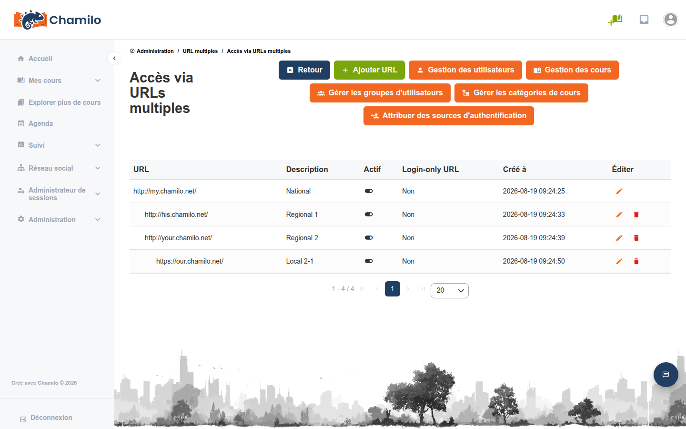

# URL d'accès

Les URL d'accès permettent à une seule installation de Chamilo de servir plusieurs portails distincts.

Cet outil est également accessible depuis le bloc [Plateforme](../platform/README.md) du tableau de bord d'administration, sous le libellé **Configurer plusieurs URL d'accès**.

## Cas d'usage

* **Déploiements multi-locataires** — Héberger des portails de formation distincts pour différentes organisations sur un seul serveur
* **Portails départementaux** — Donner à chaque département son propre portail à l'identité visuelle personnalisée (par exemple, `hr.training.company.com`, `it.training.company.com`)
* **Portails régionaux** — Portails distincts pour différentes régions ou langues

## Fonctionnement

Chaque URL d'accès constitue un point d'entrée distinct vers la même installation de Chamilo :

* Les utilisateurs peuvent être affectés à une ou plusieurs URL d'accès
* Les cours et les sessions appartiennent à des URL d'accès spécifiques
* Les paramètres de la plateforme peuvent être personnalisés par URL d'accès
* L'identité visuelle et les thèmes peuvent différer selon l'URL
* Les utilisateurs d'un portail ne peuvent pas voir les utilisateurs ni les cours d'un autre portail (sauf partage explicite)

## Configuration

### Activation du multi-URL

Le multi-URL doit être activé dans la configuration de Chamilo (généralement dans les paramètres d'environnement). Cette opération est habituellement effectuée lors de l'installation initiale.

### Création d'une URL d'accès

1. Depuis le panneau d'administration, accédez à **URL d'accès**
2. Cliquez sur **Ajouter une URL**
3. Saisissez l'URL (par exemple, `https://portal2.yoursite.com`) et une description
4. Choisissez éventuellement une **URL parente** pour imbriquer cette URL sous une autre — voir [Hiérarchie des URL](#url-hierarchy) ci-dessous
5. Enregistrez

### Affectation des utilisateurs et des cours

* **Utilisateurs** — Affectez des utilisateurs à des URL d'accès spécifiques. Un utilisateur peut appartenir à plusieurs URL.
* **Cours** — Affectez des cours à des URL d'accès spécifiques
* **Sessions** — Affectez des sessions à des URL d'accès spécifiques

### Paramètres par URL

Chaque URL d'accès peut disposer de ses propres éléments :

* **Thème de couleurs** — Identité visuelle différente
* **Nom et logo de la plateforme** — Identité personnalisée
* **Surcharges de paramètres** — Certains paramètres de la plateforme peuvent être personnalisés par URL

## Hiérarchie des URL

Les URL d'accès peuvent être organisées en arborescence parent/enfant plutôt qu'en liste plate. Lors de la création ou de la modification d'une URL, un administrateur global non restreint (voir [Administrateurs de sous-arborescence](#subtree-administrators) ci-dessous) peut choisir n'importe quelle autre URL comme **URL parente** :

* La liste déroulante ne propose jamais l'URL en cours de modification, ni aucun de ses propres descendants, comme parent possible — cela empêche la création d'un cycle. Le backend revalide cette contrainte indépendamment de ce que l'interface affiche.
* Si une URL est créée sans choix de parent, elle est rattachée par défaut à l'**URL de connexion uniquement** si elle existe (voir [Paramètres par URL](#per-url-settings) ci-dessus), ou sinon à la première URL d'accès — le même comportement par défaut qu'avant l'existence de cette fonctionnalité.
* L'URL la plus haute d'une arborescence — celle qui n'a pas de parent — est la **racine** de cette arborescence. Une seule installation de Chamilo peut héberger plusieurs arborescences indépendantes.

Partout où les URL d'accès sont listées — le tableau de bord multi-URL et la page de gestion des URL d'accès — l'arborescence est représentée par une indentation, un parent étant immédiatement suivi de ses propres enfants (les éléments de même niveau étant triés par ordre alphabétique), au lieu d'une colonne « Parent » distincte :

## Administrateurs de sous-arborescence

La hiérarchie des URL détermine également ce qu'un [administrateur global](../users/user-roles.md) peut gérer :

* Un administrateur enregistré sur l'URL **racine** d'une arborescence est **non restreint** : il gère toutes les URL d'accès, exactement comme avant l'existence de cette fonctionnalité.
* Un administrateur enregistré uniquement sur une URL **non racine** est **limité à un périmètre** : les pages multi-URL et URL d'accès n'affichent que cette URL et ses descendants, et le graphique des connexions du tableau de bord multi-URL indique « Connexions (vos URL) » au lieu de « Connexions (toutes les URL combinées) ».

Quel que soit le périmètre, les actions suivantes restent réservées à un administrateur global **non restreint** — un administrateur limité à un périmètre ne peut pas les effectuer, même pour les URL de sa propre sous-arborescence :

* Créer une nouvelle URL d'accès
* Modifier l'URL propre, la description ou le parent d'une URL d'accès
* Activer ou désactiver une URL d'accès
* Supprimer une URL d'accès (l'URL racine de l'ensemble de l'installation ne peut jamais être supprimée, par personne)
* S'enregistrer lui-même dans toutes les URL d'accès à la fois

Un administrateur limité à un périmètre peut toujours gérer tout ce qui est *affecté à* les URL de sa sous-arborescence — utilisateurs, cours, sessions, identité visuelle et paramètres — mais pas les entrées d'URL d'accès elles-mêmes.

## Conseils

* **Décider tôt** — Si vous optez pour une configuration multi-URL, vous devez le faire au début de votre projet Chamilo, car cela exige de laisser la première URL relativement vide de contenu. Activer le multi-URL ultérieurement est plus complexe (cela nécessite des modifications manuelles des bases de données).
* **Planifier la structure des URL** — Décidez de votre schéma d'URL avant de créer les URL d'accès, car modifier les URL ultérieurement affecte tous les liens et signets existants
* **Configuration DNS** — Chaque URL d'accès doit résoudre vers le même serveur Chamilo. Configurez les enregistrements DNS en conséquence.
* **Administrateur global** — Utilisez le rôle d'administrateur global pour gérer l'ensemble des URL d'accès. Pour déléguer la gestion d'une seule branche, enregistrez l'administrateur sur une URL non racine — voir [Administrateurs de sous-arborescence](#subtree-administrators)