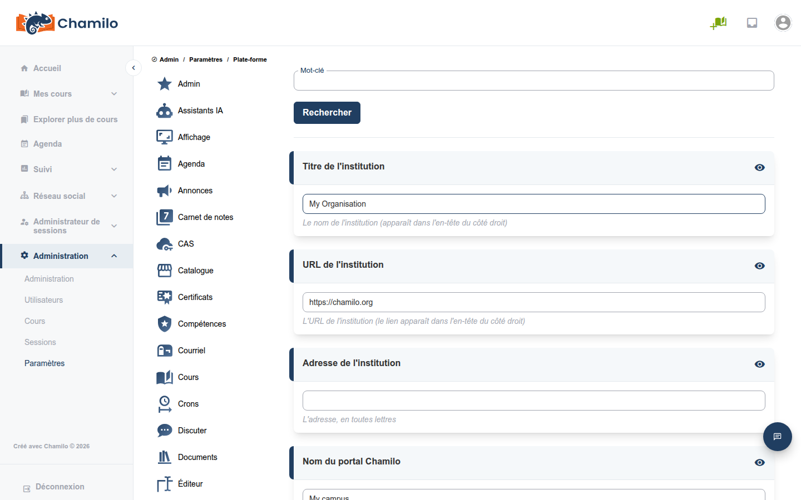

# Paramètres de la plateforme

Chamilo dispose d’un système de configuration étendu, dont les paramètres sont organisés en catégories. L’ensemble complet des catégories ci-dessous reflète la page **Paramètres de configuration** du panneau d’administration — ainsi que le fichier sous-jacent `SettingsCurrentFixtures.php` dans le code source, qui constitue la source de vérité pour les noms de variables, les titres et les descriptions.

Accédez aux paramètres de la plateforme depuis le panneau d’administration en cliquant sur **Paramètres de configuration**.

## Toutes les catégories

Il existe au total **39 catégories de configuration**, listées ci-dessous par ordre alphabétique. Le nombre après chaque lien correspond au nombre de paramètres de cette catégorie.

### À l’échelle de la plateforme

* **[Identité de l’administrateur](admin-settings.md)** (12) — Identité et coordonnées de l’administrateur de la plateforme.
* **[Plateforme](platform-settings.md)** (30) — Identité au niveau de la plateforme, fuseau horaire, politique d’inscription, utilisateurs en ligne, indicateurs de performance.
* **[Affichage](display-settings.md)** (24) — Mise en page de la page d’accueil, gravatar, menus, comportement de l’identité visuelle.
* **[Éditeur](editor-settings.md)** (26) — Barres d’outils de l’éditeur de texte enrichi (TinyMCE), plugins, assistants IA.
* **[Langues](language-settings.md)** (12) — Langues disponibles, langue par défaut, langues de repli.
* **[Courriel](mail-settings.md)** (22) — Mise en page des courriels sortants, identité de l’expéditeur, signature.
* **[Flux de travail](workflows-settings.md)** (23) — Options transversales des flux de travail (création de cours, validation des inscriptions…).

### Authentification, sécurité et confidentialité

* **[Sécurité](security-settings.md)** (31) — Protection de la connexion, politique de mots de passe, en-têtes, 2FA, IDS.
* **[Inscription](registration-settings.md)** (20) — Politique d’auto-inscription et redirections après l’inscription.
* **[Confidentialité](privacy-settings.md)** (6) — Consentement, exportation des données, demandes de suppression de compte.
* **[CAS](cas-settings.md)** (7) — Configuration CAS héritée de la version 1.x.

### Cycle de vie des cours et des sessions

* **[Cours](course-settings.md)** (45) — Valeurs par défaut et politiques qui s’appliquent aux cours à l’échelle de la plateforme.
* **[Sessions](session-settings.md)** (68) — Cycle de vie des sessions, fenêtres d’accès des tuteurs, visibilité.
* **[Catalogue de cours](catalog-settings.md)** (13) — Comportement du catalogue public de cours.
* **[Profil](profile-settings.md)** (29) — Champs affichés sur le profil utilisateur.

### Outils de cours

* **[Agenda](agenda-settings.md)** (11)
* **[Annonces](announcement-settings.md)** (9)
* **[Travaux](work-settings.md)** (12)
* **[Présences](attendance-settings.md)** (4)
* **[Chat](chat-settings.md)** (5)
* **[Documents](document-settings.md)** (29)
* **[Boîte de dépôt](dropbox-settings.md)** (10)
* **[Exercices (Tests)](exercise-settings.md)** (63)
* **[Forums](forum-settings.md)** (9)
* **[Glossaire](glossary-settings.md)** (3)
* **[Groupes](group-settings.md)** (3)
* **[Parcours d’apprentissage](lp-settings.md)** (51)
* **[Enquêtes](survey-settings.md)** (12)

### Évaluation et reconnaissance

* **[Cahier de notes (Évaluations)](gradebook-settings.md)** (34) — Affichage des scores, décimales, seuils de certificats.
* **[Certificats](certificate-settings.md)** (9) — Valeurs par défaut appliquées lorsqu’un apprenant obtient un certificat.
* **[Compétences](skill-settings.md)** (13) — Arbre des compétences, règles d’attribution, intégration au profil.
* **[Suivi](tracking-settings.md)** (14) — Ce qui est enregistré, quels rapports sont exposés.

### Communication et communauté

* **[Messagerie](message-settings.md)** (7)
* **[Réseau social](social-settings.md)** (7)

### IA

* **[Assistants IA](ai-helpers-settings.md)** (13) — Fournisseurs par type de tâche (texte, image, vidéo, tuteur, notation).

### Exploitation et intégration

* **[Tâches cron](crons-settings.md)** (3)
* **[Recherche](search-settings.md)** (3) — Configuration de la recherche plein texte Xapian.
* **[Tickets](ticket-settings.md)** (8) — Système d’assistance.
* **[Services web](webservice-settings.md)** (7) — Points de terminaison SOAP/REST hérités.

## Fonctionnement des paramètres

* Les paramètres sont stockés dans la base de données (table `settings`) et gérés via l’interface web
* Certains paramètres sont **verrouillés par URL** dans les configurations multi-URL (leur valeur s’applique à l’échelle de la plateforme et ne peut pas être remplacée par URL — voir les colonnes `access_url_locked` et `access_url_changeable` de la table `settings`) ; d’autres (la plupart) peuvent être remplacés par URL d’accès
* Les modifications prennent effet immédiatement (aucun redémarrage du serveur n’est requis), bien que votre session utilisateur puisse en conserver certaines en mémoire. Si les modifications ne se reflètent pas immédiatement, déconnectez-vous puis reconnectez-vous pour vider votre session.
* Certains paramètres ont des dépendances — en modifier un peut affecter le comportement des autres
* Les noms de variables affichés sur chaque page (par exemple `2fa_enable`) correspondent à la ligne de la table `settings` de la base de données (colonne `variable`) et aux clés utilisées dans les remplacements (`config/settings_overrides.yaml`), le cas échéant.

Pour plus d’informations, consultez [Configurations](https://github.com/chamilo/chamilo-lms/wiki/Configurations) sur notre wiki.

## Validation en ligne des paramètres JSON

Certains paramètres exigent une valeur JSON. Sur ces champs de texte spécifiques au JSON, Chamilo vérifie la syntaxe environ **trois secondes** après que vous avez cessé de saisir. Si la valeur est invalide, un message **Syntaxe JSON invalide** apparaît sous le champ, et le formulaire ne peut pas être soumis tant que la syntaxe n'est pas corrigée.

Le même comportement est disponible lors de la modification d'un paramètre JSON via les résultats de la recherche de paramètres. Les champs de texte ordinaires et les paramètres désactivés ne sont pas traités comme du JSON. Cette vérification côté navigateur aide à détecter les erreurs de saisie ; la validation côté serveur reste en vigueur. Voir [PR #9411](https://github.com/chamilo/chamilo-lms/pull/9411).

## Conseils

* **Documentez vos paramètres** — Conservez une trace des paramètres différents des valeurs par défaut et des raisons pour lesquelles vous les avez modifiés
* **Modifiez une chose à la fois** — Lors du dépannage, modifiez un paramètre à la fois afin de pouvoir en identifier l'effet
* **Testez dans un environnement de préproduction** — Pour les modifications de paramètres importantes, testez d'abord sur un serveur de préproduction