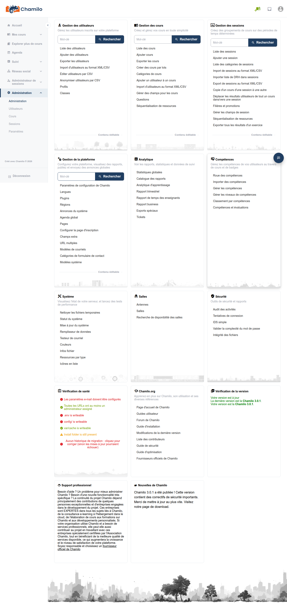

# Plugins

Les plugins étendent les fonctionnalités de Chamilo sans modifier le code du noyau. Chamilo 3.0 est livré avec plus de 50 plugins qui peuvent être activés selon les besoins.

## Le bloc Plugins

Le tableau de bord d'administration dispose également de son propre bloc **Plugins**, distinct de la gestion générale des plugins de ce chapitre. Il ne répertorie pas tous les plugins installés — uniquement ceux dont la configuration indique qu'ils doivent apparaître dans la zone du menu d'administration, offrant à chacun de ces plugins un raccourci direct vers sa propre page d'administration, directement sur le tableau de bord.

Si un plugin que vous avez activé n'apparaît pas ici, c'est normal — cela signifie que ce plugin particulier ne s'est pas déclaré pour la zone du menu d'administration, et non qu'un dysfonctionnement s'est produit. Consultez [Gestion des plugins](managing-plugins.md) pour obtenir la liste complète des plugins installés, qu'ils apparaissent ou non sur le tableau de bord.

## Dans ce chapitre

* **[Gestion des plugins](managing-plugins.md)** — Installer, activer, configurer et désactiver des plugins
* **[Paiements BuyCourses et services récurrents](buycourses.md)** — Configurer les passerelles de paiement, les renouvellements et l'historique des paiements de services