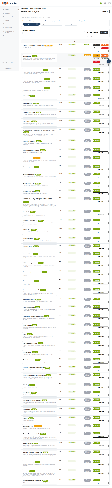

# Gestion des plugins

## Accès au gestionnaire de plugins

Depuis le panneau d'administration, cliquez sur **Gérer les plugins** pour afficher la liste des plugins disponibles.

## États des plugins

Chaque plugin possède l'un des deux états suivants :

* **Actif** — Le plugin est activé et ses fonctionnalités sont disponibles sur la plateforme
* **Inactif** — Le plugin est installé, mais désactivé

## Activation d'un plugin

1. Recherchez le plugin dans la liste
2. Cliquez sur **Installer**, puis sur **Activer**, ou basculez l'interrupteur
3. Configurez les paramètres du plugin (le cas échéant, recherchez le bouton **Configurer**)
4. Enregistrez
5. Si le README le recommande, activez-le dans une **région** spécifique

Certains plugins ajoutent des outils aux cours, de nouvelles pages à la plateforme ou des fonctionnalités supplémentaires aux fonctions existantes.

## Configuration d'un plugin

De nombreux plugins disposent d'options de configuration. Après l'activation d'un plugin :

1. Cliquez sur le bouton **Configurer** situé à côté du plugin
2. Renseignez la configuration requise (clés d'API, URL, options, etc.)
3. Enregistrez

## Désactivation d'un plugin

1. Recherchez le plugin dans la liste
2. Cliquez sur **Désactiver** ou basculez l'interrupteur
3. Les fonctionnalités du plugin sont immédiatement retirées de la plateforme, mais le plugin reste installé et conserve sa configuration jusqu'à ce que vous le **désinstalliez**

La désactivation d'un plugin ne supprime pas ses données. Si vous le réactivez ultérieurement, les données restent disponibles.

## Conseils

* **N'activez que ce dont vous avez besoin** — Chaque plugin actif ajoute une certaine charge. Laissez désactivés les plugins inutilisés.
* **Testez avant la mise en production** — Activez d'abord les nouveaux plugins dans un environnement de test
* **Vérifiez la compatibilité** — Après une mise à niveau de Chamilo, vérifiez que tous les plugins actifs fonctionnent encore correctement