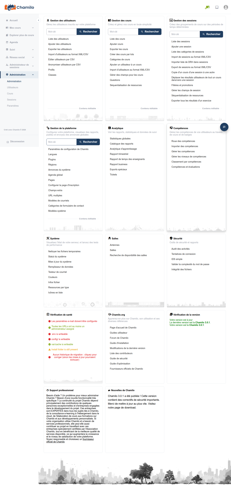

# Salles

Le bloc **Salles** du tableau de bord d'administration gère les lieux physiques que Chamilo peut suivre pour les formations en présentiel ou hybrides : les antennes (sites), les salles qu'elles contiennent, et un outil permettant de trouver quelles salles sont libres à un moment donné.

Ce chapitre traite de la gestion des antennes et des salles côté administration. Pour le côté enseignant — attribuer une salle à une session de cours — voir [Antennes et salles](../../teacher-guide/branches-and-rooms.md) dans le Guide de l'enseignant.

## Accéder au bloc Salles

Depuis le panneau d'administration, le bloc **Salles** apparaît aux côtés des autres blocs du tableau de bord. Cliquez sur l'un de ses liens pour ouvrir l'outil correspondant.

## Contenu du bloc

* **[Gestion des salles](managing-rooms.md)** — Créer et organiser les antennes (sites), ainsi que les salles de chacune d'elles
* **[Recherche de disponibilité des salles](room-availability-finder.md)** — Vérifier quelles salles sont libres pour une date et une plage horaire données

## Remarque sur le multi-URL

Sur une installation multi-URL (multi-locataire), les antennes et les salles sont chacune rattachées à une seule URL d'accès — elles ne sont jamais partagées entre les portails.